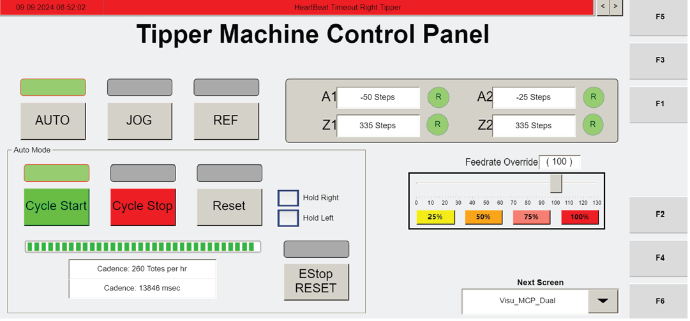
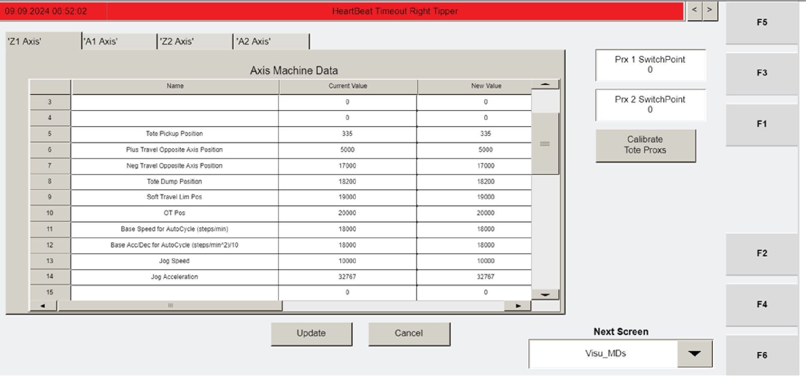

# Remove and Support Gripper for a Tipper Using Visu_MCP_Dual (Cycle Stop + Jog) and LOTO

## Runbook Header

| Field | Value |
| --- | --- |
| Procedure ID | `proc_remove_and_support_gripper_tipper_visu_mcp_dual_cycle_stop_jog_loto_v1` |
| Title | Remove and Support Gripper for a Tipper Using Visu_MCP_Dual (Cycle Stop + Jog) and LOTO |
| Procedure Type | `recovery` |
| Primary Role | `operator` |
| Supporting Roles | None |
| Support Safe | Yes |
| Capability Tags | `bag_out_or_closeout_state` |
| Access Surface | `tipper_hmi`, `physical_floor` |
| Audience Roles | `operator` |
| Failure Pattern Tags | None |
| Validation Status | `needs_sme_review` |
| Merge Status | `source_finalized` |

## Summary

Prepare a tipper for gripper removal by stopping the current cycle, enabling manual jogging on the operator station HMI (Visu_MCP_Dual), positioning the gripper at the specified location, optionally supporting the carriages if the gripper is moved off home, and performing LOTO at the station e-panel. Confirm the correct gripper selection (left vs right) before proceeding.

## When To Use

Use when you must remove a tipper gripper and need to stop the cycle, jog the tipper/gripper to the required location, mechanically support the carriages if the gripper is moved from home, and apply LOTO at the station e-panel before removal.

## Do Not Use For

* Do not use this procedure as a general tipper fault troubleshooting guide; it is specifically for gripper removal preparation (stop/jog/LOTO/left-right verification).

## Safety And Operational Notes

* Caution: Components may be heavy. Use caution when lifting (gripper replacement section includes this caution).

## Access Or Tools Needed

* Tipper operator station HMI access to the "Visu_MCP_Dual" screen
* LOTO capability at the station e-panel ("Operator Station Lockout/Tagout" referenced by the manual)
* Required tools for later removal: 2.5-mm, 3-mm, 5-mm, 6-mm hex wrenches; Loctite®
* PPE: safety glasses, gloves

## Visual References

*Photograph of the Tipper Machine Control Panel (Visu_MCP_Dual screen) showing the primary operator interface and the CYCLE STOP and JOG buttons (active buttons indicated by illuminated green bars).*

*HMI screenshot showing the "Visu_MCP_Dual" screen accessed after pressing CYCLE STOP then JOG (used as visual reference for the jogging screen context).*

*HMI image showing the "Visu_MCP_Dual" jogging context for Z-axis motor positioning checks (includes CYCLE STOP then JOG and jogging interface context).*

## Procedure Steps

### Step 1 — Navigate to the Visu_MCP_Dual screen on the operator station HMI

**Responsible role:** operator

**Instruction:**
At the operator station HMI, navigate to the "Visu_MCP_Dual" screen.

**Expected result:**
The operator station HMI is displaying the "Visu_MCP_Dual" screen.

**Stop or Escalate If:**

* Stop and escalate if you cannot access the "Visu_MCP_Dual" screen needed to control the tipper.

---

### Step 2 — Stop the cycle and enable manual jogging

**Responsible role:** operator

**Instruction:**
Press "CYCLE STOP" to stop the cycle, then press "JOG" to manually control the tipper.

**Expected result:**
The cycle is stopped and the HMI is in a state where manual jogging is enabled after pressing JOG.

**Stop or Escalate If:**

* Stop and escalate if the cycle does not stop after pressing CYCLE STOP.
* Stop and escalate if manual control does not engage after pressing JOG.

---

### Step 3 — Jog the gripper to the desired location using the axis buttons for the corresponding tipper

**Responsible role:** operator

**Instruction:**
Use the axis buttons for the corresponding tipper to move the gripper to the desired location.

**Expected result:**
The gripper is positioned at the desired location as a result of axis button jogging.

**Stop or Escalate If:**

* Stop and escalate if the gripper cannot be positioned to the required location using the axis buttons.

---

### Step 4 — Support carriages with screws if the gripper is moved from its home position

**Responsible role:** operator

**Instruction:**
If the gripper is moved from its home position, thread screws into the threaded holes in the column to support the carriages between the pair or holes.

**Expected result:**
Carriages are mechanically supported by screws threaded into the threaded holes in the column (between the pair or holes) after moving off home.

**Stop or Escalate If:**

* Stop and escalate if the gripper was moved from home and carriage support screws were not installed as required.

---

### Step 5 — LOTO the tipper at the station e-panel

**Responsible role:** operator

**Instruction:**
LOTO the tipper at the station e-panel (see "Operator Station Lockout/Tagout" on page 2).

**Expected result:**
The tipper is locked out at the station e-panel using the required lockout/tagout points/procedure.

**Stop or Escalate If:**

* Stop and escalate if LOTO at the station e-panel is not completed before gripper removal.

---

### Step 6 — Verify the correct gripper selection (left gripper vs right gripper)

**Responsible role:** operator

**Instruction:**
Verify the correct gripper has been selected (i.e., left gripper or right gripper).

**Expected result:**
You confirm whether the left gripper or right gripper is selected for the removal work.

**Stop or Escalate If:**

* Stop and escalate if the operator cannot confirm the correct gripper selection (left vs right) before proceeding.

---

## Success Criteria

* Cycle is stopped (CYCLE STOP pressed).
* Manual jogging is enabled (JOG pressed).
* Gripper is positioned at the desired location using the axis buttons for the corresponding tipper.
* If moved from home, screws are threaded into the threaded holes in the column to support the carriages.
* LOTO is applied at the station e-panel for the tipper.
* Operator confirms correct gripper selection (left vs right).

## Failure Conditions

* Cycle does not stop after pressing CYCLE STOP.
* Manual control does not engage after pressing JOG.
* Gripper cannot be positioned to the required location.
* Gripper moved from home without installing carriage support screws.
* LOTO not applied at the station e-panel.
* Operator cannot confirm correct left vs right gripper selection.

## Escalation Guidance

* If CYCLE STOP does not stop the cycle or JOG does not enable manual control, stop and escalate.
* If you cannot confirm left vs right gripper selection, stop and escalate.
* If LOTO at the station e-panel cannot be completed, stop and escalate.

## Missing Details / Known Gaps

* The manual references a separate "Operator Station Lockout/Tagout" procedure on page 2; this packet does not include the specific e-panel lockout/tagout points or step-by-step LOTO actions from page 2.
* The packet does not provide the exact HMI axis button labels/which axis corresponds to which gripper location for this specific gripper removal step (only that axis buttons for the corresponding tipper are used).
* The packet does not include the specific visual for the column threaded holes and carriage support location referenced as a note/image in the candidate.

## Source Lineage

- Candidate IDs: candidate_manual_optisweep_gripper_replacement_remove
- Source ID: `manual_optisweep_om_v3`
- Source Type: `manual`
