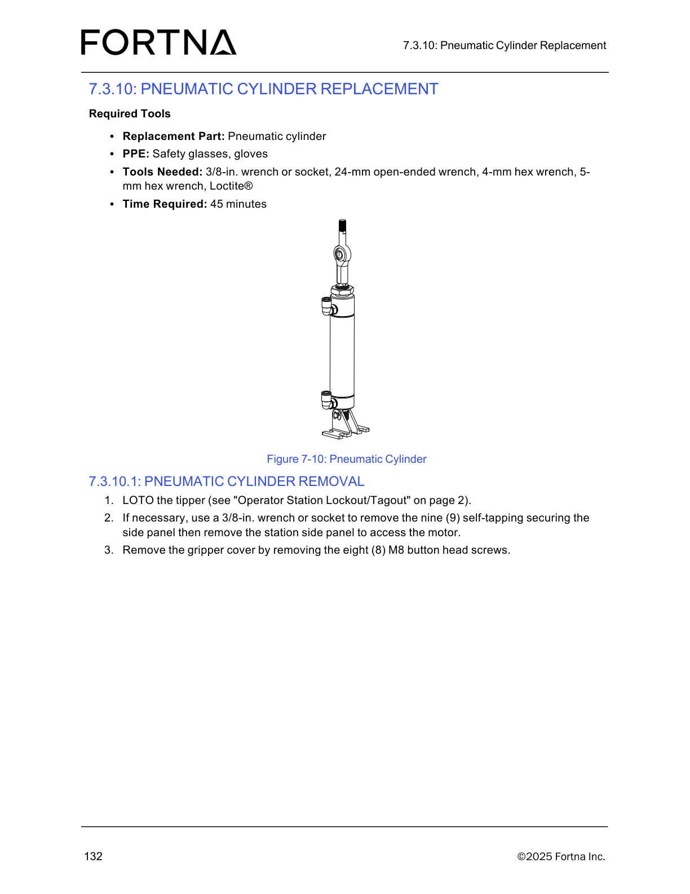

# Remove Gripper Sensor (LOTO tipper, remove gripper cover plate, disconnect M8/M3 connectors)

## Runbook Header

| Field | Value |
| --- | --- |
| Procedure ID | `proc_remove_gripper_sensor_loto_tipper_v1` |
| Title | Remove Gripper Sensor (LOTO tipper, remove gripper cover plate, disconnect M8/M3 connectors) |
| Procedure Type | `recovery` |
| Primary Role | `operator` |
| Supporting Roles | None |
| Support Safe | Yes |
| Capability Tags | `tipper_station_fault` |
| Access Surface | `physical_floor` |
| Audience Roles | `operator` |
| Failure Pattern Tags | None |
| Validation Status | `needs_sme_review` |
| Merge Status | `source_finalized` |

## Summary

Safely remove the gripper sensor assembly from the OptiSweep tipper by performing lockout/tagout (LOTO), removing the gripper cover plate, and disconnecting the M8 connector and M3 button-head cap screw (BHCS) connections so the gripper sensor can be removed/replaced.

## When To Use

Use when the gripper sensor needs removal/replacement on an OptiSweep tipper and you must first secure the tipper using the Operator Station Lockout/Tagout controls.

## Do Not Use For

* Do not proceed with removal steps if the tipper cannot be confirmed locked out via the Operator Station Lockout/Tagout controls.

## Safety And Operational Notes

* Perform LOTO on the tipper using the Operator Station Lockout/Tagout controls/locations referenced in the manual.

## Access Or Tools Needed

* Physical floor access to the tipper
* 1.5-mm hex wrench
* 5-mm hex wrench
* Tool to cut wire ties
* Replacement part: Gripper sensor

## Visual References

*Figure 7-10 (Pneumatic Cylinder Replacement) includes the manual’s gripper cover removal step context: “Remove the gripper cover by removing the eight (8) M8 button head screws.” Useful for visual orientation of the gripper cover area on the tipper station.*

## Procedure Steps

### Step 1 — LOTO the tipper using Operator Station Lockout/Tagout

**Responsible role:** operator

**Instruction:**
Perform LOTO on the tipper using the “Operator Station Lockout/Tagout” controls/locations referenced in the manual (page 2).

**Expected result:**
The tipper is locked out (LOTO applied) and you can proceed with gripper sensor removal steps.

**Stop or Escalate If:**

* Stop and re-verify LOTO if the tipper is not confirmed locked out before proceeding.

---

### Step 2 — Remove the gripper cover plate

**Responsible role:** operator

**Instruction:**
Remove the gripper cover plate.

**Expected result:**
The gripper cover plate is removed.

---

### Step 3 — Disconnect the M8 connector and M3 BHCS

**Responsible role:** operator

**Instruction:**
Disconnect the M8 connector and the M3 button-head cap screw (BHCS).

**Expected result:**
The M8 connector is disconnected and the M3 BHCS is disconnected so the gripper sensor can be removed/replaced.

**Stop or Escalate If:**

* If the M8 connector or M3 BHCS cannot be disconnected without excessive force, stop and escalate for assistance rather than forcing components.

---

### Step 4 — Prepare the gripper sensor for replacement/removal

**Responsible role:** operator

**Instruction:**
Prepare the gripper sensor for replacement/removal after the M8 connector and M3 BHCS are disconnected.

**Expected result:**
The gripper sensor is ready to be removed/replaced following disconnection of the M8 connector and M3 BHCS.

---

## Success Criteria

* Tipper is locked out using Operator Station Lockout/Tagout controls.
* Gripper cover plate is removed.
* M8 connector and M3 BHCS are disconnected so the gripper sensor can be removed/replaced.

## Failure Conditions

* Tipper is not confirmed locked out before proceeding.
* M8 connector or M3 BHCS cannot be disconnected without excessive force.

## Escalation Guidance

* If the M8 connector or M3 BHCS cannot be disconnected without excessive force, stop and escalate for assistance rather than forcing components.

## Missing Details / Known Gaps

* The provided manual section text (7.3.2.2.1: REMOVAL) includes LOTO, gripper cover plate removal, and disconnection of the M8 connector and M3 BHCS, but it does not include the full physical removal/replacement steps for the gripper sensor assembly itself within the supplied evidence.
* The packet does not include the page 2 content for the “Operator Station Lockout/Tagout” controls/locations; the exact control labels/locations are not present in the supplied evidence.

## Source Lineage

- Candidate IDs: candidate_manual_optisweep_gripper_sensor_removal
- Source ID: `manual_optisweep_om_v3`
- Source Type: `manual`
