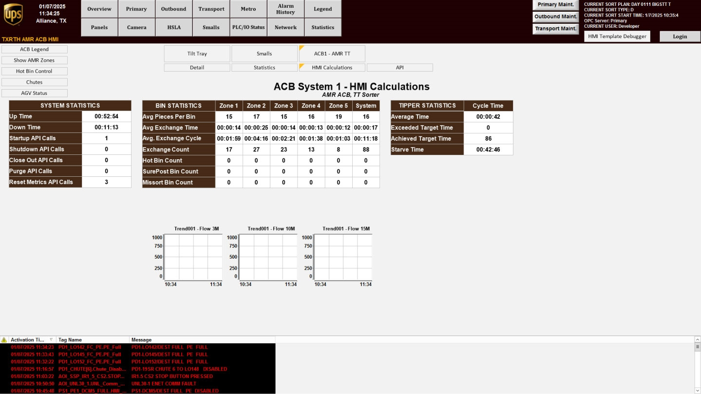
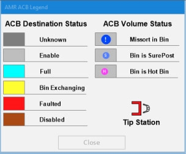

# Open HMI Calculations (Tilt Tray overview) and verify system/bin/tipper statistics

## Runbook Header

| Field | Value |
| --- | --- |
| Procedure ID | `proc_open_hmi_calculations_tilt_tray_overview_check_v1` |
| Title | Open HMI Calculations (Tilt Tray overview) and verify system/bin/tipper statistics |
| Procedure Type | `diagnostic` |
| Primary Role | `operator` |
| Supporting Roles | None |
| Support Safe | Yes |
| Capability Tags | `fleet_system_status` |
| Access Surface | `tipper_hmi` |
| Audience Roles | `operator` |
| Failure Pattern Tags | None |
| Validation Status | `needs_sme_review` |
| Merge Status | `source_finalized` |

## Summary

Use the Tipper HMI / WebVisu / VISU to open the HMI Calculations screen (Tilt Tray overview) from the ACB System screen, then confirm the screen shows populated information for system operations, bin statistics, and tipper statistics for live operation.

## When To Use

When you need to verify that the Tilt Tray overview (HMI Calculations) is displaying live system operations, bin statistics, and tipper statistics on the HMI.

## Access Or Tools Needed

* Tipper HMI / WebVisu / VISU access to the ACB System screen and HMI Calculations screen

## Related Operational Context

* ctx_manual_hmi_calculations_screen_v1
* ctx_manual_hmi_calculations_navigation_v1
* ctx_manual_tilt_tray_overview_screen_v1

## Visual References

*Figure 4-6: HMI Calculations Screen (Tilt Tray overview) showing system operations, bin statistics, and tipper statistics.*

*Figure 4-1: ACB System Overview Screen (used as the starting point for navigation to HMI CALCULATIONS).*

## Procedure Steps

### Step 1 — Open HMI Calculations from the ACB System screen

**Responsible role:** operator

**Instruction:**
On the ACB System screen, press the "HMI CALCULATIONS" button.

**Expected result:**
The HMI Calculations (Tilt Tray overview) screen begins to load after pressing "HMI CALCULATIONS" from the ACB System screen.

**Stop or Escalate If:**

* HMI Calculations screen does not open

---

### Step 2 — Confirm the HMI Calculations screen corresponds to the Tilt Tray overview

**Responsible role:** operator

**Instruction:**
Verify the screen you opened is the "HMI Calculations" screen and is the "Tilt Tray" overview.

**Expected result:**
The displayed screen is identified as the HMI Calculations screen and is the Tilt Tray overview.

**Stop or Escalate If:**

* Screen does not correspond to the Tilt Tray overview

---

### Step 3 — Review system operations, bin statistics, and tipper statistics categories

**Responsible role:** operator

**Instruction:**
On the HMI Calculations screen, locate the displayed information categories for: (1) system operations data fields, (2) bin statistics values, and (3) tipper statistics values.

**Expected result:**
All three categories (system operations, bin statistics, tipper statistics) are visible on the HMI Calculations screen.

**Stop or Escalate If:**

* System operations/bin statistics/tipper statistics categories are missing

---

### Step 4 — Confirm the statistics fields are populated (not blank/missing)

**Responsible role:** operator

**Instruction:**
Confirm the screen is populated with values (not blank/missing) for system operations, bin statistics, and tipper statistics.

**Expected result:**
System operations, bin statistics, and tipper statistics fields show populated values rather than blank/missing entries.

**Stop or Escalate If:**

* System operations/bin statistics/tipper statistics fields are blank or missing

---

## Success Criteria

* HMI Calculations (Tilt Tray overview) screen opens from the ACB System screen.
* System operations, bin statistics, and tipper statistics categories are visible.
* The system operations, bin statistics, and tipper statistics fields show populated (non-blank) values.

## Failure Conditions

* HMI Calculations screen does not open.
* System operations/bin statistics/tipper statistics fields are blank or missing.

## Escalation Guidance

* If the HMI Calculations screen does not open, or if system operations/bin statistics/tipper statistics fields are blank or missing, stop and escalate to support for further investigation.

## Missing Details / Known Gaps

* The source does not provide specific field names/labels or example value ranges for the system operations, bin statistics, and tipper statistics sections; the procedure therefore validates only that the categories are present and populated (not blank/missing).

## Source Lineage

- Candidate IDs: candidate_manual_optisweep_hmi_calculations_tilt_tray_overview_check
- Source ID: `manual_optisweep_om_v3`
- Source Type: `manual`
