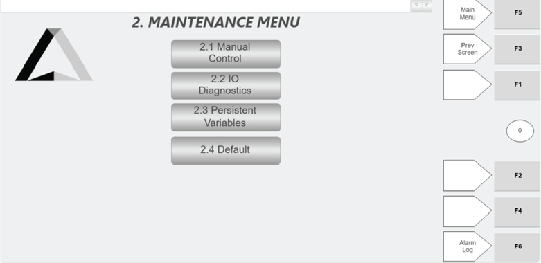
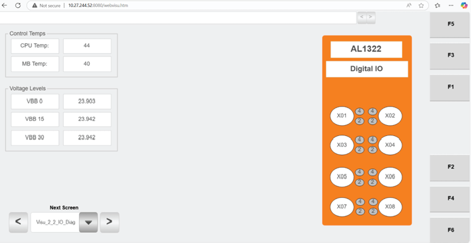
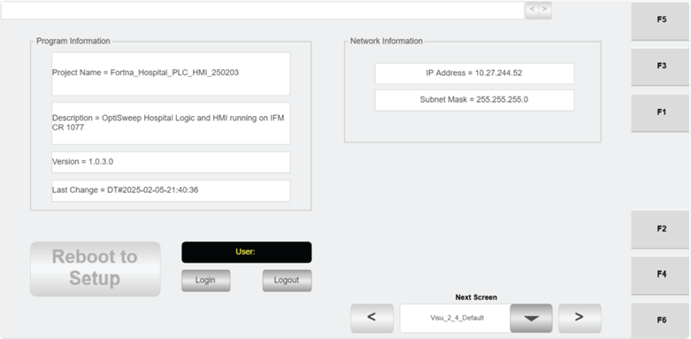

# Open Hospital HMI Maintenance Menu and select maintenance functions (Manual Control, IO Diagnostics, Persistent Variables, Default)

## Runbook Header

| Field | Value |
| --- | --- |
| Procedure ID | `proc_open_hospital_hmi_maintenance_menu_v1` |
| Title | Open Hospital HMI Maintenance Menu and select maintenance functions (Manual Control, IO Diagnostics, Persistent Variables, Default) |
| Procedure Type | `operation` |
| Primary Role | `operator` |
| Supporting Roles | None |
| Support Safe | Yes |
| Capability Tags | `gateway_health` |
| Access Surface | `hospital_hmi` |
| Audience Roles | `operator` |
| Failure Pattern Tags | None |
| Validation Status | `needs_sme_review` |
| Merge Status | `source_finalized` |

## Summary

On the Hospital HMI / lane UI, open the “Maintenance Menu” screen and use its four buttons to navigate to the selected maintenance function screen: 2.1 Manual Control, 2.2 IO Diagnostics, 2.3 Persistent Variables, or 2.4 Default.

## When To Use

Use when you need to navigate the Hospital HMI Maintenance Menu to reach a specific maintenance function screen (Manual Control, IO Diagnostics, Persistent Variables, or Default).

## Access Or Tools Needed

* Hospital HMI / lane UI

## Related Operational Context

* ctx_manual_hospital_hmi_maintenance_menu_v1

## Visual References

*Hospital HMI Maintenance Menu screen showing four buttons: 2.1 Manual Control, 2.2 IO Diagnostics, 2.3 Persistent Variables, 2.4 Default.*

*Hospital HMI 2.2 IO Diagnostics screen (switch input states; HMI temperature and voltage readings).*

*Hospital HMI 2.4 Default screen (software info; Hospital Station IP address; login/logout; REBOOT TO SETUP for maintenance personnel).*

## Procedure Steps

### Step 1 — Open the Hospital HMI Maintenance Menu screen

**Responsible role:** operator

**Instruction:**
On the Hospital HMI / lane UI, navigate to the “Maintenance Menu” screen.

**Expected result:**
The Hospital HMI shows the “Maintenance Menu” screen.

---

### Step 2 — Verify the Maintenance Menu shows four labeled buttons

**Responsible role:** operator

**Instruction:**
Check that the Maintenance Menu screen shows exactly these four buttons: “2.1 Manual Control”, “2.2 IO Diagnostics”, “2.3 Persistent Variables”, and “2.4 Default”.

**Expected result:**
All four buttons are present with the exact labels 2.1, 2.2, 2.3, and 2.4 as shown on the Maintenance Menu.

**Stop or Escalate If:**

* If the Maintenance Menu screen does not show all four buttons, stop and escalate to FORTNA support for further troubleshooting.

---

### Step 3 — Select the desired maintenance function button

**Responsible role:** operator

**Instruction:**
Click the desired button on the Maintenance Menu: Manual Control (2.1), IO Diagnostics (2.2), Persistent Variables (2.3), or Default (2.4).

**Expected result:**
The Hospital HMI screen changes away from the Maintenance Menu and opens the corresponding maintenance function screen for the selected button.

**Stop or Escalate If:**

* If the selected button does not change screens, stop and escalate to FORTNA support for further troubleshooting.

---

### Step 4 — Confirm the screen transitioned to the selected maintenance function

**Responsible role:** operator

**Instruction:**
Confirm the Hospital HMI no longer shows the Maintenance Menu buttons and instead shows the maintenance function screen corresponding to the button you selected.

**Expected result:**
The UI displays the selected maintenance function screen (Manual Control / IO Diagnostics / Persistent Variables / Default).

**Stop or Escalate If:**

* If the screen does not transition correctly to the selected maintenance function, stop and escalate to FORTNA support for further troubleshooting.

---

## Success Criteria

* The Hospital HMI Maintenance Menu displays four labeled buttons: 2.1 Manual Control, 2.2 IO Diagnostics, 2.3 Persistent Variables, and 2.4 Default.
* Selecting any of the four buttons transitions the UI away from the Maintenance Menu to the corresponding maintenance function screen.

## Failure Conditions

* Maintenance Menu screen does not show all four buttons.
* Selected button does not change screens.
* Displayed destination screen does not correspond to the selected maintenance function.

## Escalation Guidance

* If the Maintenance Menu does not show all four buttons or the selected button does not change screens, stop and escalate to FORTNA support for further troubleshooting.

## Missing Details / Known Gaps

* The packet does not include destination UI details for 2.1 Manual Control and 2.3 Persistent Variables; this runbook only verifies that the screen transitions away from the Maintenance Menu and provides optional evidence for 2.2 IO Diagnostics and 2.4 Default.

## Source Lineage

- Candidate IDs: candidate_manual_optisweep_hospital_hmi_open_maintenance_menu
- Source ID: `manual_optisweep_om_v3`
- Source Type: `manual`
