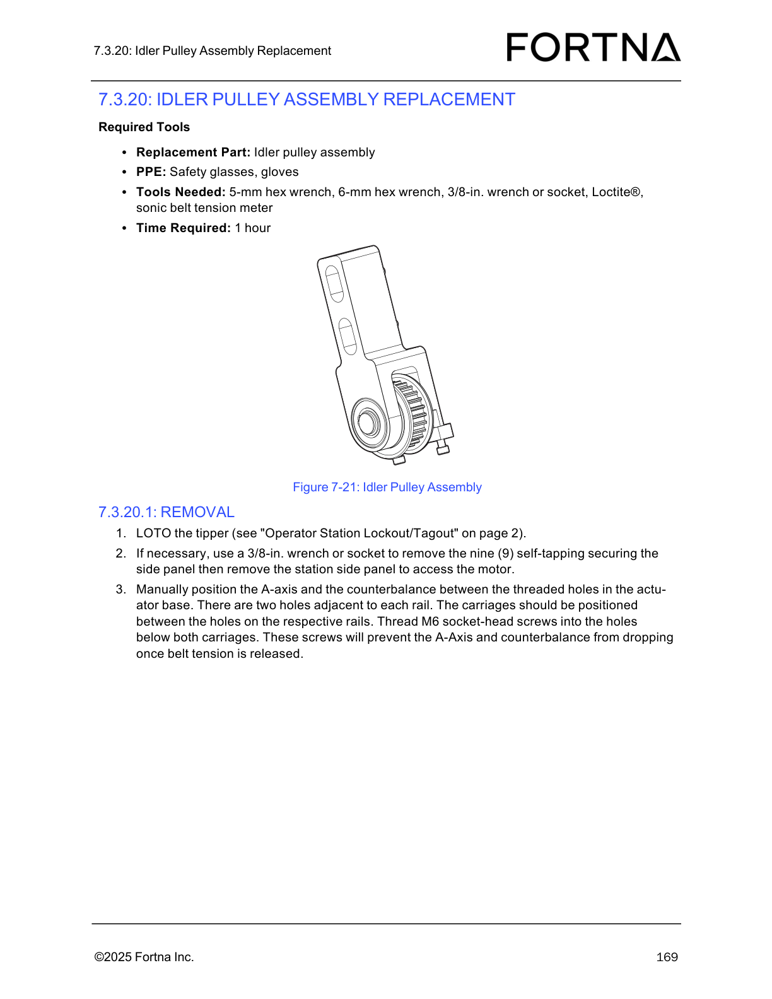

# Remove Idler Pulley Assembly (A-axis / counterbalance belt system) on a LOTOed tipper

## Runbook Header

| Field | Value |
| --- | --- |
| Procedure ID | `proc_remove_idler_pulley_assembly_a_axis_counterbalance_belt_system_lotoed_tipper_v1` |
| Title | Remove Idler Pulley Assembly (A-axis / counterbalance belt system) on a LOTOed tipper |
| Procedure Type | `recovery` |
| Primary Role | `operator` |
| Supporting Roles | None |
| Support Safe | Yes |
| Capability Tags | `tipper_station_fault` |
| Access Surface | `physical_floor` |
| Audience Roles | `operator` |
| Failure Pattern Tags | `bag_out_stuck` |
| Validation Status | `needs_sme_review` |
| Merge Status | `source_finalized` |

## Summary

LOTO the tipper, access the station side panel if needed, manually position and secure the A-axis/counterbalance using the actuator base threaded holes, remove belt clamps, release belt tension, unfasten the idler pulley assembly (M8x25 screws), and slide the idler pulley assembly out of the column. If needed, transfer the M6x35 tensioning screws to the new assembly.

## When To Use

Use when removing/replacing the tipper’s idler pulley assembly as part of a mechanical maintenance/recovery task, following the manual’s LOTO and belt-tension release precautions to prevent dropping once tension is released.

## Do Not Use For

* Do not use this procedure as a software/controls troubleshooting guide (it is a mechanical removal procedure).
* Do not proceed to release belt tension unless the A-axis/counterbalance is secured with the specified M6 socket-head screws.

## Safety And Operational Notes

* Perform LOTO on the tipper before starting mechanical removal steps.
* Secure the A-axis and counterbalance with M6 socket-head screws before releasing belt tension to prevent dropping.

## Access Or Tools Needed

* Physical access to the tipper for LOTO and side-panel removal
* PPE: safety glasses, gloves
* 5-mm hex wrench
* 6-mm hex wrench
* 3/8-in. wrench or socket
* Loctite®
* Sonic belt tension meter
* Replacement part: idler pulley assembly

## Visual References

*Figure 7-21 used by the idler pulley assembly removal procedure (shows A-axis/counterbalance positioning, M6 securing screws, belt clamps, belt tensioning screws, and M8x25 mounting screws).*

## Procedure Steps

### Step 1 — Perform LOTO on the tipper

**Responsible role:** operator

**Instruction:**
Apply lockout/tagout to the tipper (manual references “Operator Station Lockout/Tagout” on page 2).

**Expected result:**
The tipper is LOTOed and ready for mechanical work.

---

### Step 2 — Remove station side panel if necessary to access the motor

**Responsible role:** operator

**Instruction:**
If necessary, use a 3/8-in. wrench or socket to remove the nine (9) self-tapping securing screws for the station side panel, then remove the station side panel to access the motor.

**Expected result:**
Station side panel is removed and the motor access area is available.

---

### Step 3 — Position A-axis and counterbalance between actuator base threaded holes

**Responsible role:** operator

**Instruction:**
Manually position the A-axis and the counterbalance between the threaded holes in the actuator base: there are two holes adjacent to each rail; position the carriages between the holes on the respective rails.

**Expected result:**
A-axis and counterbalance carriages are positioned between the threaded holes adjacent to each rail.

---

### Step 4 — Thread M6 socket-head screws below both carriages to prevent dropping

**Responsible role:** operator

**Instruction:**
Thread M6 socket-head screws into the holes below both carriages.

**Expected result:**
M6 socket-head screws are threaded into the holes below both carriages, preventing drop when belt tension is released.

**Stop or Escalate If:**

* Stop and escalate if the A-axis/counterbalance is not held securely by the threaded M6 socket-head screws before loosening belt tension (risk of dropping).

---

### Step 5 — Remove belt clamps by removing six M6x20 countersunk screws

**Responsible role:** operator

**Instruction:**
Remove the belt clamps by removing the six (6) M6x20 countersunk screws with a 5-mm hex wrench from each clamp to free the carriages from the belt.

**Expected result:**
Belt clamps are removed and carriages are free from the belt.

---

### Step 6 — Release belt tension by loosening two M6x35 socket-head screws

**Responsible role:** operator

**Instruction:**
Release belt tension by loosening the two (2) M6x35 socket-head screws on the bottom side of the assembly.

**Expected result:**
Belt tension is released after loosening the two M6x35 socket-head screws.

**Stop or Escalate If:**

* Stop and escalate if the A-axis/counterbalance is not held securely by the threaded M6 socket-head screws before loosening belt tension (risk of dropping).

---

### Step 7 — Remove idler pulley assembly and slide it out of the column

**Responsible role:** operator

**Instruction:**
Remove the two (2) M8x25 socket-head screws holding the idler pulley assembly in place, then slide the idler pulley assembly out of the column. If needed, transfer the M6x35 tensioning screws from the removed idler pulley assembly to the new assembly.

**Expected result:**
The two M8x25 screws are removed and the idler pulley assembly slides out of the column; if required, M6x35 tensioning screws are transferred to the new assembly.

**Stop or Escalate If:**

* Stop and escalate if the idler pulley assembly does not slide out after removing the two M8x25 socket-head screws (possible remaining fasteners or misalignment).

---

## Success Criteria

* Tipper remains LOTOed throughout the mechanical removal steps.
* A-axis and counterbalance are secured with M6 socket-head screws before belt tension is released.
* Belt clamps are removed (six M6x20 countersunk screws per clamp) and belt tension is released (two M6x35 socket-head screws loosened).
* Idler pulley assembly is unfastened (two M8x25 socket-head screws removed) and slid out of the column.
* If required, M6x35 tensioning screws are transferred to the new idler pulley assembly.

## Failure Conditions

* A-axis/counterbalance is not held securely by the threaded M6 socket-head screws before loosening belt tension.
* Idler pulley assembly does not slide out after removing the two M8x25 socket-head screws.

## Escalation Guidance

* If the A-axis/counterbalance is not secured before belt tension release, stop and escalate due to risk of dropping.
* If the idler pulley assembly does not slide out after removing the two M8x25 screws, stop and escalate for inspection of remaining fasteners or misalignment.

## Missing Details / Known Gaps

* The manual references “Operator Station Lockout/Tagout” on page 2, but the specific LOTO steps/content are not included in the provided packet sections; follow the referenced page for exact lockout/tagout actions.

## Source Lineage

- Candidate IDs: candidate_manual_optisweep_idler_pulley_assembly_removal
- Source ID: `manual_optisweep_om_v3`
- Source Type: `manual`
