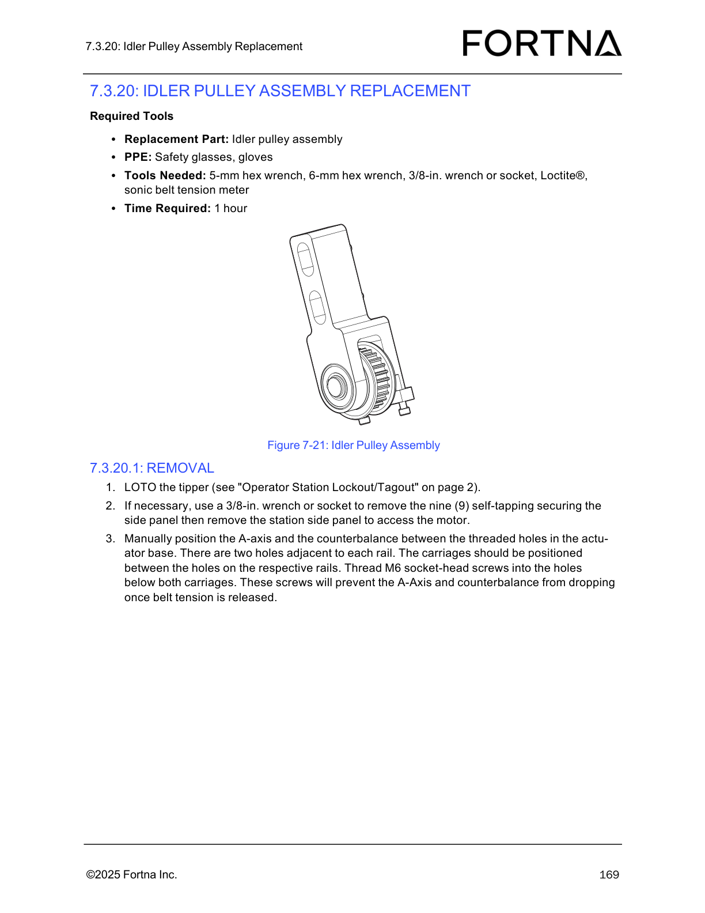

# Replace OptiSweep Idler Pulley Assembly — LOTO tipper and prevent A-axis/counterbalance drop during removal

## Runbook Header

| Field | Value |
| --- | --- |
| Procedure ID | `proc_replace_optsweep_idler_pulley_assembly_loto_axis_lock_v1` |
| Title | Replace OptiSweep Idler Pulley Assembly — LOTO tipper and prevent A-axis/counterbalance drop during removal |
| Procedure Type | `recovery` |
| Primary Role | `operator` |
| Supporting Roles | None |
| Support Safe | Yes |
| Capability Tags | `tipper_station_fault` |
| Access Surface | `physical_floor` |
| Audience Roles | `operator` |
| Failure Pattern Tags | None |
| Validation Status | `needs_sme_review` |
| Merge Status | `source_finalized` |

## Summary

Safely prepare the OptiSweep tipper for idler pulley assembly removal by performing lockout/tagout (LOTO) and mechanically restraining the A-axis and counterbalance so they cannot drop when belt tension is released.

## When To Use

Use when preparing an OptiSweep tipper station for idler pulley assembly removal and you must (1) lockout/tagout the tipper and (2) prevent the A-axis/counterbalance from dropping once belt tension is released.

## Do Not Use For

* Do not proceed if LOTO cannot be completed for the intended tipper station.
* Do not proceed if the A-axis/counterbalance cannot be positioned between the specified threaded holes or if M6 socket-head screws cannot be threaded into the holes below both carriages.

## Safety And Operational Notes

* Perform tipper lockout/tagout using the manual’s referenced "Operator Station Lockout/Tagout" procedure (page 2).
* Wear PPE as specified in the manual for the related maintenance diagrams (safety glasses, gloves).

## Access Or Tools Needed

* Physical access to the tipper station
* PPE: safety glasses, gloves
* 5-mm hex wrench
* 6-mm hex wrench
* 3/8-in. wrench or socket
* M6 socket-head screws
* 5-mm hex wrench / 6-mm hex wrench (for the overall idler pulley assembly job context)
* LOTO capability per the manual’s "Operator Station Lockout/Tagout" procedure (page 2)

## Visual References

*Idler Pulley Assembly diagram supporting the removal preparation: A-axis/counterbalance positioning between threaded holes and M6 socket-head screw restraint below both carriages.*

## Procedure Steps

### Step 1 — Identify the specific tipper station and perform LOTO

**Responsible role:** operator

**Instruction:**
Identify the specific tipper station to be serviced, then perform lockout/tagout (LOTO) on the tipper using the manual’s referenced "Operator Station Lockout/Tagout" procedure (page 2).

**Expected result:**
The tipper is locked out/tagged out for the intended station.

**Stop or Escalate If:**

* Stop if LOTO cannot be completed for the intended tipper.

---

### Step 2 — Remove the station side panel if needed to access the motor

**Responsible role:** operator

**Instruction:**
If necessary, use a 3/8-in. wrench or socket to remove the nine (9) self-tapping securing screws for the station side panel, then remove the station side panel to access the motor.

**Expected result:**
The station side panel is removed (when needed), exposing the motor area for the subsequent A-axis/counterbalance positioning steps.

---

### Step 3 — Manually position the A-axis and counterbalance between the threaded holes

**Responsible role:** operator

**Instruction:**
Manually position the A-axis and the counterbalance between the threaded holes in the actuator base. There are two holes adjacent to each rail; the carriages should be positioned between the holes on the respective rails.

**Expected result:**
The A-axis and counterbalance carriages are positioned between the two threaded holes adjacent to each rail.

**Stop or Escalate If:**

* Stop if the A-axis/counterbalance cannot be positioned between the specified holes.

---

### Step 4 — Thread M6 socket-head screws below both carriages to prevent dropping

**Responsible role:** operator

**Instruction:**
Thread M6 socket-head screws into the holes below both carriages.

**Expected result:**
M6 socket-head screws are threaded into the holes below both carriages, providing mechanical restraint against dropping when belt tension is released.

**Stop or Escalate If:**

* Stop if the A-axis/counterbalance cannot be positioned between the threaded holes as described or if the M6 socket-head screws cannot be threaded into the holes below both carriages.

---

### Step 5 — Escalate if LOTO or mechanical positioning/restraint cannot be completed

**Responsible role:** operator

**Instruction:**
If LOTO cannot be completed for the intended tipper, or if the A-axis/counterbalance cannot be positioned between the specified holes or the M6 socket-head screws cannot be threaded into the holes below both carriages, stop and escalate to FORTNA support or follow the site’s safety escalation process.

**Expected result:**
You stop the procedure and escalate rather than proceeding with idler pulley assembly removal preparation.

**Stop or Escalate If:**

* Escalate if LOTO cannot be performed on the intended tipper.
* Escalate if the A-axis/counterbalance cannot be positioned between the threaded holes as described or if the M6 socket-head screws cannot be threaded into the holes below both carriages.

---

## Success Criteria

* LOTO is completed for the intended tipper station.
* If side panel removal is needed, the station side panel is removed to access the motor.
* A-axis and counterbalance carriages are positioned between the two threaded holes adjacent to each rail.
* M6 socket-head screws are threaded into the holes below both carriages to prevent dropping once belt tension is released.

## Failure Conditions

* LOTO cannot be completed for the intended tipper station.
* A-axis/counterbalance cannot be positioned between the specified threaded holes.
* M6 socket-head screws cannot be threaded into the holes below both carriages.

## Escalation Guidance

* Stop and escalate to FORTNA support or follow the site’s safety escalation process if LOTO cannot be completed or if the A-axis/counterbalance positioning and M6 restraint screw installation cannot be completed as specified.

## Missing Details / Known Gaps

* The manual’s referenced "Operator Station Lockout/Tagout" procedure content (page 2) is not included in the provided packet excerpt; only the reference is available.
* The procedure does not include any later steps for actual idler pulley assembly removal/replacement beyond the preparation steps in the provided excerpt.

## Source Lineage

- Candidate IDs: candidate_manual_optisweep_idler_pulley_assembly_replacement_loto_and_axis_lock
- Source ID: `manual_optisweep_om_v3`
- Source Type: `manual`
