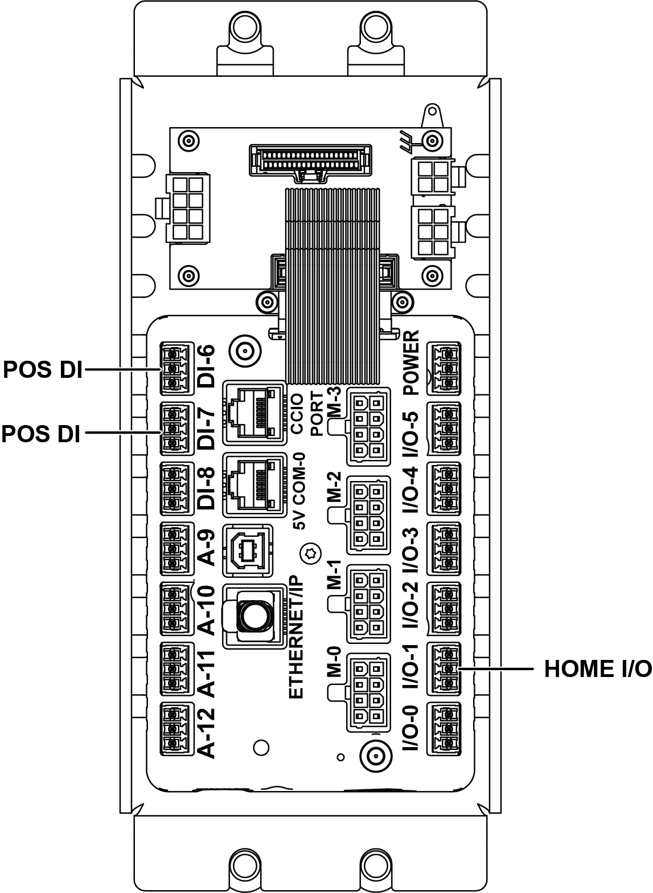

# Install CLINK Sensor Wiring for Z-Axis (I/O1/DI6/DI7) and A-Axis (PCA) and Restart Operator Station

## Runbook Header

| Field | Value |
| --- | --- |
| Procedure ID | `proc_install_clink_sensor_wiring_z_axis_a_axis_restart_operator_station_v1` |
| Title | Install CLINK Sensor Wiring for Z-Axis (I/O1/DI6/DI7) and A-Axis (PCA) and Restart Operator Station |
| Procedure Type | `operation` |
| Primary Role | `operator` |
| Supporting Roles | None |
| Support Safe | Yes |
| Capability Tags | `tipper_station_fault` |
| Access Surface | `tipper_hmi`, `physical_floor` |
| Audience Roles | `operator` |
| Failure Pattern Tags | None |
| Validation Status | `needs_sme_review` |
| Merge Status | `source_finalized` |

## Summary

Install the CLINK sensor wiring by feeding the sensor through the rear wire routing hole and fastening it with an M3 button-head screw, routing Z-axis wires through the column and out the lower grommet into the control box (I/O1, DI6, or DI7), routing A-axis wires around the gearbox into the PCA, then restarting the operator station so the sensor connections are active.

## When To Use

Use when CLINK sensor wiring for the Z-axis and A-axis needs to be installed/reconnected so the sensor connections are active after wiring work.

## Access Or Tools Needed

* Physical access to the sensor rear side and wire routing hole
* M3 button-head screw
* Access to the control box ports (I/O1, DI6, DI7)
* Access to the PCA connector for A-axis wiring
* Operator station restart capability (per "Starting The Operator Station" on page 66)

## Visual References

*Figure 7-2: Z-Axis CLINK Connections (rear wire routing hole, column path, lower grommet exit, and control box ports I/O1, DI6, DI7).*

*Figure 7-3: A-Axis PCA Connections (A-axis wire routing around the gearbox into the PCA).*

## Procedure Steps

### Step 1 — Feed the sensor through the rear wire routing hole and fasten with the M3 button-head screw

**Responsible role:** operator

**Instruction:**
Feed the sensor through the wire routing hole on the rear side and fasten it in place using the M3 button-head screw.

**Expected result:**
The sensor is mechanically fastened at the rear wire routing hole using the M3 button-head screw.

---

### Step 2 — Route Z-axis wires through the column and out the lower grommet into the control box (I/O1, DI6, or DI7)

**Responsible role:** operator

**Instruction:**
Route the Z-axis wires by dropping them down through the column and out the lower grommet into the control box, then plug into either I/O1, DI6, or DI7.

**Expected result:**
Z-axis wiring exits via the lower grommet into the control box and is connected to one of I/O1, DI6, or DI7.

**Stop or Escalate If:**

* Stop and re-check wiring routing if the Z-axis wires are not exiting through the lower grommet into the control box or if they are not plugged into I/O1, DI6, or DI7.

---

### Step 3 — Route A-axis wires around the gearbox and plug into the PCA

**Responsible role:** operator

**Instruction:**
Route the A-axis wires around the gearbox and plug them into the PCA.

**Expected result:**
A-axis wiring is routed around the gearbox and connected to the PCA.

**Stop or Escalate If:**

* Stop and re-check wiring routing if the A-axis wires are not routed around the gearbox or are not plugged into the PCA.

---

### Step 4 — Restart the operator station

**Responsible role:** operator

**Instruction:**
Restart the operator station using the procedure referenced as "Starting The Operator Station" on page 66.

**Expected result:**
The operator station has been restarted.

**Stop or Escalate If:**

* If the operator station restart does not complete successfully, escalate to support and use the operator-station restart troubleshooting guidance (not included in this section).

---

## Success Criteria

* Sensor is mechanically fastened with the M3 button-head screw.
* Z-axis wiring exits via the lower grommet into the control box and is connected to I/O1, DI6, or DI7.
* A-axis wiring is routed around the gearbox and connected to the PCA.
* Operator station restart completes successfully.

## Failure Conditions

* Z-axis wires are not exiting through the lower grommet into the control box, or are not plugged into I/O1, DI6, or DI7.
* A-axis wires are not routed around the gearbox, or are not plugged into the PCA.
* Operator station restart does not complete successfully.

## Escalation Guidance

* If the operator station restart does not complete successfully, escalate to support and use the operator-station restart troubleshooting guidance (not included in this section).

## Missing Details / Known Gaps

* Operator station restart controls/buttons and the exact restart procedure steps from "Starting The Operator Station" on page 66 are not included in the provided packet; this runbook references that section but cannot specify the exact UI/control actions.

## Source Lineage

- Candidate IDs: candidate_manual_optisweep_install_clink_sensor_z_axis_a_axis_connections
- Source ID: `manual_optisweep_om_v3`
- Source Type: `manual`
