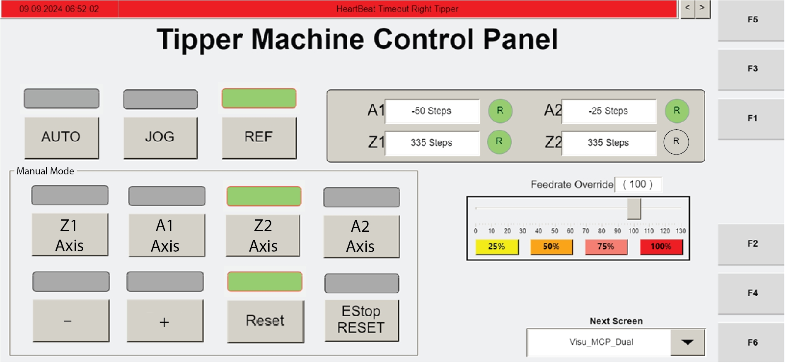

# Manually Reference Tipper Axes Using Operator Station HMI (Visu_Dual_MCP)

## Runbook Header

| Field | Value |
| --- | --- |
| Procedure ID | `proc_manually_reference_tipper_axes_visu_dual_mcp_v1` |
| Title | Manually Reference Tipper Axes Using Operator Station HMI (Visu_Dual_MCP) |
| Procedure Type | `operation` |
| Primary Role | `operator` |
| Supporting Roles | None |
| Support Safe | Yes |
| Capability Tags | `tipper_station_fault` |
| Access Surface | `tipper_hmi` |
| Audience Roles | `operator` |
| Failure Pattern Tags | None |
| Validation Status | `needs_sme_review` |
| Merge Status | `source_finalized` |

## Summary

Use the operator station HMI to stop the automatic tipping cycle, open the reference screen, and manually reference the required tipper axis(es) when the circled 'R' indicator shows they need referencing.

## When To Use

When maintenance requires manually referencing the tipper axis(es) using the operator station HMI reference screen (Visu_Dual_MCP).

## Safety And Operational Notes

* This procedure is performed on the operator station HMI to stop the automatic tipping cycle before moving axes for maintenance referencing.

## Access Or Tools Needed

* Operator station HMI access
* Visu_Dual_MCP screen (F3)
* HMI controls: CYCLE STOP, REF, axis selection, '-' button

## Visual References

*Operator station HMI screen showing Visu_Dual_MCP (F3) and the CYCLE STOP step context for manually referencing axes.*

*Reference screen showing the circled 'R' indicator next to axis information, axis selection, and the '-' movement start control.*

## Procedure Steps

### Step 1 — Navigate to Visu_Dual_MCP (F3) on the operator station HMI

**Responsible role:** operator

**Instruction:**
On the operator station HMI, navigate to the "Visu_Dual_MCP" screen (F3).

**Expected result:**
The operator station HMI displays the "Visu_Dual_MCP" screen (F3) with the tipping cycle controls available.

---

### Step 2 — Press CYCLE STOP to stop the automatic tipping cycle

**Responsible role:** operator

**Instruction:**
Press "CYCLE STOP" to stop the automatic tipping cycle.

**Expected result:**
The automatic tipping cycle is stopped (CYCLE STOP is pressed while in Auto tipping cycle context).

---

### Step 3 — Press REF to open the reference screen

**Responsible role:** operator

**Instruction:**
Press "REF" to open the reference screen.

**Expected result:**
The reference screen opens.

**Stop or Escalate If:**

* Reference screen does not open after pressing REF.

---

### Step 4 — Check circled 'R' indicator and select axis needing referencing

**Responsible role:** operator

**Instruction:**
On the reference screen, check the circled 'R' indicator next to the axis information. If the circled 'R' is clear, that axis needs to be referenced. Select the axis to be referenced.

**Expected result:**
The circled 'R' status is visible next to axis information, and the axis requiring referencing is selected.

**Stop or Escalate If:**

* Circled 'R' indicator/axis selection area is not visible or does not respond as expected.

---

### Step 5 — Press '-' to start movement of the selected axis for referencing

**Responsible role:** operator

**Instruction:**
Press the '-' button to start the movement of the selected axis.

**Expected result:**
Pressing '-' starts movement of the selected axis for referencing.

**Stop or Escalate If:**

* Pressing '-' does not start axis movement for the selected axis.

---

## Success Criteria

* Reference screen opens after pressing REF.
* Circled 'R' indicator next to axis information is visible and the operator selects an axis where the circled 'R' is clear.
* After selecting the axis, pressing '-' starts movement of the selected axis for referencing.

## Failure Conditions

* Reference screen does not open after pressing REF.
* Circled 'R' indicator/axis selection area is not visible or does not respond as expected.
* Pressing '-' does not start axis movement for the selected axis.

## Escalation Guidance

* If the reference screen does not open after pressing REF, or if pressing '-' does not start axis movement for the selected axis, stop the procedure and escalate for assistance.

## Missing Details / Known Gaps

* The packet does not provide explicit operator-visible success confirmation beyond axis movement initiation (e.g., whether the circled 'R' changes state after movement).

## Source Lineage

- Candidate IDs: candidate_manual_optisweep_manually_reference_axes_visu_dual_mcp
- Source ID: `manual_optisweep_om_v3`
- Source Type: `manual`
