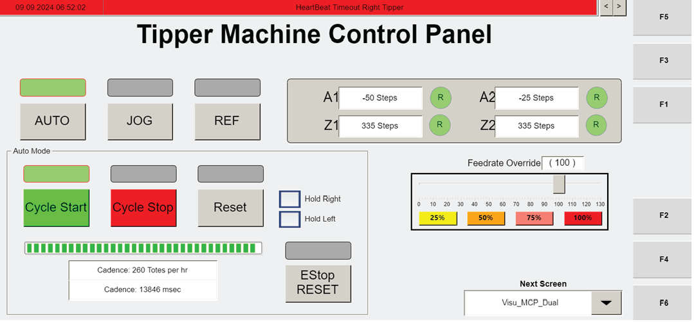

# Recover Non-Recoverable Operator Station Motor Fault Using MCP_Dual (F3) Manual Jog, Reset, and Cycle Start

## Runbook Header

| Field | Value |
| --- | --- |
| Procedure ID | `proc_recover_non_recoverable_operator_station_motor_fault_mcp_dual_f3_v1` |
| Title | Recover Non-Recoverable Operator Station Motor Fault Using MCP_Dual (F3) Manual Jog, Reset, and Cycle Start |
| Procedure Type | `recovery` |
| Primary Role | `operator` |
| Supporting Roles | None |
| Support Safe | Yes |
| Capability Tags | `tipper_station_fault` |
| Access Surface | `tipper_hmi` |
| Audience Roles | `operator` |
| Failure Pattern Tags | None |
| Validation Status | `needs_sme_review` |
| Merge Status | `source_finalized` |

## Summary

When a non-recoverable operator station motor fault (e.g., motor overload) cannot be recovered in software, use the operator station HMI MCP_Dual screen (F3) to stop the cycle, enter manual jog mode, clear any axis faults with RESET, jog the correct axes to reposition the tote on/near the robot, then return to automatic mode and press CYCLE START to release the grippers and command the robot to the hospital station. After the robot leaves the tipper, press RESET.

## When To Use

Use this procedure when the operator station has a non-recoverable motor fault (example given: motor overload) and the station needs to be manually reset so the tote can be repositioned and the robot can be commanded to the hospital station.

## Access Or Tools Needed

* Operator access to the operator station HMI
* MCP_Dual screen (F3) controls: CYCLE STOP, JOG, RESET, AUTO, CYCLE START, and axis jog controls for Z1, Z2, A1, A2

## Related Operational Context

* ctx_manual_non_recoverable_fault_operator_station_motors_v1
* ctx_manual_mcp_dual_screen_v1
* ctx_manual_operator_station_axes_v1
* ctx_manual_hospital_station_v1

## Visual References

*MCP_Dual (F3) screen showing Manual Mode Fault indicator, RESET button, and axis status indicators (Z1, Z2, A2, A1) used for non-recoverable operator station motor fault recovery.*

*MCP_Dual (F3) screen in manual jog mode showing JOG, Manual Mode status, axis fault indicators, and RESET button.*

*MCP_Dual (F3) screen showing AUTO and CYCLE START sequence context (grippers release and robot commanded to hospital station).*

## Procedure Steps

### Step 1 — Navigate to MCP_Dual (F3) on the operator station HMI

**Responsible role:** operator

**Instruction:**
On the operator station HMI, navigate to the "MCP_Dual" screen (F3).

**Expected result:**
The MCP_Dual (F3) screen is displayed with the Manual Mode/Fault area and the visible controls used for recovery (including RESET and cycle controls).

---

### Step 2 — Stop the tipping cycle with CYCLE STOP

**Responsible role:** operator

**Instruction:**
Press CYCLE STOP to stop the tipping cycle.

**Expected result:**
The tipping cycle is stopped (cycle is halted) on the MCP_Dual (F3) screen.

---

### Step 3 — Enter manual jog mode with JOG

**Responsible role:** operator

**Instruction:**
Press JOG to enter manual jog mode.

**Expected result:**
Manual jog mode is active (Manual Mode indicator/status is shown) on MCP_Dual (F3).

---

### Step 4 — Clear any axis faults with RESET

**Responsible role:** operator

**Instruction:**
If any of the axes show a fault, press RESET to clear the fault.

**Expected result:**
Axis fault indicators clear after pressing RESET (no longer indicated on the affected axis/axes).

**Stop or Escalate If:**

* Stop and escalate if you cannot clear an axis fault using RESET while in manual jog mode (fault remains indicated on one or more axes).

---

### Step 5 — Jog axes to reposition the tote on/near the robot

**Responsible role:** operator

**Instruction:**
If the tote is lifted off the robot, jog either the Z-axis or A-axis, or both, to position the tote on or nearly on the robot. Use A1 and Z1 for the left axis; use A2 and Z2 for the right tipper.

**Expected result:**
The tote is positioned on or nearly on the robot by jogging the correct axis controls (left: A1/Z1, right: A2/Z2).

---

### Step 6 — Return to automatic mode with AUTO

**Responsible role:** operator

**Instruction:**
Press AUTO to enter automatic mode.

**Expected result:**
Automatic mode is active (Manual Mode indicator clears/changes) on MCP_Dual (F3).

---

### Step 7 — Start cycle with CYCLE START to release grippers and command hospital

**Responsible role:** operator

**Instruction:**
Press CYCLE START. The grippers will release and the robot will be commanded to go to the hospital station.

**Expected result:**
Grippers release and the robot is commanded to go to the hospital station.

**Stop or Escalate If:**

* Stop and escalate if pressing CYCLE START does not result in gripper release and a command for the robot to go to the hospital station.

---

### Step 8 — After robot leaves tipper, press RESET

**Responsible role:** operator

**Instruction:**
After the robot has left the tipper, press RESET.

**Expected result:**
RESET is pressed after robot departure from the tipper, completing the recovery sequence.

---

## Success Criteria

* Axis faults are cleared after pressing RESET in manual jog mode.
* Tote is positioned on or nearly on the robot using the correct axes (A1/Z1 for left; A2/Z2 for right).
* After pressing AUTO then CYCLE START, grippers release and the robot is commanded to go to the hospital station.
* After the robot has left the tipper, pressing RESET completes the recovery sequence.

## Failure Conditions

* Axis fault indicators remain after pressing RESET in manual jog mode.
* CYCLE START does not cause gripper release and does not command the robot to the hospital station.

## Escalation Guidance

* If you cannot clear an axis fault using RESET while in manual jog mode, stop and escalate.
* If pressing CYCLE START does not result in gripper release and a command for the robot to go to the hospital station, stop and escalate.

## Source Lineage

- Candidate IDs: candidate_manual_optisweep_non_recoverable_fault_mcp_dual_reset_jog_cycle
- Source ID: `manual_optisweep_om_v3`
- Source Type: `manual`
