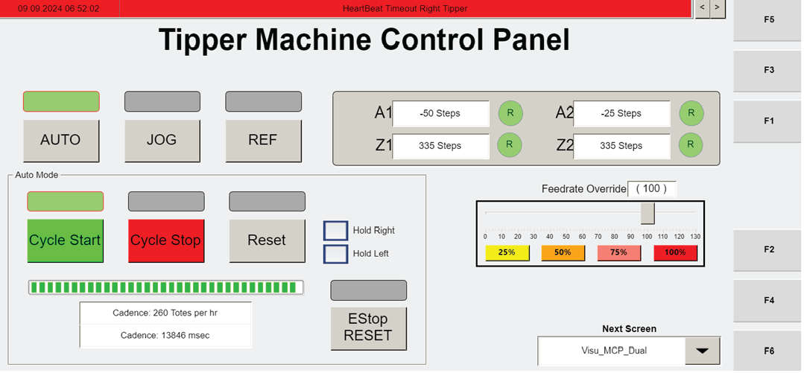

# Recover Non-Recoverable Operator Station Motor Fault by Stopping Cycle and Pressing RESET

## Runbook Header

| Field | Value |
| --- | --- |
| Procedure ID | `proc_recover_non_recoverable_operator_station_motor_fault_by_stopping_cycle_and_pressing_reset_v1` |
| Title | Recover Non-Recoverable Operator Station Motor Fault by Stopping Cycle and Pressing RESET |
| Procedure Type | `recovery` |
| Primary Role | `operator` |
| Supporting Roles | None |
| Support Safe | Yes |
| Capability Tags | None |
| Access Surface | `tipper_hmi` |
| Audience Roles | `operator` |
| Failure Pattern Tags | None |
| Validation Status | `needs_sme_review` |
| Merge Status | `source_finalized` |

## Summary

For non-recoverable operator station motor faults (e.g., motor overload) that cannot be recovered in software, stop the tipping cycle from the operator station HMI and press RESET to clear the fault.

## When To Use

Use when the operator station shows a non-recoverable motor fault (example given: motor overload) and the fault must be manually reset because it cannot be recovered via software.

## Access Or Tools Needed

* Operator station HMI
* MCP_Dual screen (F3)
* CYCLE STOP control
* RESET control

## Related Operational Context

* ctx_manual_non_recoverable_faults_overview_v1
* ctx_manual_operator_station_motor_fault_recovery_v1
* ctx_manual_hmi_mcp_dual_screen_v1
* ctx_manual_hmi_cycle_stop_control_v1

## Visual References

*Operator station HMI screen capture showing the MCP_Dual screen (F3) in manual mode for non-recoverable operator station motor faults, including the Manual Mode Fault indicator and RESET button.*

*Operator station HMI screen showing the MCP_Dual manual mode fault status and RESET control for non-recoverable motor faults.*

*Operator station HMI photo showing manual jog mode with axis fault indicators (Z1, Z2, A1, A2) and RESET availability for clearing faults.*

*Operator Station Control Panel (Visu_MCP_Dual screen) figure showing CYCLE STOP and other operator controls; useful for locating the CYCLE STOP button.*

## Procedure Steps

### Step 1 — Navigate to MCP_Dual screen (F3) on the operator station HMI

**Responsible role:** operator

**Instruction:**
On the operator station HMI, navigate to the "MCP_Dual" screen (F3).

**Expected result:**
The "MCP_Dual" screen is displayed on the operator station HMI.

---

### Step 2 — Press CYCLE STOP to stop the tipping cycle

**Responsible role:** operator

**Instruction:**
On the MCP_Dual screen, press "CYCLE STOP" to stop the tipping cycle.

**Expected result:**
The tipping cycle is stopped after pressing CYCLE STOP.

---

### Step 3 — Press RESET to clear the non-recoverable fault (manual mode)

**Responsible role:** operator

**Instruction:**
If the fault is shown in manual mode, press "RESET" to reset the fault.

**Expected result:**
The non-recoverable fault clears after pressing RESET (fault no longer remains in the manual fault state).

**Stop or Escalate If:**

* If pressing RESET does not clear the fault or the system remains in the fault/manual state, escalate to FORTNA support for further troubleshooting.

---

## Success Criteria

* Tipping cycle is stopped after pressing CYCLE STOP.
* Non-recoverable motor fault clears after pressing RESET (fault no longer remains in the manual fault state).

## Failure Conditions

* Fault remains in manual fault state after pressing RESET.
* Tipping cycle does not stop after pressing CYCLE STOP.

## Escalation Guidance

* If pressing RESET does not clear the fault or the system remains in the fault/manual state, escalate to FORTNA support for further troubleshooting.

## Missing Details / Known Gaps

* The provided excerpt includes navigation to MCP_Dual (F3) and pressing CYCLE STOP, plus a general instruction that RESET clears the fault; it does not include additional manual-mode steps beyond RESET in the packet excerpt.

## Source Lineage

- Candidate IDs: candidate_manual_optisweep_nonrecoverable_operator_station_motors_reset
- Source ID: `manual_optisweep_om_v3`
- Source Type: `manual`
