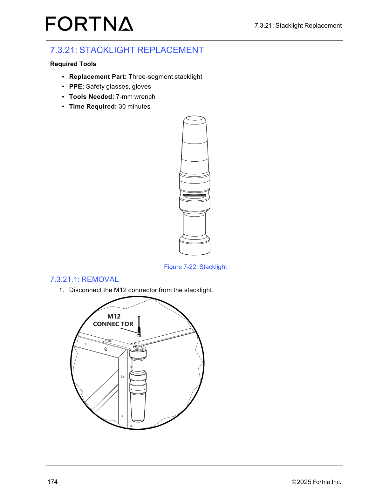

# Perform Operator Station Daily Preventive Maintenance Inspection (Controller, Stacklights, Chute Debris)

## Runbook Header

| Field | Value |
| --- | --- |
| Procedure ID | `proc_perform_operator_station_daily_preventive_maintenance_inspection_controller_stacklights_chute_debris_v1` |
| Title | Perform Operator Station Daily Preventive Maintenance Inspection (Controller, Stacklights, Chute Debris) |
| Procedure Type | `operation` |
| Primary Role | `operator` |
| Supporting Roles | None |
| Support Safe | Yes |
| Capability Tags | `fleet_system_status` |
| Access Surface | `physical_floor` |
| Audience Roles | `operator` |
| Failure Pattern Tags | None |
| Validation Status | `needs_sme_review` |
| Merge Status | `source_finalized` |

## Summary

Perform a daily preventive maintenance inspection of the OptiSweep operator station by checking the controller for visible damage, confirming the stacklights are operational, and ensuring the chute area is free of debris such as stuck labels.

## When To Use

Use this procedure for the daily preventive maintenance inspection of the OptiSweep operator station to verify it is safe to operate (controller condition, stacklights operational, and chute free of debris such as stuck labels).

## Safety And Operational Notes

* If you find controller damage, non-operational stacklights, or chute debris (e.g., stuck labels), stop the inspection and escalate to maintenance support rather than continuing operation.

## Access Or Tools Needed

* Physical access to the operator station
* Visual inspection capability

## Related Operational Context

* ctx_manual_operator_station_daily_inspection_v1
* ctx_manual_operator_station_chute_debris_v1

## Visual References

*Controller PCA diagram (used here only as a visual reference for the controller PCA/controller box area).*

*Stacklight photo (visual reference for the stacklight assembly).*

## Procedure Steps

### Step 1 — Inspect the operator station controller for visible damage

**Responsible role:** operator

**Instruction:**
At the operator station, visually inspect the controller for any visible damage (e.g., cracks, loose components, or other physical damage).

**Expected result:**
The controller shows no visible damage.

**Stop or Escalate If:**

* Controller has visible damage.

---

### Step 2 — Verify operator station stacklights are operational

**Responsible role:** operator

**Instruction:**
At the operator station, observe the stacklights and confirm they illuminate/operate as expected (i.e., they are operational).

**Expected result:**
Stacklights are operational (they illuminate/operate as expected).

**Stop or Escalate If:**

* Stacklights are not operational.

---

### Step 3 — Inspect the chute area for debris (e.g., stuck labels)

**Responsible role:** operator

**Instruction:**
Inspect the operator station chute area and confirm it is free of debris such as stuck labels.

**Expected result:**
Chute area is clear with no stuck labels or other debris present.

**Stop or Escalate If:**

* Chute contains debris (e.g., stuck labels).

---

### Step 4 — Stop inspection and escalate if any required condition is not met

**Responsible role:** operator

**Instruction:**
If you find controller damage, non-operational stacklights, or chute debris (e.g., stuck labels), stop the inspection and escalate to the appropriate maintenance support. For tipper-related maintenance, contact Lifecycle Performance Services (LPS) at 888-444-4647.

**Expected result:**
Inspection is stopped and maintenance support is contacted/escalated due to the identified issue.

**Stop or Escalate If:**

* Controller has visible damage.
* Stacklights are not operational.
* Chute contains debris (e.g., stuck labels).

---

## Success Criteria

* Controller shows no visible damage.
* Stacklights are operational (illuminate/operate as expected).
* Chute area is clear with no stuck labels or other debris present.

## Failure Conditions

* Controller has visible damage.
* Stacklights are not operational.
* Chute contains debris (e.g., stuck labels).

## Escalation Guidance

* If controller damage, non-operational stacklights, or chute debris is found, stop the inspection and escalate to the appropriate maintenance support.
* For tipper-related maintenance, contact Lifecycle Performance Services (LPS) at 888-444-4647.

## Missing Details / Known Gaps

* The source section provides checklist items (controller damage, stacklights operational, chute free of debris) but does not define specific visual criteria/states for what constitutes “operational” stacklights beyond the requirement that they are operational.
* The packet includes image support notes, but the specific stacklight/chute example figures are not explicitly identified in the operator-station checklist section text (page 97).

## Source Lineage

- Candidate IDs: candidate_manual_optisweep_operator_station_daily_preventive_maintenance_inspection
- Source ID: `manual_optisweep_om_v3`
- Source Type: `manual`
