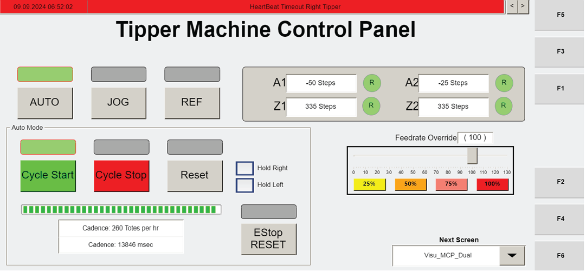

# Navigate OptiSweep Operator Station HMI Screens Using F-Keys, On-Screen Buttons, and Next Screen Drop-Down

## Runbook Header

| Field | Value |
| --- | --- |
| Procedure ID | `proc_navigate_opisweep_operator_station_hmi_fkeys_v1` |
| Title | Navigate OptiSweep Operator Station HMI Screens Using F-Keys, On-Screen Buttons, and Next Screen Drop-Down |
| Procedure Type | `operation` |
| Primary Role | `operator` |
| Supporting Roles | None |
| Support Safe | Yes |
| Capability Tags | `device_roster_state` |
| Access Surface | `tipper_hmi` |
| Audience Roles | `operator` |
| Failure Pattern Tags | None |
| Validation Status | `needs_sme_review` |
| Merge Status | `source_finalized` |

## Summary

Operators use the operator station HMI navigation controls to switch between the Visu_MCP_Dual (main control panel), Visu_Data (data), and Visu_Alarm (alarms) screens, and to navigate/select items on the current screen or jump directly to another screen using the Next Screen drop-down.

## When To Use

When you need to open the correct live operator station HMI screen at a tipper station (main control panel, data, or alarms) or navigate to a specific item / jump to another available screen.

## Access Or Tools Needed

* Tipper station operator station HMI / WebVisu/VISU screens (right-side display)
* Physical function keys F1–F6 and on-screen navigation controls

## Related Operational Context

* ctx_manual_operator_station_hmi_location_v1
* ctx_manual_operator_station_navigation_methods_v1
* ctx_manual_operator_station_primary_screens_v1
* ctx_manual_operator_station_function_key_mapping_v1
* ctx_manual_operator_station_selection_controls_v1

## Visual References

*Labeled diagram/table mapping the operator station physical function keys (F1–F6), selection/navigation arrow buttons (arrows + center select), and the Next Screen drop-down to the corresponding Visu_* screens (including F3=Visu_MCP_Dual, F5=Visu_Data, F6=Visu_Alarm).*

*Confirm the screen title/contents match the Operator Station HMI Data Screen (VISU_DATA), including the informational banner area and the Tipper Stats section.*

## Procedure Steps

### Step 1 — Locate the operator station HMI display on the right side of the tipper station

**Responsible role:** operator

**Instruction:**
At the tipper station, locate the operator station HMI display on the right side of the station.

**Expected result:**
You can visually identify the operator station HMI display at the right side of the tipper station.

---

### Step 2 — Open the primary main control panel screen (Visu_MCP_Dual) using F3

**Responsible role:** operator

**Instruction:**
Press the physical F3 button and confirm the display navigates to the "Visu_MCP_Dual" screen.

**Expected result:**
The active screen title/contents change to the "Visu_MCP_Dual" screen after pressing F3.

**Stop or Escalate If:**

* If pressing F3 does not navigate to the expected screen name ("Visu_MCP_Dual"), stop and escalate to support/site troubleshooting rather than continuing to operate the station from an unknown screen state.

---

### Step 3 — Open the data screen (Visu_Data) using F5

**Responsible role:** operator

**Instruction:**
Press the physical F5 button and confirm the display navigates to the "Visu_Data" screen.

**Expected result:**
The active screen changes to the "Visu_Data" screen after pressing F5.

**Screens / Images:**

*Confirm the screen title/contents match the Operator Station HMI Data Screen (VISU_DATA), including the informational banner area and the Tipper Stats section.*

**Stop or Escalate If:**

* If pressing F5 does not navigate to the expected screen name ("Visu_Data"), stop and escalate to support/site troubleshooting rather than continuing to operate the station from an unknown screen state.

---

### Step 4 — Open the alarms screen (Visu_Alarm) using F6

**Responsible role:** operator

**Instruction:**
Press the physical F6 button and confirm the display navigates to the "Visu_Alarm" screen.

**Expected result:**
The active screen changes to the "Visu_Alarm" screen after pressing F6.

**Stop or Escalate If:**

* If pressing F6 does not navigate to the expected screen name ("Visu_Alarm"), stop and escalate to support/site troubleshooting rather than continuing to operate the station from an unknown screen state.

---

### Step 5 — Navigate to an on-screen item using arrow buttons and select it with the center button

**Responsible role:** operator

**Instruction:**
Use the selection/navigation arrow buttons to move to the item on the current screen, then press the center button to select it.

**Expected result:**
The highlighted/focused item changes as you use the arrow buttons, and the selected item activates after pressing the center button.

---

### Step 6 — Jump directly to another screen using the Next Screen drop-down menu

**Responsible role:** operator

**Instruction:**
Use the "Next Screen" drop-down menu to select the next screen to view.

**Expected result:**
After selecting from the Next Screen drop-down, the HMI navigates to the chosen next screen.

---

### Step 7 — Stop when the required screen is visible and proceed with the station task

**Responsible role:** operator

**Instruction:**
Stop when the required screen is visible (Visu_MCP_Dual, Visu_Data, or Visu_Alarm) and proceed with the intended station task on that screen.

**Expected result:**
The active screen matches the required screen name (Visu_MCP_Dual, Visu_Data, or Visu_Alarm).

**Stop or Escalate If:**

* If you cannot confirm the required screen is visible, stop and escalate to support/site troubleshooting rather than continuing to operate the station from an unknown screen state.

---

## Success Criteria

* Pressing F3 navigates to "Visu_MCP_Dual".
* Pressing F5 navigates to "Visu_Data".
* Pressing F6 navigates to "Visu_Alarm".
* Arrow buttons move between on-screen items and the center button selects the focused item.
* Next Screen drop-down selection navigates directly to the chosen next screen.

## Failure Conditions

* F3/F5/F6 does not navigate to the expected screen names (Visu_MCP_Dual / Visu_Data / Visu_Alarm).
* Arrow navigation does not move between items or center select does not activate the selected item.
* Next Screen drop-down selection does not change the active screen.

## Escalation Guidance

* If function keys (F3/F5/F6) do not navigate to the expected screen names, stop and escalate to support/site troubleshooting rather than continuing to operate the station from an unknown screen state.

## Source Lineage

- Candidate IDs: candidate_manual_optisweep_operator_station_hmi_navigation_keys
- Source ID: `manual_optisweep_om_v3`
- Source Type: `manual`
