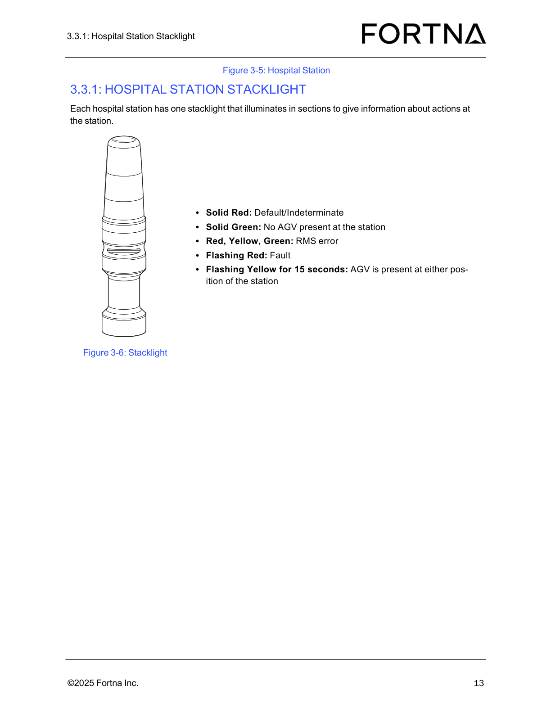

# Determine Tipper/Station Status From Operator Station Stacklights

## Runbook Header

| Field | Value |
| --- | --- |
| Procedure ID | `proc_determine_tipper_station_status_from_operator_station_stacklights_v1` |
| Title | Determine Tipper/Station Status From Operator Station Stacklights |
| Procedure Type | `diagnostic` |
| Primary Role | `operator` |
| Supporting Roles | None |
| Support Safe | Yes |
| Capability Tags | `agv_active_errors` |
| Access Surface | `tipper_hmi` |
| Audience Roles | `operator` |
| Failure Pattern Tags | None |
| Validation Status | `needs_sme_review` |
| Merge Status | `source_finalized` |

## Summary

Use the operator station stacklight color/flash/horn pattern to identify the current status of the corresponding tipper and station, including RMS error, E-stop, tipping state, and bagout/surepost indications.

## When To Use

When you need to determine the current documented status of a tipper/station from the operator station stacklights (solid vs flashing colors, and horn alarm pattern when present).

## Do Not Use For

* Do not use this procedure to clear or reset E-stop or RMS error conditions.

## Safety And Operational Notes

* If the observed stacklight pattern indicates E-stop activated (Solid Red), escalate immediately and do not attempt to clear remotely from this procedure.

## Access Or Tools Needed

* Physical access to the operator station stacklights
* Ability to observe stacklight color(s), solid vs flashing, and horn alarm pattern (long vs intermittent) when present

## Visual References

*Stacklight state meanings (solid/flashing colors and RMS error/fault/AGV presence) used to interpret station status.*

*Operator station HMI Manual Control screen showing LAMP TEST behavior (audible alarm and stacklight flashing red) and tipper disable/fault reset controls for context while interpreting stacklight signals.*

*HMI context for Surepost tote indication (stacklight flashes white) and operator station controls (Surepost LEFT/RIGHT).*

## Procedure Steps

### Step 1 — Go to the affected operator station

**Responsible role:** operator

**Instruction:**
Walk to the operator station for the affected tipper/station and position yourself so you can clearly see both stacklights.

**Expected result:**
You can visually identify both stacklights at the operator station for the affected tipper/station.

---

### Step 2 — Observe both stacklights and record solid vs flashing colors

**Responsible role:** operator

**Instruction:**
Observe both stacklights and note whether each is solid or flashing, and the displayed color(s).

**Expected result:**
You have identified each stacklight’s state (solid/flashing) and color(s).

---

### Step 3 — If horn alarm pattern is indicated, determine long vs intermittent horn during flashing

**Responsible role:** operator

**Instruction:**
If the source indicates a horn alarm pattern for the flashing state you are seeing, also observe whether there is a long horn alarm or intermittent horn alarm during the flashing pattern.

**Expected result:**
You have determined whether the horn alarm is long or intermittent during the flashing pattern.

---

### Step 4 — Match the observed stacklight pattern to the documented tipper/station status meanings

**Responsible role:** operator

**Instruction:**
Match the observed pattern to the documented meanings for tipper/station status, including RMS error, E-stop, tipping state, and surepost/bagout indications.

**Expected result:**
You can map the observed stacklight solid/flashing color combination (and horn timing when present) to one documented status.

**Stop or Escalate If:**

* Observed stacklight pattern does not match any documented combination

---

### Step 5 — Stop and escalate for E-stop activated or RMS error

**Responsible role:** operator

**Instruction:**
If the mapped status indicates E-stop activated (Solid Red) or RMS error (Solid Red+Yellow+Green), stop and escalate immediately.

**Expected result:**
You have identified whether the mapped status is Solid Red (E-stop activated) or Solid Red+Yellow+Green (RMS error) and escalated accordingly.

**Stop or Escalate If:**

* Solid Red indicates Estop is activated
* Solid Red+Yellow+Green indicates an RMS error

---

## Success Criteria

* Operator can map the observed stacklight solid/flashing color combination (and horn timing when present) to a documented tipper/station status.
* Operator escalates immediately when the mapped status indicates Solid Red (E-stop activated) or Solid Red+Yellow+Green (RMS error).

## Failure Conditions

* Observed stacklight pattern does not match any documented combination.
* Solid Red (E-stop activated) or Solid Red+Yellow+Green (RMS error) is present and escalation is not initiated.

## Escalation Guidance

* If Solid Red indicates Estop is activated: escalate immediately; do not attempt to clear remotely from this procedure.
* If Solid Red+Yellow+Green indicates an RMS error: escalate for further diagnostics.

## Missing Details / Known Gaps

* The candidate references an operator station stacklight photo/figure and an HMI screen for manual control, but the packet does not include the specific 'two stacklights at the top of either side of the operator station frame' image artifact. Interpretation is still grounded to the stacklight meaning list, but the exact operator-station two-stacklight photo is not attached in the provided artifacts.

## Source Lineage

- Candidate IDs: candidate_manual_optisweep_operator_station_stacklights_interpret_status
- Source ID: `manual_optisweep_om_v3`
- Source Type: `manual`
