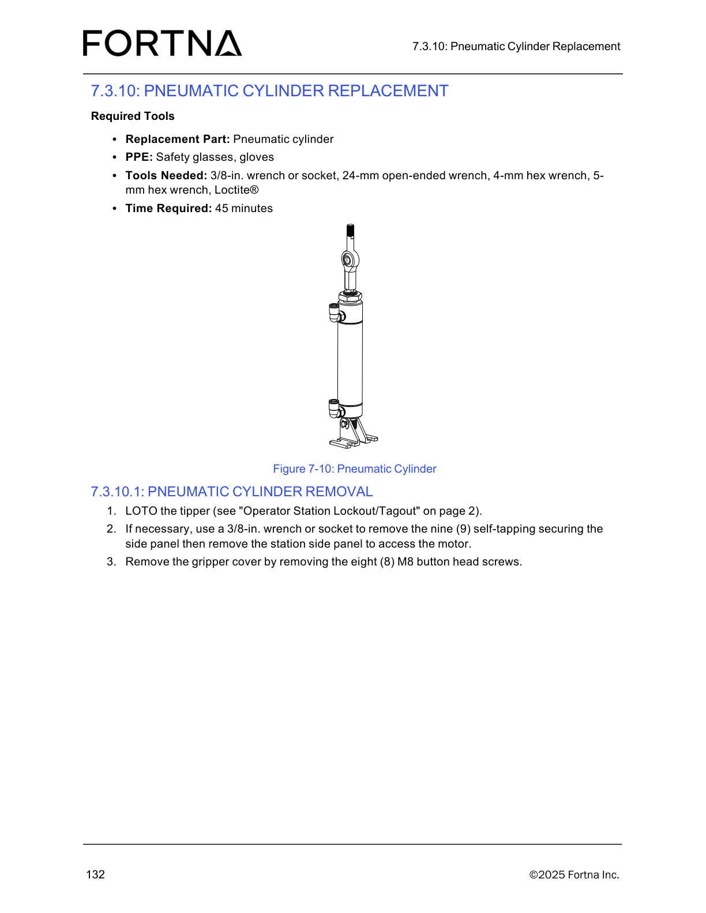

# Install Pneumatic Cylinder After Replacement (transfer fittings, bracket/rod end, reconnect air, reassemble, restart operator station)

## Runbook Header

| Field | Value |
| --- | --- |
| Procedure ID | `proc_install_pneumatic_cylinder_after_replacement_v1` |
| Title | Install Pneumatic Cylinder After Replacement (transfer fittings, bracket/rod end, reconnect air, reassemble, restart operator station) |
| Procedure Type | `recovery` |
| Primary Role | `operator` |
| Supporting Roles | None |
| Support Safe | Yes |
| Capability Tags | `tipper_station_fault` |
| Access Surface | `tipper_hmi` |
| Audience Roles | `operator` |
| Failure Pattern Tags | None |
| Validation Status | `needs_sme_review` |
| Merge Status | `source_finalized` |

## Summary

Reinstall a replaced pneumatic cylinder correctly so the lift plate rod end is pinned/retained, air lines are reconnected, covers/panels are reinstalled, and the operator station is restarted to resume normal operation.

## When To Use

Use this procedure after replacing a pneumatic cylinder when the cylinder must be reinstalled with the correct mechanical retention (rod end pin + retaining ring), air line reconnection, and reassembly, followed by restarting the operator station.

## Access Or Tools Needed

* Physical access to the pneumatic cylinder assembly
* Hand tools for M6 socket head screws and M8 button-head screws
* Tools to install pin and retaining ring
* Ability to restart the operator station

## Visual References

*Pneumatic cylinder assembly figure referenced by the pneumatic cylinder replacement/install section.*

## Procedure Steps

### Step 1 — Transfer air fittings and spherical rod end to the new cylinder

**Responsible role:** operator

**Instruction:**
Transfer the air fittings and the spherical rod end from the old cylinder to the new cylinder.

**Expected result:**
The new pneumatic cylinder has the air line fittings and spherical rod end installed/attached as transferred from the old cylinder.

---

### Step 2 — Mount cylinder bottom in bracket and install bracket half with two M6 screws

**Responsible role:** operator

**Instruction:**
Place the bottom of the cylinder in the bracket, then install the other half of the bracket using two (2) M6 socket head screws.

**Expected result:**
The cylinder bottom is seated in the bracket and the other half of the bracket is installed using two (2) M6 socket head screws.

**Stop or Escalate If:**

* Stop and escalate if the rod end cannot be fully seated between the lift plate brackets or if the pin/retaining ring cannot be installed securely.

---

### Step 3 — Install rod end between lift plate brackets and secure with pin and retaining ring

**Responsible role:** operator

**Instruction:**
Slip the rod end between the brackets on the lift plate, then insert the pin and retaining ring.

**Expected result:**
The rod end is positioned between the lift plate brackets and the pin and retaining ring are installed.

**Stop or Escalate If:**

* Stop and escalate if the rod end cannot be fully seated between the lift plate brackets or if the pin/retaining ring cannot be installed securely.

---

### Step 4 — Reconnect air lines

**Responsible role:** operator

**Instruction:**
Reconnect the air lines.

**Expected result:**
Air lines are reconnected to the pneumatic cylinder as required by the installation.

**Stop or Escalate If:**

* Stop and escalate if air line reconnection is incomplete or fittings cannot be reattached as required.

---

### Step 5 — Replace cover plate using eight M8 button-head screws

**Responsible role:** operator

**Instruction:**
Replace the cover plate using the eight (8) M8 button-head screws.

**Expected result:**
Cover plate is installed and fastened with eight (8) M8 button-head screws.

---

### Step 6 — Reinstall top and/or bottom side panels if necessary

**Responsible role:** operator

**Instruction:**
Reinstall the top and/or bottom side panels, if necessary.

**Expected result:**
Top and/or bottom side panels are reinstalled if they were removed.

---

### Step 7 — Restart the operator station

**Responsible role:** operator

**Instruction:**
Re-start the operator station (see “Starting The Operator Station” on page 66).

**Expected result:**
The operator station is restarted after reassembly.

**Stop or Escalate If:**

* If the operator station restart does not bring the station back to normal operation after restart, escalate for further troubleshooting.

---

## Success Criteria

* Pneumatic cylinder is mechanically secured with the bracket installed using two (2) M6 socket head screws.
* Lift plate rod end is retained with the pin and retaining ring installed.
* Air lines are reconnected.
* Cover plate is fastened using eight (8) M8 button-head screws.
* Top and/or bottom side panels are reinstalled if they were removed.
* Operator station restart returns the station to normal operation.

## Failure Conditions

* Rod end cannot be fully seated between lift plate brackets or pin/retaining ring cannot be installed securely.
* Air line reconnection is incomplete or fittings cannot be reattached as required.
* Operator station restart does not bring the station back to normal operation.

## Escalation Guidance

* Stop and escalate if rod end retention (pin/retaining ring) cannot be completed securely.
* Stop and escalate if air line reconnection cannot be completed as required.
* If restarting the operator station does not return the station to normal operation, escalate for further troubleshooting.

## Missing Details / Known Gaps

* The candidate references 'Starting The Operator Station' on page 66, but the exact restart control/location is not included in the provided excerpt; step 7 cannot specify the exact operator-station start action beyond 're-start the operator station'.

## Source Lineage

- Candidate IDs: candidate_manual_optisweep_pneumatic_cylinder_installation
- Source ID: `manual_optisweep_om_v3`
- Source Type: `manual`
