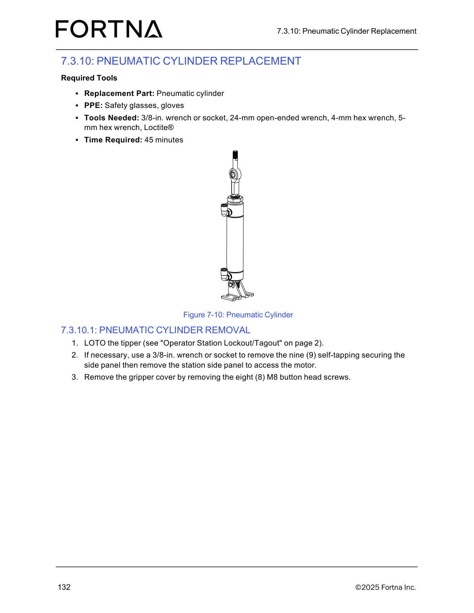

# Remove a Tipppper Pneumatic Cylinder (LOTO, side panel, gripper cover, air lines, retaining ring/pin, lower bracket screws)

## Runbook Header

| Field | Value |
| --- | --- |
| Procedure ID | `proc_remove_tipper_pneumatic_cylinder_loto_v1` |
| Title | Remove a Tipppper Pneumatic Cylinder (LOTO, side panel, gripper cover, air lines, retaining ring/pin, lower bracket screws) |
| Procedure Type | `recovery` |
| Primary Role | `operator` |
| Supporting Roles | None |
| Support Safe | Yes |
| Capability Tags | `tipper_station_fault` |
| Access Surface | `physical_floor` |
| Audience Roles | `operator` |
| Failure Pattern Tags | None |
| Validation Status | `needs_sme_review` |
| Merge Status | `source_finalized` |

## Summary

Safely remove the tipper pneumatic cylinder assembly for replacement by following the documented disassembly sequence and verifying the cylinder is released before removal.

## When To Use

Use when replacing the OptiSweep tipper pneumatic cylinder assembly and you need to remove it in the documented sequence (LOTO → side panel/gripper cover access → disconnect air lines → release lift plate via retaining ring/pin → remove lower bracket screws to free the cylinder).

## Safety And Operational Notes

* Perform LOTO on the tipper before starting disassembly (manual references “Operator Station Lockout/Tagout” on page 2).
* After removing the retaining ring and pulling the pin, the lift plate will drop a short distance—keep hands/feet clear of the drop path.

## Access Or Tools Needed

* Physical access to the tipper station
* PPE: safety glasses, gloves
* 3/8-in. wrench or socket
* 24-mm open-ended wrench
* 4-mm hex wrench
* 5-mm hex wrench
* Loctite® (listed as required tool for the overall replacement context)

## Visual References

*Figure 7-10: Pneumatic cylinder assembly referenced by the pneumatic cylinder removal procedure (shows the pneumatic cylinder assembly and supports the removal sequence).*

## Procedure Steps

### Step 1 — Apply LOTO to the tipper

**Responsible role:** operator

**Instruction:**
Apply lockout/tagout (LOTO) to the tipper using the manual’s “Operator Station Lockout/Tagout” method.

**Expected result:**
The tipper is locked out (LOTO applied) before proceeding to remove side panel/gripper cover components.

**Stop or Escalate If:**

* If LOTO cannot be applied/confirmed, stop and do not proceed with cover removal or air line disconnection.

---

### Step 2 — Remove the station side panel (if needed) to access the motor

**Responsible role:** operator

**Instruction:**
If necessary for access, use a 3/8-in. wrench or socket to remove the nine (9) self-tapping securing screws for the station side panel, then remove the station side panel.

**Expected result:**
Station side panel is removed (when needed) and the motor area is accessible.

**Stop or Escalate If:**

* Escalate if fasteners do not match the documented counts/sizes (nine self-tapping side panel screws).

---

### Step 3 — Remove the gripper cover

**Responsible role:** operator

**Instruction:**
Remove the gripper cover by removing the eight (8) M8 button head screws.

**Expected result:**
Gripper cover is removed and the pneumatic cylinder area is accessible.

**Stop or Escalate If:**

* Escalate if fasteners do not match the documented counts/sizes (eight M8 gripper cover screws).

---

### Step 4 — Disconnect the two air lines from the pneumatic cylinder

**Responsible role:** operator

**Instruction:**
Remove the two (2) air lines from the pneumatic cylinder.

**Expected result:**
Both air lines are disconnected from the pneumatic cylinder.

**Stop or Escalate If:**

* Stop/escalate if air lines cannot be removed.

---

### Step 5 — Release the lift plate by removing the retaining ring and pulling the pin

**Responsible role:** operator

**Instruction:**
At the rod end of the cylinder, remove one retaining ring and pull the pin releasing the lift plate; the lift plate will drop a short distance.

**Expected result:**
Lift plate releases and drops a short distance after removing the retaining ring and pulling the pin.

**Stop or Escalate If:**

* Stop if the lift plate does not release after removing the retaining ring/pin as described; re-check that the correct retaining ring and pin are removed before proceeding.

---

### Step 6 — Free the cylinder by removing the two lower bracket screws

**Responsible role:** operator

**Instruction:**
At the bottom of the cylinder, remove two (2) M6 socket head screws to release half of the lower bracket and free the air cylinder.

**Expected result:**
Cylinder is freed after removing the two (2) M6 socket head screws (lower bracket released).

**Stop or Escalate If:**

* Escalate if fasteners do not match the documented counts/sizes (two M6 socket head screws at bottom).

---

## Success Criteria

* LOTO is applied to the tipper before disassembly.
* Gripper cover is removed (eight (8) M8 button head screws removed).
* Both air lines are disconnected from the pneumatic cylinder.
* Lift plate releases and drops a short distance after removing the retaining ring and pulling the pin.
* Cylinder is freed after removing the two (2) M6 socket head screws.

## Failure Conditions

* Lift plate does not release after removing the retaining ring/pin as described.
* Air lines cannot be removed.
* Fasteners do not match documented counts/sizes at any step.

## Escalation Guidance

* If the lift plate does not release after removing the retaining ring/pin, stop and re-check that the correct retaining ring and pin are removed before proceeding.
* Escalate if air lines cannot be removed or if fasteners do not match the documented counts/sizes (nine self-tapping side panel screws, eight M8 gripper cover screws, one retaining ring/pin at rod end, two M6 socket head screws at bottom).

## Missing Details / Known Gaps

* The manual references “Operator Station Lockout/Tagout” on page 2, but that page content is not included in this packet; the exact LOTO hardware steps are therefore not specified here.

## Source Lineage

- Candidate IDs: candidate_manual_optisweep_pneumatic_cylinder_removal_loto
- Source ID: `manual_optisweep_om_v3`
- Source Type: `manual`
