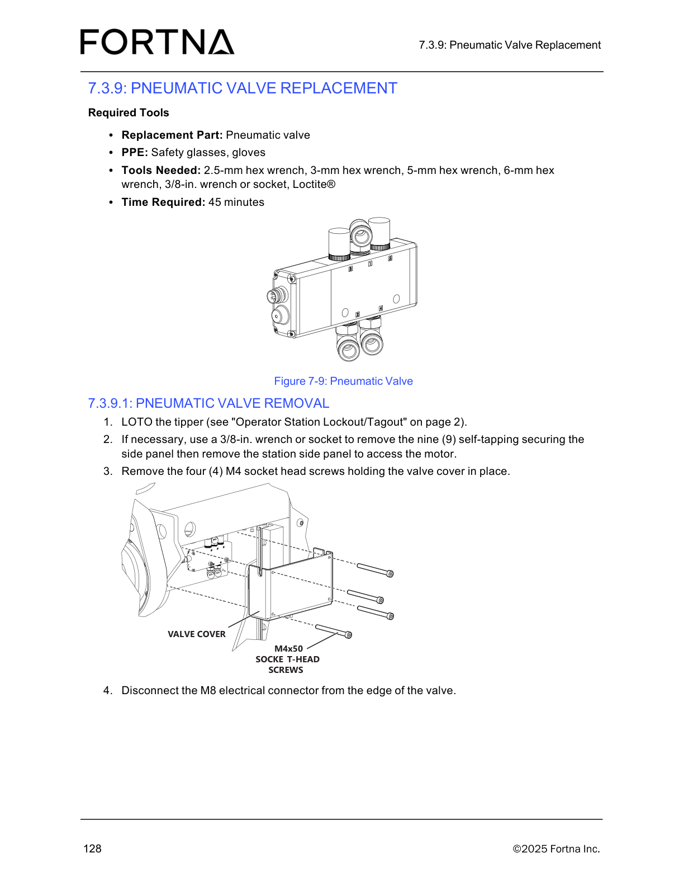

# Remove Pneumatic Valve From Tipper (LOTO, side panel access, valve cover screws, M8 connector disconnect)

## Runbook Header

| Field | Value |
| --- | --- |
| Procedure ID | `proc_remove_pneumatic_valve_from_tipper_loto_disconnect_v1` |
| Title | Remove Pneumatic Valve From Tipper (LOTO, side panel access, valve cover screws, M8 connector disconnect) |
| Procedure Type | `recovery` |
| Primary Role | `operator` |
| Supporting Roles | None |
| Support Safe | Yes |
| Capability Tags | `tipper_station_fault` |
| Access Surface | `physical_floor` |
| Audience Roles | `operator` |
| Failure Pattern Tags | None |
| Validation Status | `needs_sme_review` |
| Merge Status | `source_finalized` |

## Summary

Safely prepare the OptiSweep tipper for pneumatic valve replacement by performing lockout/tagout (LOTO), exposing the valve cover (including removing the station side panel if needed), removing the valve cover fasteners, and disconnecting the valve’s M8 electrical connector.

## When To Use

Use when you are preparing the OptiSweep tipper station for pneumatic valve replacement and need to LOTO the tipper, access the valve cover, remove the valve cover fasteners, and disconnect the valve’s M8 electrical connector.

## Do Not Use For

* Do not use this procedure as a substitute for diagnosing tipper station faults on HMI/DB/API surfaces; this is a physical prep/removal step set for valve replacement.

## Safety And Operational Notes

* Perform LOTO on the tipper before removing the valve cover and disconnecting the M8 electrical connector (LOTO referenced as “Operator Station Lockout/Tagout” on page 2).
* Wear safety glasses and gloves during the removal/prep work.

## Access Or Tools Needed

* Physical floor / grid access to the tipper
* PPE: safety glasses, gloves
* Tools: 2.5-mm hex wrench, 3-mm hex wrench, 5-mm hex wrench, 6-mm hex wrench, 3/8-in. wrench or socket, Loctite®
* Replacement part: pneumatic valve

## Visual References

*Figure 7-9: Pneumatic Valve assembly showing valve cover, four (4) M4x50 socket-head screws, and the M8 electrical connector at the valve edge.*

## Procedure Steps

### Step 1 — Gather required tools and PPE

**Responsible role:** operator

**Instruction:**
On the physical floor, stage the replacement pneumatic valve, PPE (safety glasses and gloves), and the required hex wrenches (2.5-mm, 3-mm, 5-mm, 6-mm), plus a 3/8-in. wrench or socket and Loctite®.

**Expected result:**
You have the specified tools/PPE available to proceed with LOTO, side panel access (if needed), valve cover fastener removal, and M8 connector disconnection.

---

### Step 2 — Perform LOTO on the tipper

**Responsible role:** operator

**Instruction:**
Perform LOTO on the tipper using the manual’s “Operator Station Lockout/Tagout” procedure (referenced on page 2).

**Expected result:**
The tipper is locked out/tagged out prior to removing the valve cover and disconnecting the M8 electrical connector.

**Stop or Escalate If:**

* Stop and escalate if you cannot safely perform LOTO.

---

### Step 3 — Remove station side panel for motor/valve access (if necessary)

**Responsible role:** operator

**Instruction:**
If necessary, use a 3/8-in. wrench or socket to remove the nine (9) self-tapping securing screws for the station side panel, then remove the station side panel to access the motor.

**Expected result:**
Station side panel is removed (when necessary) to access the motor/valve cover area.

**Stop or Escalate If:**

* Stop and escalate if the valve cover cannot be removed without forcing fasteners.

---

### Step 4 — Remove valve cover fasteners (four M4 socket head screws)

**Responsible role:** operator

**Instruction:**
Remove the four (4) M4 socket head screws holding the valve cover in place.

**Expected result:**
The four (4) M4 socket head screws are removed and the valve cover is no longer secured.

**Stop or Escalate If:**

* Stop and escalate if the valve cover cannot be removed without forcing fasteners.

---

### Step 5 — Disconnect the M8 electrical connector from the valve edge

**Responsible role:** operator

**Instruction:**
Disconnect the M8 electrical connector from the edge of the valve.

**Expected result:**
The M8 electrical connector is disconnected from the edge of the valve.

**Stop or Escalate If:**

* Stop and escalate if the M8 connector cannot be disconnected without excessive force or if wiring/connector damage is observed.

---

## Success Criteria

* Tipper is locked out/tagged out before disassembly.
* Station side panel is removed (when necessary) to access the motor/valve cover area.
* Valve cover fasteners are removed: four (4) M4 socket head screws.
* M8 electrical connector is disconnected from the edge of the valve.

## Failure Conditions

* LOTO cannot be safely performed.
* Valve cover cannot be removed without forcing fasteners.
* M8 connector cannot be disconnected without excessive force.
* Wiring/connector damage is observed during M8 disconnect.

## Escalation Guidance

* If you cannot safely perform LOTO, stop and escalate.
* If the valve cover cannot be removed without forcing fasteners, stop and escalate.
* If the M8 connector cannot be disconnected without excessive force or if wiring/connector damage is observed, stop and escalate.

## Missing Details / Known Gaps

* The packet does not include the specific page/figure for the “Operator Station Lockout/Tagout” control location (only referenced as being on page 2).
* The packet does not include a dedicated close-up image for the four (4) M4 socket head screws or the M8 connector beyond Figure 7-9; steps rely on Figure 7-9 for visual identification.
* This runbook covers only the removal/prep portion (LOTO, side panel access, valve cover screw removal, M8 connector disconnect). Later replacement/reassembly steps are not included in this packet section.

## Source Lineage

- Candidate IDs: candidate_manual_optisweep_pneumatic_valve_removal_loto_disconnect
- Source ID: `manual_optisweep_om_v3`
- Source Type: `manual`
