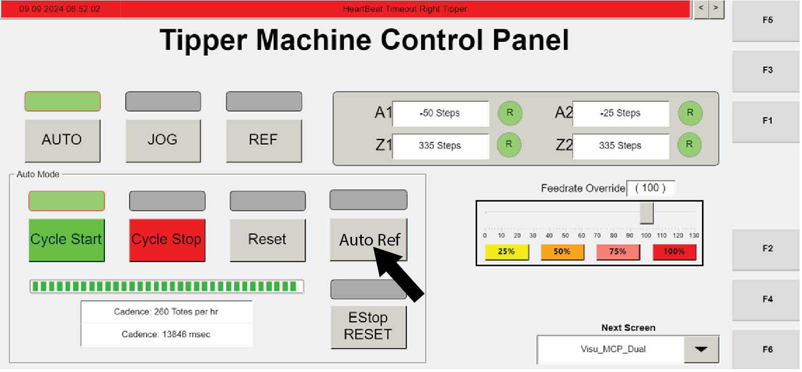

# Automatically Reference All Tipper Axes Using Operator Station HMI (RESET → AUTO REF → AUTO → CYCLE START)

## Runbook Header

| Field | Value |
| --- | --- |
| Procedure ID | `proc_automatically_reference_all_tipper_axes_operator_station_hmi_v1` |
| Title | Automatically Reference All Tipper Axes Using Operator Station HMI (RESET → AUTO REF → AUTO → CYCLE START) |
| Procedure Type | `operation` |
| Primary Role | `operator` |
| Supporting Roles | None |
| Support Safe | Yes |
| Capability Tags | `agv_physical_recovery` |
| Access Surface | `tipper_hmi` |
| Audience Roles | `operator` |
| Failure Pattern Tags | None |
| Validation Status | `needs_sme_review` |
| Merge Status | `source_finalized` |

## Summary

Use the operator station HMI to automatically reference all tipper axes. Confirm referencing completes when the 'R' icons turn green, then press AUTO and restart operation with CYCLE START.

## When To Use

When tipper axes need automatic referencing so the system can resume operation.

## Access Or Tools Needed

* Tipper HMI / WebVisu / VISU (operator station HMI)

## Visual References

*Operator station HMI screen used for referencing axes (shows the automatic referencing controls and 'R' icons behavior).*

*Operator Station Control Panel (Visu_MCP_Dual screen) showing AUTO and CYCLE START controls and active button indicators.*

## Procedure Steps

### Step 1 — Press RESET on the operator station HMI

**Responsible role:** operator

**Instruction:**
On the operator station HMI, press RESET.

**Expected result:**
The automatic referencing sequence is initiated (next step is AUTO REF to reference all tipper axes).

---

### Step 2 — Press AUTO REF to reference all tipper axes

**Responsible role:** operator

**Instruction:**
On the operator station HMI, press AUTO REF to reference all of the axes of the tippers.

**Expected result:**
Referencing begins for all tipper axes and the 'R' icons will indicate completion.

---

### Step 3 — Confirm referencing completion by verifying 'R' icons turn green

**Responsible role:** operator

**Instruction:**
Watch the 'R' icons on the operator station HMI and confirm they turn green when referencing is completed.

**Expected result:**
The 'R' icons turn green indicating referencing is completed.

**Stop or Escalate If:**

* If the 'R' icons do not turn green, stop and escalate for support rather than continuing to AUTO/CYCLE START.

---

### Step 4 — Press AUTO after referencing completes

**Responsible role:** operator

**Instruction:**
After referencing is completed (after the 'R' icons turn green), press AUTO on the operator station HMI.

**Expected result:**
AUTO is engaged after referencing completes.

---

### Step 5 — Press CYCLE START to restart operation

**Responsible role:** operator

**Instruction:**
Press CYCLE START on the operator station HMI to restart operation.

**Expected result:**
Operation restarts (cycle start command issued) after AUTO is engaged.

---

## Success Criteria

* The 'R' icons turn green indicating referencing is completed.
* AUTO is engaged after referencing completes.
* Pressing CYCLE START restarts operation.

## Failure Conditions

* The 'R' icons do not turn green (referencing not completed).
* AUTO cannot be engaged after referencing completes.
* CYCLE START does not restart operation.

## Escalation Guidance

* If the 'R' icons do not turn green, stop and escalate for support rather than continuing to AUTO/CYCLE START.

## Missing Details / Known Gaps

* The packet does not specify the exact operator station HMI screen name for the automatic referencing controls (RESET / AUTO REF / AUTO / CYCLE START). It only states these controls are on the operator station HMI.

## Source Lineage

- Candidate IDs: candidate_manual_optisweep_reference_axes_auto_ref
- Source ID: `manual_optisweep_om_v3`
- Source Type: `manual`
