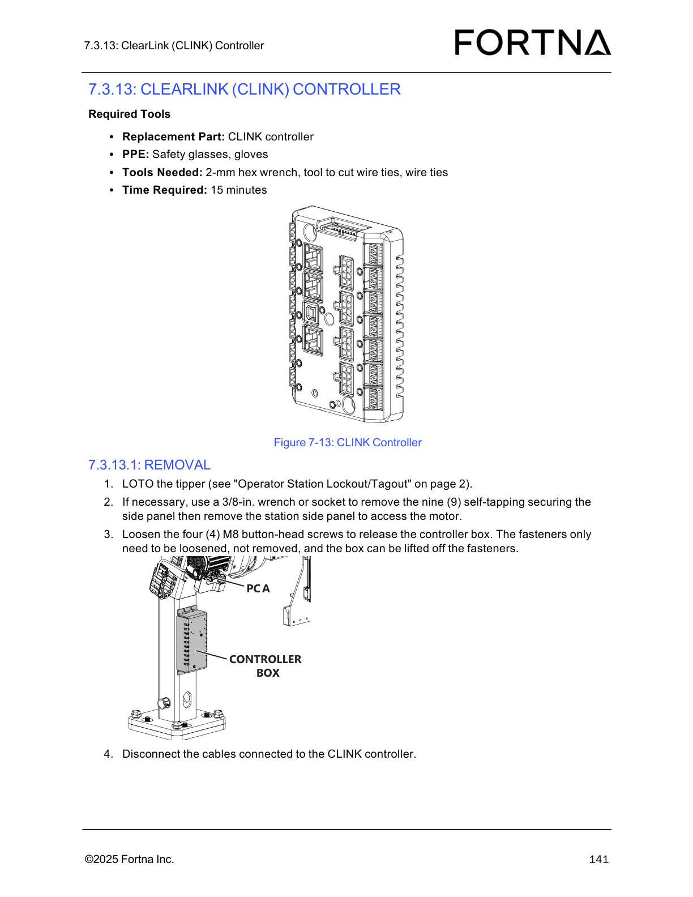

# Remove and replace a Limit/Home sensor (A-axis or Z-axis) with LOTO

## Runbook Header

| Field | Value |
| --- | --- |
| Procedure ID | `proc_remove_replace_limit_home_sensor_loto_v1` |
| Title | Remove and replace a Limit/Home sensor (A-axis or Z-axis) with LOTO |
| Procedure Type | `recovery` |
| Primary Role | `operator` |
| Supporting Roles | None |
| Support Safe | Yes |
| Capability Tags | `tipper_station_fault` |
| Access Surface | `physical_floor` |
| Audience Roles | `operator` |
| Failure Pattern Tags | None |
| Validation Status | `needs_sme_review` |
| Merge Status | `source_finalized` |

## Summary

Perform LOTO on the OptiSweep tipper, unplug the defective Limit/Home proximity sensor, and remove it from its mounting location. A-axis sensors are unplugged from a PCA near the A-axis motor; Z-axis sensors are unplugged from the CLINK controller inside the control box.

## When To Use

Use when a Limit/Home proximity sensor (A-axis or Z-axis) is defective and must be unplugged and physically removed for replacement.

## Safety And Operational Notes

* Perform LOTO on the tipper before unplugging or removing the sensor.

## Access Or Tools Needed

* Physical access to the tipper for LOTO
* Safety glasses and gloves (PPE)
* 1.5-mm hex wrench
* Tool to cut wire ties
* Wire ties
* Replacement part: Limit sensor or home sensor

## Visual References

*Controller PCA diagram showing the controller box and access context for controller-related components (used for visual orientation of the control box area).*

*CLINK controller diagram showing controller box access and cable connections (used for Z-axis sensor location context).*

*A-axis PCA connections diagram showing where A-axis sensor wiring plugs into the PCA after routing through the wire routing hole.*

## Procedure Steps

### Step 1 — Perform LOTO on the tipper

**Responsible role:** operator

**Instruction:**
Apply Operator Station Lockout/Tagout to the tipper (LOTO the tipper).

**Expected result:**
The tipper is in a locked-out/tagged-out state prior to sensor unplugging/removal.

**Stop or Escalate If:**

* Escalate if LOTO cannot be completed or the tipper lockout/tagout controls are not accessible/clear.

---

### Step 2 — Unplug the sensor

**Responsible role:** operator

**Instruction:**
Unplug the Limit/Home sensor.

**Expected result:**
The defective sensor is electrically disconnected (unplugged) from its connection point.

**Stop or Escalate If:**

* Stop and escalate if the sensor cannot be unplugged without forcing (risk of damaging the PCA/CLINK controller wiring or the wire routing).

---

### Step 3 — Identify sensor type by location (A-axis vs Z-axis)

**Responsible role:** operator

**Instruction:**
Identify whether the defective sensor is an A-axis sensor or a Z-axis sensor by its location and connection type.

**Expected result:**
You correctly determine the sensor location: A-axis sensors are plugged into a PCA near the A-axis motor; Z-axis sensors are plugged into the CLINK controller inside the control box.

---

### Step 4 — Remove the mounting screw and feed the sensor through the wire routing hole

**Responsible role:** operator

**Instruction:**
Remove the M3 button-head screw holding the sensor in place and feed the sensor through the hole where the wire is routed.

**Expected result:**
The sensor is unfastened (M3 button-head screw removed) and can be fed through the wire routing hole.

**Stop or Escalate If:**

* Stop and escalate if the sensor cannot be unplugged or removed without forcing (risk of damaging the PCA/CLINK controller wiring or the wire routing).

---

### Step 5 — For Z-axis sensors: pull the sensor from the column

**Responsible role:** operator

**Instruction:**
If the sensor is Z-axis, pull the Z-axis sensor from the column.

**Expected result:**
The Z-axis sensor is fully removed from the column.

**Stop or Escalate If:**

* Stop and escalate if the sensor cannot be unplugged or removed without forcing (risk of damaging the PCA/CLINK controller wiring or the wire routing).

---

### Step 6 — For A-axis sensors: pull the sensor away; cut wire tie if needed

**Responsible role:** operator

**Instruction:**
If the sensor is A-axis, pull the defective A-axis sensor away. If needed, cut the wire tie to free the sensor.

**Expected result:**
The A-axis sensor is removed from its mounting location; any wire tie that blocks removal is cut if required.

**Stop or Escalate If:**

* Stop and escalate if the sensor cannot be unplugged or removed without forcing (risk of damaging the PCA/CLINK controller wiring or the wire routing).

---

## Success Criteria

* Defective Limit/Home sensor is physically removed from its mounting location.
* Sensor electrical connection is unplugged.
* For A-axis sensors, any wire tie blocking removal is cut if required.

## Failure Conditions

* Sensor cannot be unplugged or removed without forcing (risk of damaging PCA/CLINK controller wiring or wire routing).
* LOTO cannot be completed or tipper lockout/tagout controls are not accessible/clear.

## Escalation Guidance

* Escalate if LOTO cannot be completed or the tipper lockout/tagout controls are not accessible/clear.
* Stop and escalate if the sensor cannot be unplugged or removed without forcing (risk of damaging PCA/CLINK controller wiring or wire routing).

## Missing Details / Known Gaps

* Operator Station Lockout/Tagout control locations/steps are referenced as "see Operator Station Lockout/Tagout on page 2" but the page content is not included in this packet; the runbook cannot specify the exact UI/control actions.

## Source Lineage

- Candidate IDs: candidate_manual_optisweep_remove_limit_home_sensor
- Source ID: `manual_optisweep_om_v3`
- Source Type: `manual`
