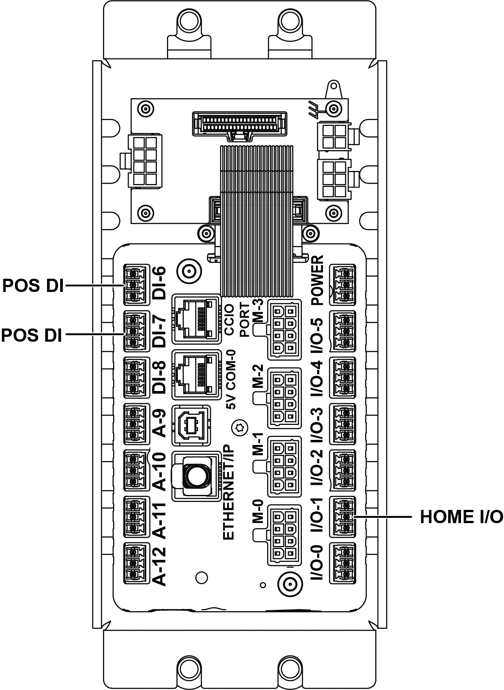

# Route a replacement sensor through the frame, connect M8, reinstall M3 screw, and re-start the operator station

## Runbook Header

| Field | Value |
| --- | --- |
| Procedure ID | `proc_route_replacement_sensor_through_frame_connect_m8_reinstall_m3_restart_operator_station_v1` |
| Title | Route a replacement sensor through the frame, connect M8, reinstall M3 screw, and re-start the operator station |
| Procedure Type | `operation` |
| Primary Role | `operator` |
| Supporting Roles | None |
| Support Safe | Yes |
| Capability Tags | `tipper_station_fault` |
| Access Surface | `physical_floor`, `tipper_hmi` |
| Audience Roles | `operator` |
| Failure Pattern Tags | None |
| Validation Status | `needs_sme_review` |
| Merge Status | `source_finalized` |

## Summary

Route a replacement sensor through the frame, connect the M8 connection, reinstall the M3 button-head screw, reinstall any removed grommets, and re-start the operator station.

## When To Use

Use when a replacement sensor must be installed by routing it through the frame, securing it with the M8 connection and M3 button-head screw, and then re-starting the operator station.

## Safety And Operational Notes

* The provided evidence references LOTO in other maintenance figures/sections, but this specific sensor-routing/restart excerpt does not explicitly state LOTO. If your site procedure requires LOTO for sensor replacement work, follow that site requirement.

## Access Or Tools Needed

* Physical access to the sensor frame and M8 connector
* Tools needed are not fully listed in the provided excerpt; use the manual’s sensor tool list for the specific sensor type being replaced
* Operator station access to perform the referenced 'Starting The Operator Station' procedure

## Visual References

*A-Axis PCA connections diagram showing sensor wire routing around the gearbox and the PCA connection point; also references re-start of the operator station.*

*Z-Axis CLINK connections diagram showing sensor wire routing through the column and out the lower grommet into the control box, and plugging into I/O1, DI6, or DI7; also references re-start of the operator station.*

## Procedure Steps

### Step 1 — Tape the replacement sensor to the M8 connector to route it through the frame

**Responsible role:** operator

**Instruction:**
Tape the replacement sensor to the M8 connector so the old sensor can be used to route the new sensor through the frame.

**Expected result:**
The replacement sensor is taped to the M8 connector in a way that allows the old sensor to be used to pull/route the new sensor through the frame.

**Stop or Escalate If:**

* Sensor cannot be routed through the frame without excessive force.

---

### Step 2 — Pull the sensor out

**Responsible role:** operator

**Instruction:**
Pull the sensor out.

**Expected result:**
The old sensor is pulled out after routing the replacement sensor through the frame.

---

### Step 3 — Route the sensor through the frame

**Responsible role:** operator

**Instruction:**
Route the sensor through the frame.

**Expected result:**
The sensor is routed through the frame.

**Stop or Escalate If:**

* Sensor cannot be routed through the frame without excessive force.

---

### Step 4 — Connect the M8 connection and re-install the M3 button-head screw

**Responsible role:** operator

**Instruction:**
Connect the M8 connection and re-install the M3 button-head screw.

**Expected result:**
The M8 connection is connected and the M3 button-head screw is reinstalled.

---

### Step 5 — Re-install any removed grommets

**Responsible role:** operator

**Instruction:**
Re-install any removed grommets.

**Expected result:**
Any removed grommets are reinstalled.

**Stop or Escalate If:**

* Grommets cannot be reinstalled.

---

### Step 6 — Re-start the operator station

**Responsible role:** operator

**Instruction:**
Re-start the operator station (referenced as 'Starting The Operator Station' on page 66).

**Expected result:**
The operator station is restarted using the manual’s referenced procedure.

**Stop or Escalate If:**

* Operator station cannot be re-started using the referenced procedure.

---

## Success Criteria

* Replacement sensor is routed through the frame.
* M8 connection is connected.
* M3 button-head screw is reinstalled.
* Any removed grommets are reinstalled.
* Operator station is restarted successfully.

## Failure Conditions

* Sensor cannot be routed through the frame without excessive force.
* Grommets cannot be reinstalled.
* Operator station cannot be re-started using the referenced procedure.

## Escalation Guidance

* If the sensor cannot be routed without excessive force, or grommets cannot be reinstalled, stop and escalate.
* If the operator station cannot be re-started using the referenced procedure, stop and escalate.

## Missing Details / Known Gaps

* The excerpt does not explicitly name the exact sensor type for this routing block; confidence is low and the procedure is kept generic as 'replacement sensor'.
* The excerpt does not list the specific tools for the sensor type being replaced; it states to use the manual’s sensor tool list for the specific sensor type (not included in this packet).
* The excerpt references 'Starting The Operator Station' on page 66, but the actual start control steps/screenshot are not included in the provided packet; therefore the restart step cannot specify exact HMI controls.

## Source Lineage

- Candidate IDs: candidate_manual_optisweep_sensor_routing_m8_m3_restart_operator_station
- Source ID: `manual_optisweep_om_v3`
- Source Type: `manual`
