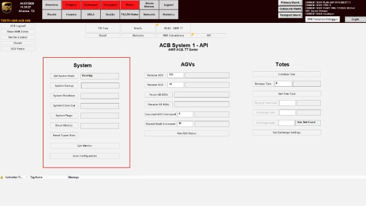

# Stop the OptiSweep System Using the System HMI API Screen (SYSTEM SHUTDOWN)

## Runbook Header

| Field | Value |
| --- | --- |
| Procedure ID | `proc_stop_optsweepsystem_via_system_hmi_api_screen_system_shutdown_v1` |
| Title | Stop the OptiSweep System Using the System HMI API Screen (SYSTEM SHUTDOWN) |
| Procedure Type | `operation` |
| Primary Role | `operator` |
| Supporting Roles | None |
| Support Safe | Yes |
| Capability Tags | `fleet_system_status` |
| Access Surface | `tipper_hmi` |
| Audience Roles | `operator` |
| Failure Pattern Tags | None |
| Validation Status | `needs_sme_review` |
| Merge Status | `source_finalized` |

## Summary

Use the system HMI API screen to initiate SYSTEM SHUTDOWN and confirm the AGVs transition to a shutdown queue between sorts.

## When To Use

When you need to stop the OptiSweep system between sorts so AGVs move to a shutdown queue.

## Safety And Operational Notes

* The system should be shutdown between sorts to allow AGVs to charge.

## Access Or Tools Needed

* Tipper HMI / WebVisu / VISU (system HMI access)

## Visual References

*System API Controls screen showing the System section and the System Shutdown control; includes note that System Shutdown shuts down the system and sends AGVs to a shutdown queue.*

*Operator station main screen image used in the stopping procedure; includes the SYSTEM SHUTDOWN step context (navigate to system HMI API screen, press SYSTEM SHUTDOWN).*

## Procedure Steps

### Step 1 — Navigate to the system API screen on the system HMI

**Responsible role:** operator

**Instruction:**
On the system HMI, navigate to the system API screen.

**Expected result:**
The system API screen is open and ready for the SYSTEM SHUTDOWN action.

---

### Step 2 — Press SYSTEM SHUTDOWN

**Responsible role:** operator

**Instruction:**
Press SYSTEM SHUTDOWN on the system API screen.

**Expected result:**
SYSTEM SHUTDOWN is initiated.

---

### Step 3 — Confirm AGVs transition to the shutdown queue

**Responsible role:** operator

**Instruction:**
Observe that the AGVs go to a shutdown queue after SYSTEM SHUTDOWN.

**Expected result:**
AGVs are in a shutdown queue state.

**Stop or Escalate If:**

* Escalate if AGVs do not transition to the shutdown queue after SYSTEM SHUTDOWN.

---

## Success Criteria

* After pressing SYSTEM SHUTDOWN, AGVs are in a shutdown queue state.

## Failure Conditions

* AGVs do not transition to the shutdown queue after SYSTEM SHUTDOWN.

## Escalation Guidance

* Escalate if AGVs do not transition to the shutdown queue after SYSTEM SHUTDOWN.

## Missing Details / Known Gaps

* The packet does not specify the exact live UI element/label used to confirm that AGVs are in the shutdown queue (e.g., which screen/field shows the queue state).

## Source Lineage

- Candidate IDs: candidate_manual_optisweep_stop_system_via_system_shutdown
- Source ID: `manual_optisweep_om_v3`
- Source Type: `manual`
