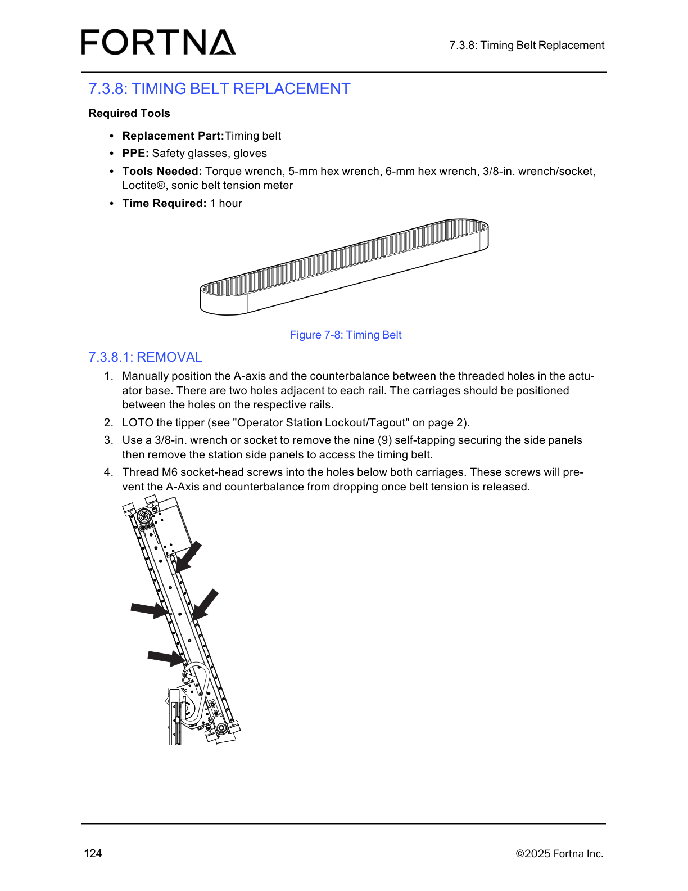

# Remove Timing Belt on Tipper Station (A-axis/counterbalance positioning, LOTO, side panel removal, belt access)

## Runbook Header

| Field | Value |
| --- | --- |
| Procedure ID | `proc_remove_timing_belt_on_tipper_station_a_axis_counterbalance_loto_side_panel_m6_screws_v1` |
| Title | Remove Timing Belt on Tipper Station (A-axis/counterbalance positioning, LOTO, side panel removal, belt access) |
| Procedure Type | `recovery` |
| Primary Role | `operator` |
| Supporting Roles | None |
| Support Safe | Yes |
| Capability Tags | `tipper_station_fault` |
| Access Surface | `physical_floor` |
| Audience Roles | `operator` |
| Failure Pattern Tags | None |
| Validation Status | `needs_sme_review` |
| Merge Status | `source_finalized` |

## Summary

Safely prepare the OptiSweep tipper station for timing belt replacement by manually positioning the A-axis/counterbalance between the actuator-base threaded holes, performing site “Operator Station Lockout/Tagout” on the tipper, removing the nine (9) self-tapping side-panel fasteners to access the timing belt, and threading M6 socket-head screws into the holes below both carriages to prevent dropping once belt tension is released.

## When To Use

Use this procedure when preparing the tipper station for timing belt replacement and you must (1) position the A-axis/counterbalance correctly, (2) lock out/tag out the tipper using the site Operator Station LOTO process, (3) remove the station side panels to access the timing belt, and (4) install M6 socket-head screws below both carriages before releasing belt tension.

## Do Not Use For

* Do not proceed to belt tension release unless the M6 socket-head screws are threaded into the holes below both carriages to prevent dropping.

## Safety And Operational Notes

* Perform LOTO on the tipper using the site’s “Operator Station Lockout/Tagout” process before removing side panels or accessing belt components.
* Do not release belt tension unless the M6 socket-head screws are threaded into the holes below both carriages to prevent the A-axis/counterbalance from dropping.

## Access Or Tools Needed

* Physical access to the tipper station
* PPE: safety glasses, gloves
* Replacement part: timing belt
* Torque wrench
* 5-mm hex wrench
* 6-mm hex wrench
* 3/8-in. wrench/socket
* Loctite®
* Sonic belt tension meter

## Visual References

*Timing Belt Replacement (7.3.8.1 REMOVAL) figure showing A-axis/counterbalance positioning between actuator-base threaded holes, side panel access, and M6 socket-head screws below both carriages.*

## Procedure Steps

### Step 1 — Manually position the A-axis and counterbalance between actuator-base threaded holes

**Responsible role:** operator

**Instruction:**
Manually position the A-axis and the counterbalance between the threaded holes in the actuator base. There are two holes adjacent to each rail; position the carriages between the holes on the respective rails.

**Expected result:**
The A-axis and counterbalance carriages are positioned between the threaded holes on their respective rails (two holes adjacent to each rail).

**Stop or Escalate If:**

* Stop and re-check positioning if the carriages are not between the threaded holes on their respective rails.

---

### Step 2 — Perform LOTO on the tipper using the site Operator Station Lockout/Tagout process

**Responsible role:** operator

**Instruction:**
Perform LOTO on the tipper using the site’s “Operator Station Lockout/Tagout” process.

**Expected result:**
The tipper is in a locked-out/tagged-out state per the site Operator Station Lockout/Tagout process.

**Stop or Escalate If:**

* Do not proceed if LOTO cannot be completed/verified for the tipper.

---

### Step 3 — Remove the nine (9) self-tapping side-panel fasteners and remove side panels to access the timing belt

**Responsible role:** operator

**Instruction:**
Use a 3/8-in. wrench or socket to remove the nine (9) self-tapping securing the station side panels, then remove the station side panels to access the timing belt.

**Expected result:**
The nine (9) self-tapping side-panel fasteners are removed and the station side panels are off, exposing the timing belt access area.

---

### Step 4 — Thread M6 socket-head screws into holes below both carriages to prevent dropping

**Responsible role:** operator

**Instruction:**
Thread M6 socket-head screws into the holes below both carriages. These screws will prevent the A-axis and counterbalance from dropping once belt tension is released.

**Expected result:**
M6 socket-head screws are installed in the holes below both carriages.

**Stop or Escalate If:**

* Do not release belt tension unless the M6 socket-head screws are threaded into the holes below both carriages to prevent dropping.

---

## Success Criteria

* A-axis and counterbalance are positioned between the actuator-base threaded holes with carriages between the holes on their respective rails.
* Tipper is LOTO’d using the site Operator Station Lockout/Tagout process.
* Nine (9) self-tapping side-panel fasteners are removed and side panels are off to access the timing belt.
* M6 socket-head screws are threaded into the holes below both carriages to prevent dropping once belt tension is released.

## Failure Conditions

* Carriages are not between the threaded holes on their respective rails.
* LOTO cannot be completed/verified for the tipper.
* Side panels cannot be removed because the nine self-tapping fasteners are not fully removed.
* M6 socket-head screws are missing below one or both carriages, making belt tension release unsafe.

## Escalation Guidance

* If positioning is incorrect, stop and re-check carriage placement between the threaded holes on their respective rails before continuing.
* If LOTO cannot be completed/verified for the tipper, stop and do not proceed.
* If M6 socket-head screws cannot be installed below both carriages, stop and do not release belt tension.

## Missing Details / Known Gaps

* The packet does not include the specific physical location/label of the tipper LOTO control points; it only references the site’s “Operator Station Lockout/Tagout” process.
* The packet does not include the exact visual identification of the nine (9) self-tapping fasteners on the side panels beyond the count and tool size; use the provided timing belt figure for general placement.

## Source Lineage

- Candidate IDs: candidate_manual_optisweep_timing_belt_replacement_removal
- Source ID: `manual_optisweep_om_v3`
- Source Type: `manual`
