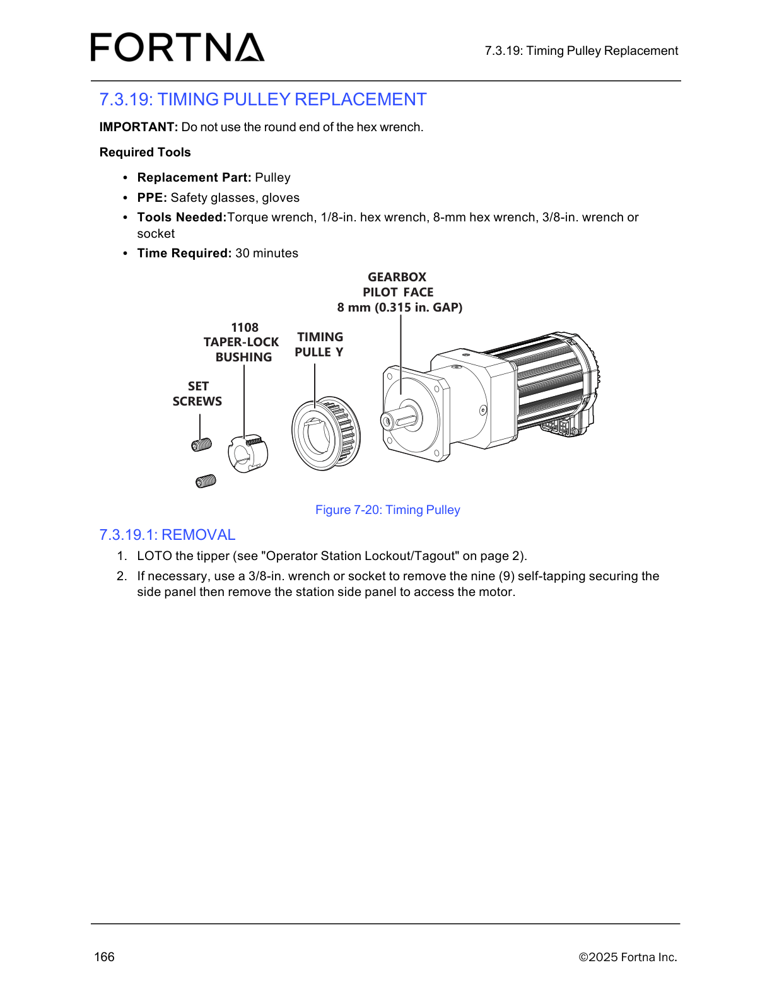

# LOTO the tipper and remove the station side panel to access the motor for Timing Pulley Replacement

## Runbook Header

| Field | Value |
| --- | --- |
| Procedure ID | `proc_loto_tipper_and_remove_station_side_panel_timing_pulley_replacement_v1` |
| Title | LOTO the tipper and remove the station side panel to access the motor for Timing Pulley Replacement |
| Procedure Type | `recovery` |
| Primary Role | `operator` |
| Supporting Roles | None |
| Support Safe | Yes |
| Capability Tags | `tipper_station_fault` |
| Access Surface | `physical_floor` |
| Audience Roles | `operator` |
| Failure Pattern Tags | None |
| Validation Status | `needs_sme_review` |
| Merge Status | `source_finalized` |

## Summary

Perform lockout/tagout (LOTO) for the specific tipper being serviced, then remove the station side panel (by removing nine self-tapping fasteners if needed) to access the motor area prior to Timing Pulley Replacement.

## When To Use

Use when you must service the tipper’s motor area for Timing Pulley Replacement and need safe physical access by applying LOTO and removing the station side panel.

## Do Not Use For

* Do not proceed with side panel removal if you cannot confirm LOTO is correctly applied to the tipper.

## Safety And Operational Notes

* Apply LOTO to the tipper using the manual’s referenced "Operator Station Lockout/Tagout" procedure on page 2 before accessing the motor area.

## Access Or Tools Needed

* Physical access to the tipper station
* PPE: safety glasses, gloves
* 3/8-in. wrench or socket
* Operator Station Lockout/Tagout procedure (page 2 reference in the manual)

## Visual References

*Exploded view of the Timing Pulley assembly (includes the LOTO + side panel removal prerequisites shown in the Timing Pulley Replacement removal section).*

## Procedure Steps

### Step 1 — Identify the specific tipper and perform LOTO

**Responsible role:** operator

**Instruction:**
Identify the specific tipper to be serviced. Perform LOTO for that tipper using the manual’s referenced "Operator Station Lockout/Tagout" procedure on page 2.

**Expected result:**
The tipper being serviced is locked out/tagged out.

**Stop or Escalate If:**

* Stop and re-verify LOTO is correctly applied before proceeding if lockout/tagout cannot be confirmed.

---

### Step 2 — Remove the station side panel (remove nine self-tapping fasteners if necessary)

**Responsible role:** operator

**Instruction:**
If necessary, use a 3/8-in. wrench or socket to remove the nine (9) self-tapping securing fasteners on the station side panel, then remove the station side panel to access the motor.

**Expected result:**
The nine self-tapping fasteners are removed (if needed) and the station side panel is removed, exposing the motor area.

**Stop or Escalate If:**

* If the side panel cannot be removed after removing the nine self-tapping fasteners, stop and escalate for assistance rather than forcing the panel.

---

## Success Criteria

* Tipper is locked out/tagged out.
* Station side panel is removed and the motor area is accessible.

## Failure Conditions

* LOTO cannot be confirmed as correctly applied to the tipper.
* Station side panel cannot be removed after removing the nine self-tapping fasteners.

## Escalation Guidance

* If the side panel cannot be removed after removing the nine self-tapping fasteners, stop and escalate for assistance rather than forcing the panel.

## Missing Details / Known Gaps

* The packet does not include the actual content of the referenced "Operator Station Lockout/Tagout" procedure on page 2 (only that it must be used).
* The packet does not include any additional live-system checks/observables beyond confirming LOTO and successful side panel removal.

## Source Lineage

- Candidate IDs: candidate_manual_optisweep_timing_pulley_replacement_loto_and_side_panel_access
- Source ID: `manual_optisweep_om_v3`
- Source Type: `manual`
