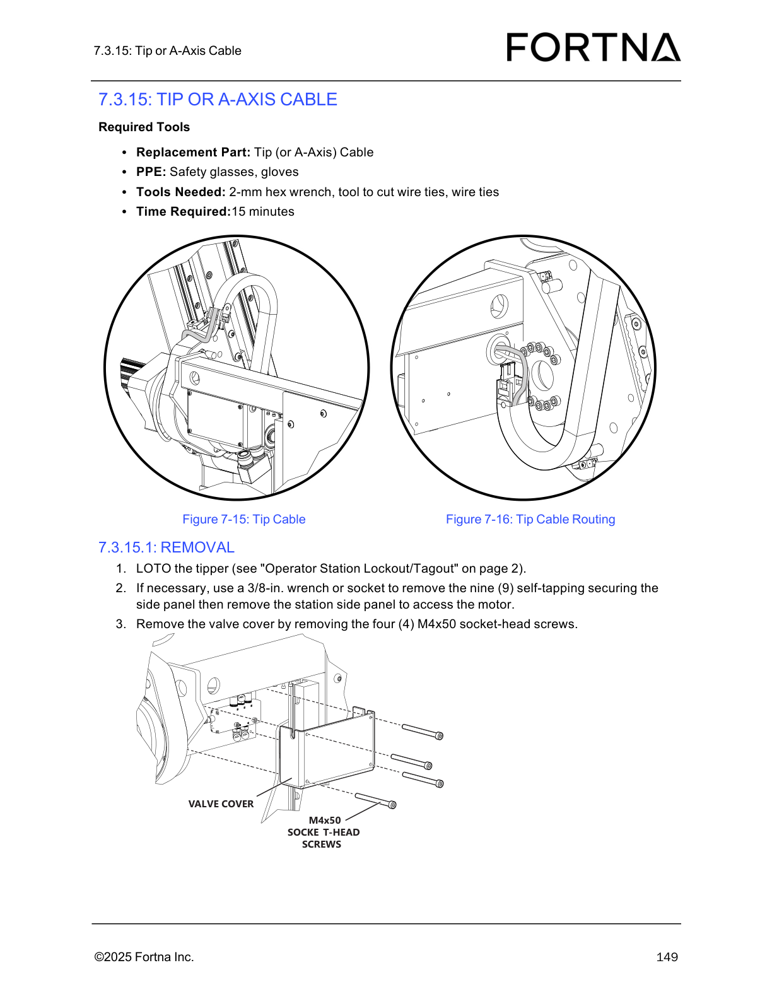

# Remove Tip (or A-Axis) Cable From Tipper/A-Axis Carriage

## Runbook Header

| Field | Value |
| --- | --- |
| Procedure ID | `proc_remove_tip_or_a_axis_cable_from_tipper_a_axis_carriage_v1` |
| Title | Remove Tip (or A-Axis) Cable From Tipper/A-Axis Carriage |
| Procedure Type | `recovery` |
| Primary Role | `operator` |
| Supporting Roles | None |
| Support Safe | Yes |
| Capability Tags | `tipper_station_fault` |
| Access Surface | `physical_floor` |
| Audience Roles | `operator` |
| Failure Pattern Tags | None |
| Validation Status | `needs_sme_review` |
| Merge Status | `source_finalized` |

## Summary

Safely remove the Tip (A-Axis) cable from the OptiSweep tipper station by performing LOTO, removing the station side panel and valve cover, disconnecting the four M8 connectors, routing the cable through the grommet, opening the snap-open cable carrier, cutting cable ties, and unplugging the cable from the A-axis PCA.

## When To Use

Use when the Tip (or A-Axis) cable must be physically disconnected/removed from the tipper station (e.g., for maintenance/replacement), following the manual’s removal steps.

## Safety And Operational Notes

* Perform LOTO on the tipper before removing the side panel/valve cover and disconnecting the cable.

## Access Or Tools Needed

* Physical access to the tipper station for LOTO and panel/cover removal
* PPE: safety glasses, gloves
* 2-mm hex wrench
* Tool to cut wire ties
* Wire ties (for later reinstallation, implied by required tools list)
* 3/8-in. wrench or socket (if side panel removal is necessary)
* Replacement part: Tip (or A-Axis) Cable

## Visual References

*Figure 7-15: Tip Cable (shows the Tip (A-Axis) cable referenced by the removal procedure).*

*Figure 7-16: Tip Cable Routing (shows the routing path for the Tip (A-Axis) cable inside the tipper station).*

*Removal procedure diagram for Tip (or A-Axis) cable: M8 connectors, grommet, snap-open cable carrier cross bars, cable tie locations, and A-axis PCA unplug point.*

## Procedure Steps

### Step 1 — Perform LOTO on the tipper

**Responsible role:** operator

**Instruction:**
Perform LOTO on the tipper (manual references "Operator Station Lockout/Tagout" on page 2).

**Expected result:**
Tipper is under LOTO prior to proceeding to side panel/valve cover removal and cable disconnection.

**Stop or Escalate If:**

* If LOTO cannot be completed, stop and escalate to FORTNA support.

---

### Step 2 — Remove the station side panel to access the motor (if necessary)

**Responsible role:** operator

**Instruction:**
If necessary, use a 3/8-in. wrench or socket to remove the nine (9) self-tapping screws securing the side panel, then remove the station side panel to access the motor.

**Expected result:**
Station side panel is removed, exposing the motor access area for subsequent valve cover removal.

**Stop or Escalate If:**

* Escalate to FORTNA support if access to the motor/valve cover cannot be achieved as described.

---

### Step 3 — Remove the valve cover

**Responsible role:** operator

**Instruction:**
Remove the valve cover by removing the four (4) M4x50 socket-head screws.

**Expected result:**
Valve cover is removed after taking out the four (4) M4x50 socket-head screws.

**Stop or Escalate If:**

* Escalate to FORTNA support if the valve cover cannot be removed as described.

---

### Step 4 — Disconnect all four (4) M8 connectors

**Responsible role:** operator

**Instruction:**
Disconnect all four (4) M8 connectors.

**Expected result:**
All four M8 connectors are disconnected from the A-axis carriage.

**Stop or Escalate If:**

* Stop and re-check if any M8 connectors remain connected.

---

### Step 5 — Route the cable through the grommet and feed M8 connectors one at a time

**Responsible role:** operator

**Instruction:**
Pull the jacketed part of the cable out of the grommet, then feed all the M8 connectors through the grommet one at a time.

**Expected result:**
Cable jacket is pulled out of the grommet and all four M8 connectors have been fed through the grommet.

**Stop or Escalate If:**

* Stop and re-check if the cable cannot be pulled free after opening the cable carrier cross bars.

---

### Step 6 — Open the snap-open cable carrier cross bars

**Responsible role:** operator

**Instruction:**
Open all of the cross bars on the outside of the cable carrier (snap-open type).

**Expected result:**
All cable carrier cross bars are opened (carrier is unlatched for cable removal).

**Stop or Escalate If:**

* Stop and re-check if the cable cannot be pulled free after opening the cable carrier cross bars.

---

### Step 7 — Mark the cable on both ends where it enters the cable carrier

**Responsible role:** operator

**Instruction:**
Use tape or a marker to mark the cable on both ends where the cable enters the cable carrier.

**Expected result:**
Two cable entry marks are applied (one at each end where the cable enters the cable carrier).

---

### Step 8 — Cut cable ties at both carrier ends and the A-axis carriage tie point

**Responsible role:** operator

**Instruction:**
Note how the cable ties are situated at both ends of the carrier (take a picture) and cut the cable ties holding the cable to the cable carrier at both ends and the tie point on the A-axis carriage.

**Expected result:**
Cable ties at both carrier ends and the A-axis carriage tie point are cut, freeing the cable from those restraints.

**Stop or Escalate If:**

* Stop and re-check if the cable is still attached by an uncut cable tie near the A-axis PCA (the procedure notes there may be one more cable tie to cut near the PCA).

---

### Step 9 — Unplug from the A-axis PCA and remove from the cable carrier

**Responsible role:** operator

**Instruction:**
Unplug the cable from the A-axis PCA and remove it from the cable carrier. There may be one more cable tie to cut near the PCA.

**Expected result:**
Cable is unplugged from the A-axis PCA and removed from the cable carrier.

**Stop or Escalate If:**

* Stop and re-check if the cable is still attached by an uncut cable tie near the A-axis PCA (the procedure notes there may be one more cable tie to cut near the PCA).

---

### Step 10 — Transfer the markings to the new cable

**Responsible role:** operator

**Instruction:**
Transfer the markings from Step 5 to the new cable.

**Expected result:**
Marks from the original cable are applied to the new cable at the corresponding entry points.

---

## Success Criteria

* All four M8 connectors are disconnected.
* Cable jacket is routed through the grommet and the cable is removed from the cable carrier.
* Cable carrier cross bars are opened.
* Cable ties at both carrier ends and the A-axis carriage tie point are cut.
* Cable is unplugged from the A-axis PCA.

## Failure Conditions

* Any M8 connector remains connected.
* Cable cannot be pulled free after opening the cable carrier cross bars.
* Cable remains attached due to an uncut tie near the A-axis PCA.

## Escalation Guidance

* Escalate to FORTNA support if LOTO cannot be completed or if access to the motor/valve cover cannot be achieved as described.

## Missing Details / Known Gaps

* The candidate references an image for the "Operator Station Lockout/Tagout" location/page, but no specific artifact for that page is included in the packet; LOTO is still required per the manual text reference.

## Source Lineage

- Candidate IDs: candidate_manual_optisweep_tip_a_axis_cable_removal
- Source ID: `manual_optisweep_om_v3`
- Source Type: `manual`
