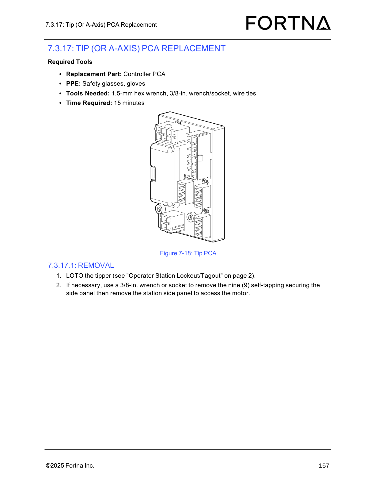
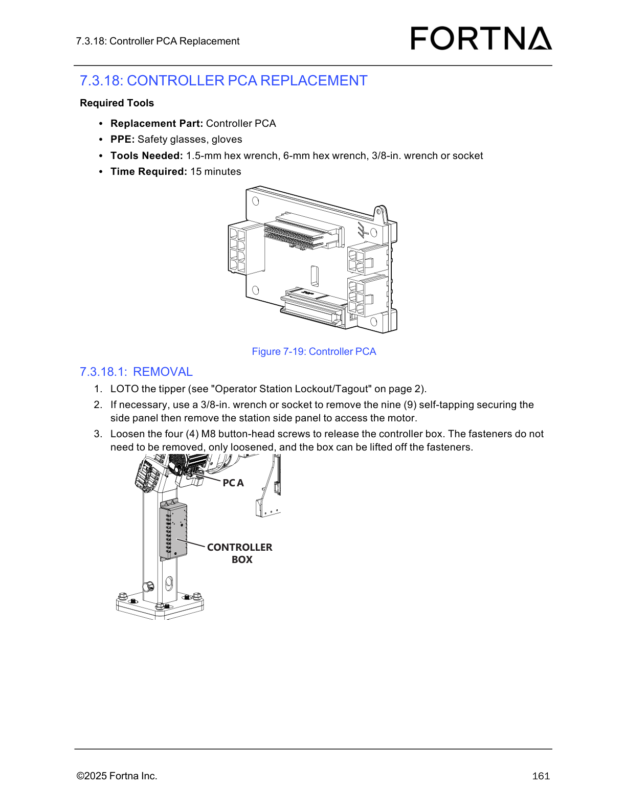

# Remove Tip (A-Axis) Controller PCA on the Tipper Station (LOTO + side panel access)

## Runbook Header

| Field | Value |
| --- | --- |
| Procedure ID | `proc_remove_tip_a_axis_controller_pca_tipper_station_loto_side_panel_v1` |
| Title | Remove Tip (A-Axis) Controller PCA on the Tipper Station (LOTO + side panel access) |
| Procedure Type | `recovery` |
| Primary Role | `operator` |
| Supporting Roles | None |
| Support Safe | Yes |
| Capability Tags | None |
| Access Surface | `physical_floor` |
| Audience Roles | `operator` |
| Failure Pattern Tags | None |
| Validation Status | `needs_sme_review` |
| Merge Status | `source_finalized` |

## Summary

Prepare the tipper for on-site Tip (or A-Axis) Controller PCA replacement by performing LOTO and removing the station side panel (when necessary) to access the motor/controller area.

## When To Use

Use when you need to replace the Tip (or A-Axis) Controller PCA and must first isolate the tipper (LOTO) and gain access to the motor/controller area by removing the station side panel if required.

## Do Not Use For

* Do not use this procedure as a substitute for the full LOTO steps in the referenced "Operator Station Lockout/Tagout" procedure (page 2).

## Safety And Operational Notes

* Perform LOTO for the tipper using the referenced "Operator Station Lockout/Tagout" procedure (page 2).
* Wear PPE: safety glasses and gloves.

## Access Or Tools Needed

* Physical access to the tipper station
* PPE: safety glasses, gloves
* Replacement part: Controller PCA
* 1.5-mm hex wrench
* 3/8-in. wrench or socket
* Wire ties
* LOTO procedure referenced as "Operator Station Lockout/Tagout" (page 2)

## Visual References

*Figure 7-18: Tip PCA diagram used to identify the Tip (A-Axis) PCA referenced in the replacement procedure.*

*Figure 7-19: Controller PCA diagram showing the controller box/mounting context (supports understanding of the motor/controller access area after side panel removal).*

## Procedure Steps

### Step 1 — Perform LOTO for the tipper

**Responsible role:** operator

**Instruction:**
At the tipper station, perform LOTO for the tipper using the referenced "Operator Station Lockout/Tagout" procedure (page 2).

**Expected result:**
The tipper is locked out/tagged out.

**Stop or Escalate If:**

* Stop and escalate if you cannot complete LOTO for the tipper.

---

### Step 2 — Remove the station side panel (if necessary) to access the motor

**Responsible role:** operator

**Instruction:**
If necessary, use a 3/8-in. wrench or socket to remove the nine (9) self-tapping securing screws for the station side panel, then remove the station side panel to access the motor.

**Expected result:**
The station side panel is removed (or confirmed unnecessary) such that the motor/controller access area is reachable.

**Stop or Escalate If:**

* Stop and escalate if the side panel cannot be removed after removing the nine (9) self-tapping securing screws (possible missing fasteners or incorrect panel).

---

## Success Criteria

* Tipper is locked out/tagged out.
* Station side panel is removed (or confirmed unnecessary) and the motor/controller access area is reachable for the next PCA removal step.

## Failure Conditions

* LOTO for the tipper cannot be completed.
* Side panel cannot be removed after removing the nine (9) self-tapping securing screws.

## Escalation Guidance

* Stop and escalate if you cannot complete LOTO for the tipper.
* Stop and escalate if the side panel cannot be removed after removing the nine (9) self-tapping securing screws (possible missing fasteners or incorrect panel).

## Missing Details / Known Gaps

* The packet excerpt only includes removal-prep steps (LOTO + side panel access). It does not include the subsequent steps to actually remove the Tip (A-Axis) Controller PCA.
* The packet references "Operator Station Lockout/Tagout" on page 2, but the specific LOTO control locations/steps are not included in the provided excerpt.

## Source Lineage

- Candidate IDs: candidate_manual_optisweep_tip_pca_replacement_removal
- Source ID: `manual_optisweep_om_v3`
- Source Type: `manual`
