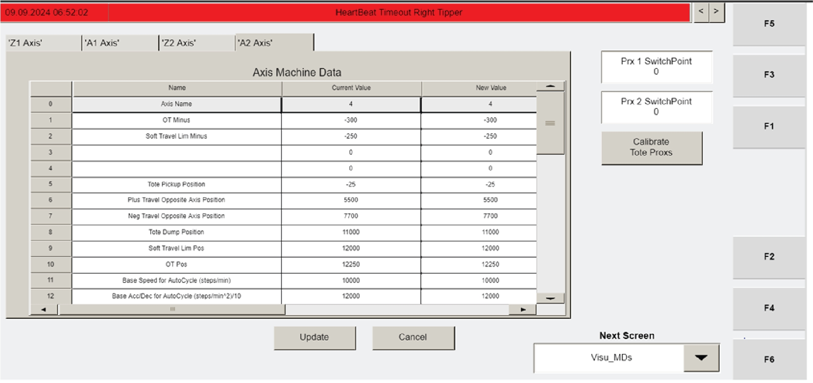

# Apply Power to Tipper Station (Electrical Panel Power Switch)

## Runbook Header

| Field | Value |
| --- | --- |
| Procedure ID | `proc_apply_power_to_tipper_station_electrical_panel_power_switch_v1` |
| Title | Apply Power to Tipper Station (Electrical Panel Power Switch) |
| Procedure Type | `operation` |
| Primary Role | `operator` |
| Supporting Roles | None |
| Support Safe | Yes |
| Capability Tags | `tipper_station_fault` |
| Access Surface | `physical_floor` |
| Audience Roles | `operator` |
| Failure Pattern Tags | None |
| Validation Status | `needs_sme_review` |
| Merge Status | `source_finalized` |

## Summary

Turn on electrical power to the tipper station by moving the electrical panel power switch to the "On" position as the first step of tipper commissioning.

## When To Use

Use as the first step when starting tipper commissioning to energize the tipper station before subsequent commissioning steps.

## Access Or Tools Needed

* Physical access to the tipper station electrical panel

## Related Operational Context

* ctx_manual_tipper_commissioning_apply_power_v1
* ctx_manual_tipper_commissioning_overview_v1

## Visual References

*Image associated with tipper commissioning step 7.3.23.1 showing the electrical panel power switch and its labeled position.*

## Procedure Steps

### Step 1 — Locate the electrical panel power switch at the tipper station

**Responsible role:** operator

**Instruction:**
Go to the tipper station electrical panel and locate the power switch.

**Expected result:**
You have identified the electrical panel power switch that will be moved to the "On" position.

**Stop or Escalate If:**

* Stop and escalate if the power switch cannot be moved to "On".

---

### Step 2 — Turn the electrical panel power switch to "On"

**Responsible role:** operator

**Instruction:**
Turn the power switch to the "On" position.

**Expected result:**
The electrical panel power switch is in the "On" position and the station is powered for subsequent commissioning steps.

**Stop or Escalate If:**

* Stop and escalate if the power switch cannot be moved to "On".
* Stop and escalate if the panel indicates an abnormal condition (e.g., no power indication/visible fault) that prevents commissioning from proceeding.

---

## Success Criteria

* Electrical panel power switch is in the "On" position.
* No abnormal panel indication is present that would prevent proceeding with commissioning.

## Failure Conditions

* Power switch cannot be moved to "On".
* Panel indicates an abnormal condition (e.g., no power indication/visible fault) that prevents commissioning from proceeding.

## Escalation Guidance

* If the power switch cannot be moved to "On" or the panel shows an abnormal condition preventing commissioning, stop and escalate.

## Missing Details / Known Gaps

* The candidate notes an image support need for the electrical panel power switch label/appearance; the packet does not provide switch label text in OCR, so the exact visual label beyond "On" is not specified.

## Source Lineage

- Candidate IDs: candidate_manual_optisweep_tipper_commissioning_apply_power
- Source ID: `manual_optisweep_om_v3`
- Source Type: `manual`
