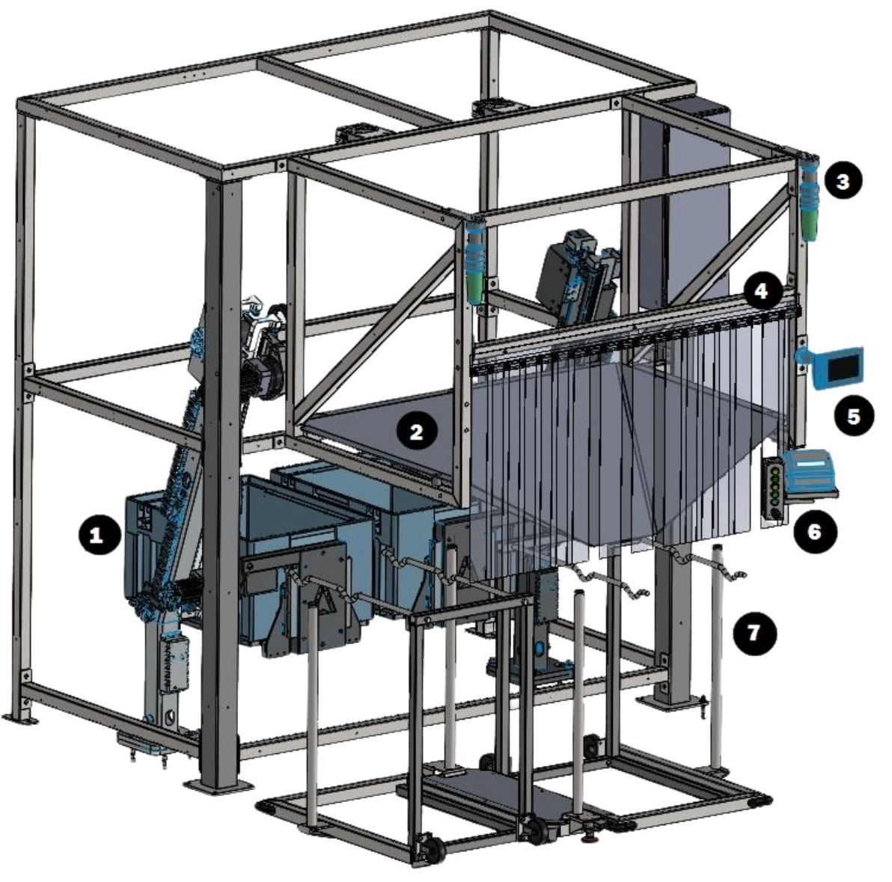

# Perform Daily Maintenance Checklist for Tipper (Operator Station, Chute, Stacklights, Guards, QR Codes)

## Runbook Header

| Field | Value |
| --- | --- |
| Procedure ID | `proc_perform_daily_maintenance_checklist_for_tipper_operator_station_chute_stacklights_guards_qr_codes_v1` |
| Title | Perform Daily Maintenance Checklist for Tipper (Operator Station, Chute, Stacklights, Guards, QR Codes) |
| Procedure Type | `operation` |
| Primary Role | `operator` |
| Supporting Roles | None |
| Support Safe | Yes |
| Capability Tags | `tipper_station_fault` |
| Access Surface | `physical_floor` |
| Audience Roles | `operator` |
| Failure Pattern Tags | None |
| Validation Status | `needs_sme_review` |
| Merge Status | `source_finalized` |

## Summary

Complete the daily inspection items for the OptiSweep tipper system to confirm key operator-station and physical components are in acceptable condition.

## When To Use

Use this daily checklist procedure to perform routine operator-station and physical inspections of the tipper system components: Operator Station controller, Operator Station chute, stacklights, guards/attaching hardware, and QR codes on the floor and racks.

## Safety And Operational Notes

* If any checklist item fails (controller damage, chute debris, non-operational stacklights, loose/unsafe guards, damaged/peeling QR codes), stop the checklist and escalate per site maintenance process.

## Access Or Tools Needed

* Physical access to the tipper operator station controller, chute, stacklights, guards, and QR codes on the floor and racks
* Daily Maintenance Checklist form (photocopiable)

## Related Operational Context

* ctx_manual_tipper_pm_schedule_v1

## Visual References

*Labeled photograph of the OptiSweep operator station showing the internal layout (tipper, chute, stacklight, plastic curtain, operator station HMI, push-buttons, rotary station). Useful for identifying the components referenced by the daily checklist.*

*Diagram of the Controller PCA and its mounting box within the OptiSweep tipper station. Useful for understanding what the “Operator Station controller” refers to visually.*

## Procedure Steps

### Step 1 — Record inspection metadata on the Daily Maintenance Checklist form

**Responsible role:** operator

**Instruction:**
On the Daily Maintenance Checklist form, record the Inspection Date, Inspected By, and Unit Inspected.

**Expected result:**
The form has entries for Inspection Date, Inspected By, and Unit Inspected.

---

### Step 2 — Inspect the Operator Station controller for damage

**Responsible role:** operator

**Instruction:**
Visually inspect the Operator Station controller for damage.

**Expected result:**
You can mark the checklist item as passing because no damage is found on the Operator Station controller.

**Stop or Escalate If:**

* If controller damage is found, stop the checklist and escalate per site maintenance process.

---

### Step 3 — Ensure the Operator Station chute is free of debris

**Responsible role:** operator

**Instruction:**
Inspect the Operator Station chute and ensure it is free of debris.

**Expected result:**
You can mark the checklist item as passing because no debris is present in the Operator Station chute.

**Stop or Escalate If:**

* If debris is found, stop the checklist and escalate per site maintenance process.

---

### Step 4 — Verify stacklights are operational

**Responsible role:** operator

**Instruction:**
Verify the stacklights are operational.

**Expected result:**
You can mark the checklist item as passing because the stacklights are operational.

**Stop or Escalate If:**

* If stacklights are non-operational, stop the checklist and escalate per site maintenance process.

---

### Step 5 — Inspect guards and verify attaching hardware is secure

**Responsible role:** operator

**Instruction:**
Inspect the guards and verify attaching hardware is secure.

**Expected result:**
You can mark the checklist item as passing because guards are secure and attaching hardware is secure.

**Stop or Escalate If:**

* If guards are loose/unsafe or attaching hardware is not secure, stop the checklist and escalate per site maintenance process.

---

### Step 6 — Inspect all QR codes on the floor for damage or peeling

**Responsible role:** operator

**Instruction:**
Inspect all QR codes on the floor for damage or peeling.

**Expected result:**
You can mark the checklist item as passing because all floor QR codes show no damage or peeling.

**Stop or Escalate If:**

* If any floor QR code is damaged or peeling, stop the checklist and escalate per site maintenance process.

---

### Step 7 — Inspect all QR codes on the racks for damage or peeling

**Responsible role:** operator

**Instruction:**
Inspect all QR codes on the racks for damage or peeling.

**Expected result:**
You can mark the checklist item as passing because all rack QR codes show no damage or peeling.

**Stop or Escalate If:**

* If any rack QR code is damaged or peeling, stop the checklist and escalate per site maintenance process.

---

## Success Criteria

* All checklist items can be marked as passing: no damage found on the Operator Station controller, chute is clear of debris, stacklights function, guards and attaching hardware are secure, and all floor/rack QR codes show no damage or peeling.

## Failure Conditions

* Damage found on the Operator Station controller
* Debris present in the Operator Station chute
* Stacklights are not operational
* Guards loose/attaching hardware not secure
* Floor QR codes damaged or peeling
* Rack QR codes damaged or peeling

## Escalation Guidance

* If any checklist item fails (controller damage, chute debris, non-operational stacklights, loose/unsafe guards, damaged/peeling QR codes), stop the checklist and escalate per site maintenance process.

## Missing Details / Known Gaps

* The manual checklist states to “Verify stacklights are operational” but the packet does not include an explicit definition of what “operational” looks like (e.g., which colors/states or how to test). The operator should use their on-site observation criteria for operational functionality until a stacklight test/observable criteria is provided in the source materials.

## Source Lineage

- Candidate IDs: candidate_manual_optisweep_tipper_daily_maintenance_checklist
- Source ID: `manual_optisweep_om_v3`
- Source Type: `manual`
