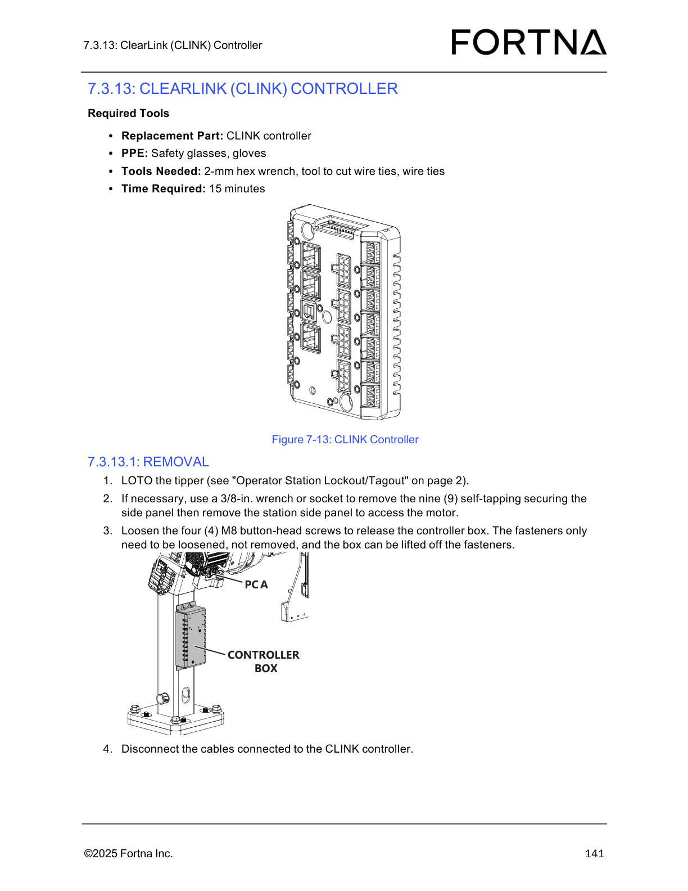
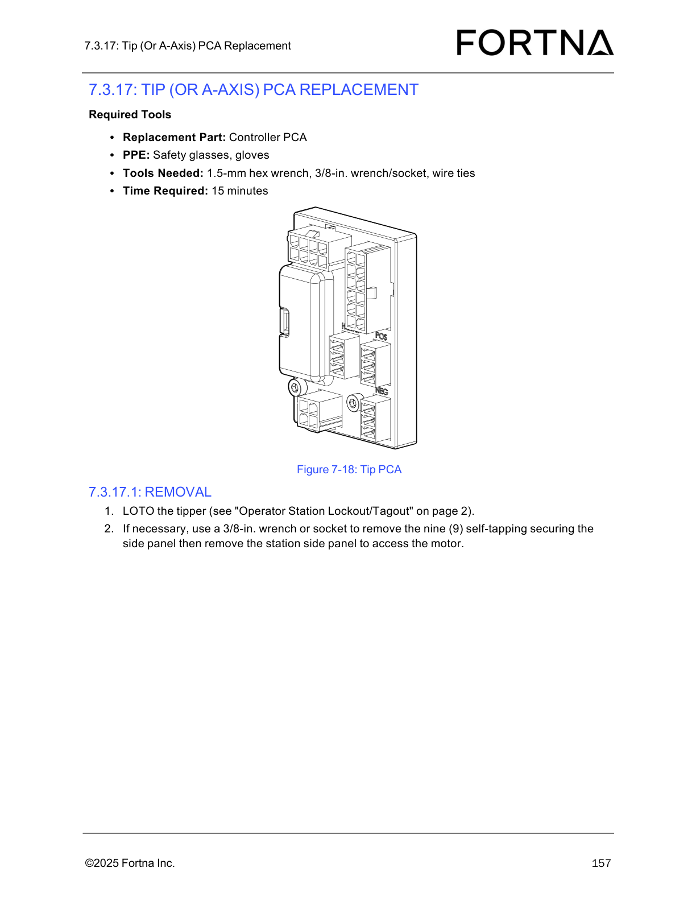
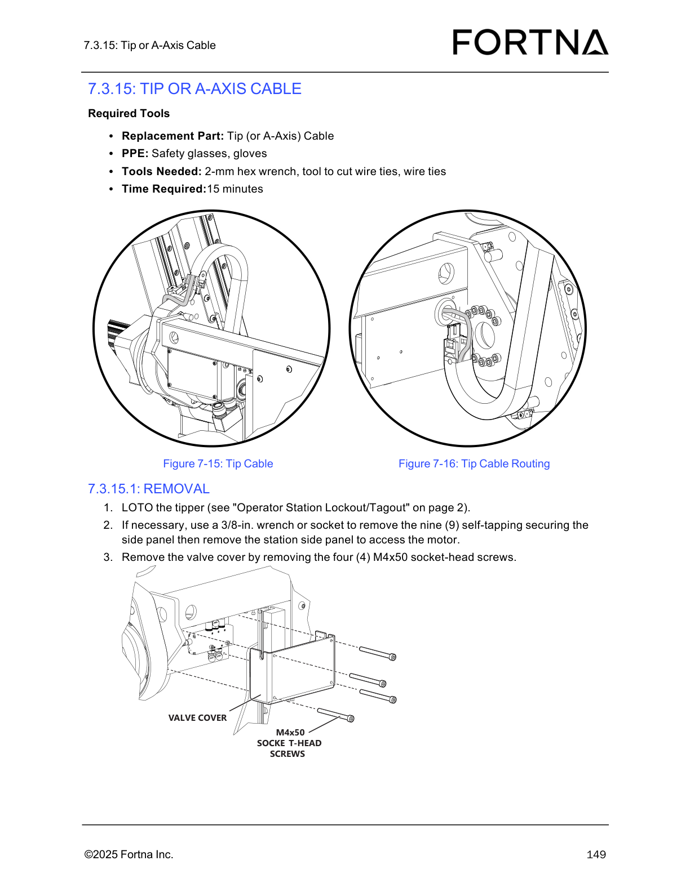
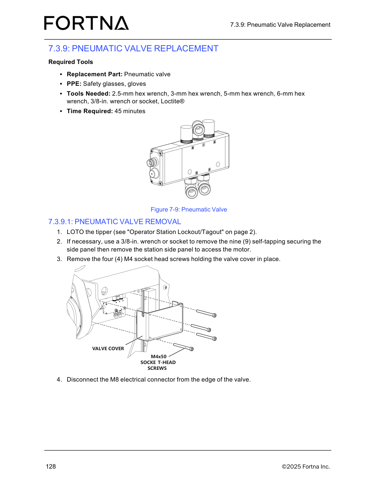
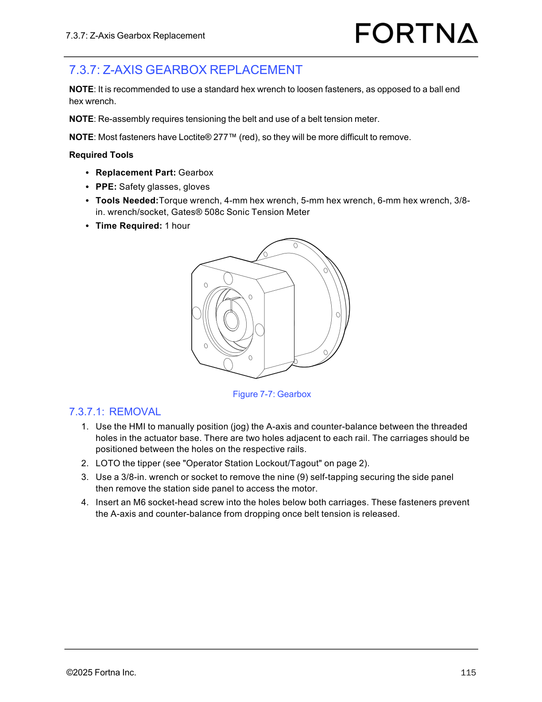
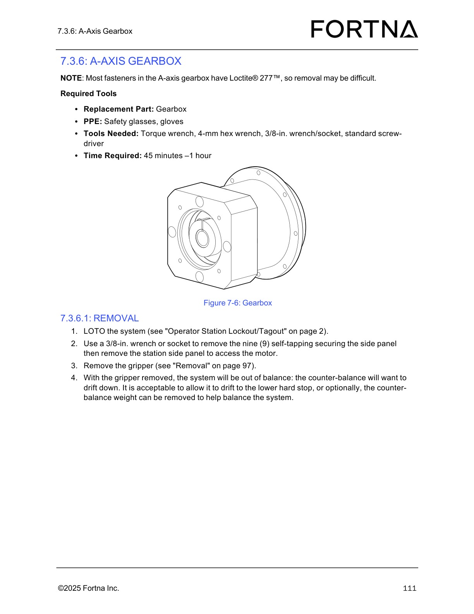
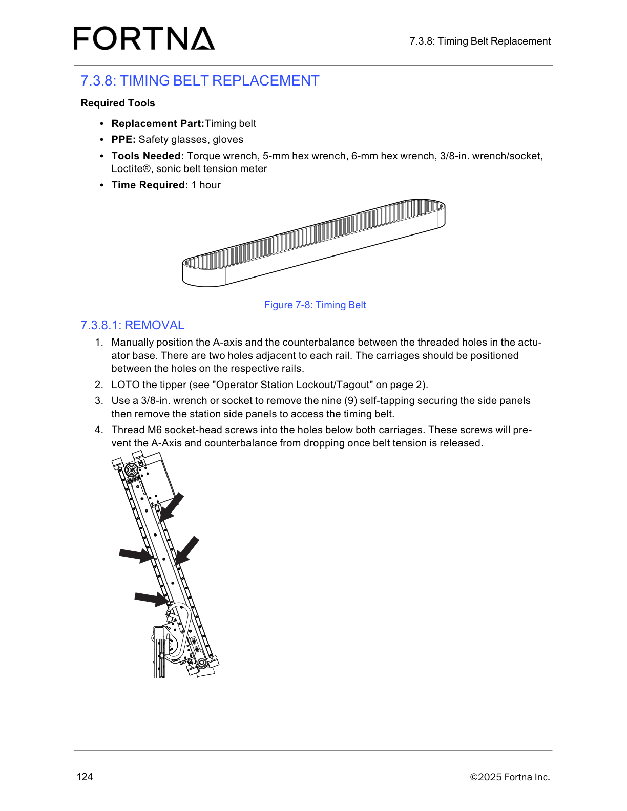

# Remove a Tipper (LOTO + disconnect power/air/Ethernet/conduit) for Tipper Replacement

## Runbook Header

| Field | Value |
| --- | --- |
| Procedure ID | `proc_remove_a_tipper_loto_disconnect_power_air_ethernet_conduit_v1` |
| Title | Remove a Tipper (LOTO + disconnect power/air/Ethernet/conduit) for Tipper Replacement |
| Procedure Type | `recovery` |
| Primary Role | `operator` |
| Supporting Roles | None |
| Support Safe | Yes |
| Capability Tags | None |
| Access Surface | `physical_floor` |
| Audience Roles | `operator` |
| Failure Pattern Tags | None |
| Validation Status | `needs_sme_review` |
| Merge Status | `source_finalized` |

## Summary

Safely remove a failed OptiSweep tipper from its station by applying lockout/tagout (LOTO) and disconnecting the tipper’s power (6-pin Molex), Ethernet (ClearLink controller), air line (quick disconnect), and the conduit bringing power/air/Ethernet to the column. Optionally remove the gripper and counter-balance weights before unbolting the tipper.

## When To Use

Use when a tipper must be physically removed for replacement and the documented removal connections (power, Ethernet, air, and conduit) must be safely disconnected after LOTO.

## Do Not Use For

* Do not use as a troubleshooting procedure for tipper alarms/heartbeat without performing the physical removal steps.
* Do not use if you cannot complete LOTO or cannot safely disconnect any of the required connections as described.

## Safety And Operational Notes

* Apply LOTO to the tipper before disconnecting power/Ethernet/air/conduit.
* Keep the tipper supported while removing the mounting screws.

## Access Or Tools Needed

* Physical access to the tipper station
* PPE: safety glasses, gloves
* Replacement part: Tipper (for later installation step; removal uses the existing tipper)
* 3/8-in. wrench or socket (if side panel removal is necessary)
* Tools to remove the nine (9) self-tapping securing screws for the side panel (if needed)
* Tools to remove the four (4) hex head screws holding the tipper to the sub-plate

## Visual References

*ClearLink (CLINK) controller diagram referenced for controller box access and cable disconnection during tipper removal.*

*Tip PCA diagram referenced for tipper station access context during removal.*

*Tip cable routing diagram referenced for cable routing context during tipper station access.*

*Pneumatic valve diagram referenced for pneumatic-side access context during tipper removal.*

*Gearbox diagram referenced for A-axis/counter-balance positioning context (used by related procedures).*

*A-axis gearbox diagram referenced for gripper/counter-balance balance context (used by related procedures).*

*Controller PCA diagram referenced for controller box access context during removal.*

*Timing belt diagram referenced for A-axis/counter-balance positioning context (used by related procedures).*

## Procedure Steps

### Step 1 — Apply LOTO to the tipper

**Responsible role:** operator

**Instruction:**
Perform lockout/tagout (LOTO) on the tipper using the operator station lockout/tagout controls referenced by the manual.

**Expected result:**
LOTO is applied to the tipper (tipper is isolated) before proceeding to disconnect power/Ethernet/air/conduit.

**Stop or Escalate If:**

* You cannot complete LOTO on the tipper.

---

### Step 2 — Remove station side panel (if necessary) to access the motor

**Responsible role:** operator

**Instruction:**
If necessary, use a 3/8-in. wrench or socket to remove the nine (9) self-tapping securing screws for the side panel, then remove the station side panel to access the motor.

**Expected result:**
Station side panel is removed and the motor area is accessible.

---

### Step 3 — Disconnect control box power (6-pin Molex) and push cable into the column

**Responsible role:** operator

**Instruction:**
Remove the control box and disconnect the power cable from the control box using the 6-pin Molex connector, then push the cable into the column.

**Expected result:**
Power cable is disconnected from the control box (6-pin Molex) and the cable is pushed into the column.

**Stop or Escalate If:**

* Any connection (power/ethernet/air/conduit) cannot be safely disconnected as described.

---

### Step 4 — Unplug Ethernet from the ClearLink controller and push into the column

**Responsible role:** operator

**Instruction:**
Unplug the Ethernet cable from the ClearLink controller and push the Ethernet cable into the column.

**Expected result:**
Ethernet cable is unplugged from the ClearLink controller and routed/pushed into the column.

**Stop or Escalate If:**

* Any connection (power/ethernet/air/conduit) cannot be safely disconnected as described.

---

### Step 5 — Disconnect air line at the quick disconnect (leave quick disconnect with tipper side of air line)

**Responsible role:** operator

**Instruction:**
Disconnect the air line at the quick disconnect at the bottom of the column, leaving the quick disconnect with the tipper side of the air line.

**Expected result:**
Air line is disconnected at the quick disconnect; the quick disconnect remains on the tipper side of the air line.

**Stop or Escalate If:**

* Any connection (power/ethernet/air/conduit) cannot be safely disconnected as described.

---

### Step 6 — Tape air line openings to prevent debris

**Responsible role:** operator

**Instruction:**
Add tape over the air line and quick disconnect to prevent debris from entering either side of the air line.

**Expected result:**
Tape is applied over the air line and quick disconnect openings on both sides to block debris ingress.

---

### Step 7 — Fully disconnect conduit bringing power/air/Ethernet to the column and pull cables free from the tipper

**Responsible role:** operator

**Instruction:**
Fully disconnect the conduit bringing power, air, and Ethernet to the column and pull these cables free from the tipper.

**Expected result:**
Conduit connections are freed from the tipper and the power/air/Ethernet cables are pulled free from the tipper.

**Stop or Escalate If:**

* Any connection (power/ethernet/air/conduit) cannot be safely disconnected as described.

---

### Step 8 — Optional: remove gripper and counter-balance weights

**Responsible role:** operator

**Instruction:**
Optional but recommended: remove the gripper (see Gripper Replacement) and the counter-balance weights (see Counter-balance weights) before unbolting the tipper.

**Expected result:**
Gripper and counter-balance weights are removed (if you choose to perform the optional steps).

---

### Step 9 — Remove four hex head screws holding tipper to sub-plate (tipper supported)

**Responsible role:** operator

**Instruction:**
With the tipper supported, remove the four (4) hex head screws holding the tipper to the sub-plate.

**Expected result:**
All four (4) hex head screws are removed while the tipper remains supported.

**Stop or Escalate If:**

* The tipper cannot be supported safely while removing the four (4) hex head screws.

---

## Success Criteria

* LOTO is applied to the tipper.
* Power is disconnected at the control box using the 6-pin Molex connector and the cable is pushed into the column.
* Ethernet is unplugged from the ClearLink controller and pushed into the column.
* Air line is disconnected at the quick disconnect at the bottom of the column with the quick disconnect left on the tipper side.
* Tape is applied over the air line and quick disconnect openings to prevent debris ingress.
* Conduit bringing power/air/Ethernet to the column is fully disconnected and cables are pulled free from the tipper.
* Four (4) hex head screws are removed while the tipper remains supported.

## Failure Conditions

* LOTO cannot be completed on the tipper.
* Any connection (power/ethernet/air/conduit) cannot be safely disconnected as described.
* Tipper cannot be supported safely while removing the four (4) hex head screws.

## Escalation Guidance

* Stop and escalate if you cannot complete LOTO or if any connection cannot be safely disconnected as described.
* Stop and escalate if the tipper cannot be supported safely while removing the four (4) hex head screws.

## Missing Details / Known Gaps

* Operator Station Lockout/Tagout control location/controls referenced on page 2 are not included in this packet; step 1 includes an image placeholder but no verified artifact for the lockout/tagout controls.

## Source Lineage

- Candidate IDs: candidate_manual_optisweep_tipper_replacement_removal
- Source ID: `manual_optisweep_om_v3`
- Source Type: `manual`
