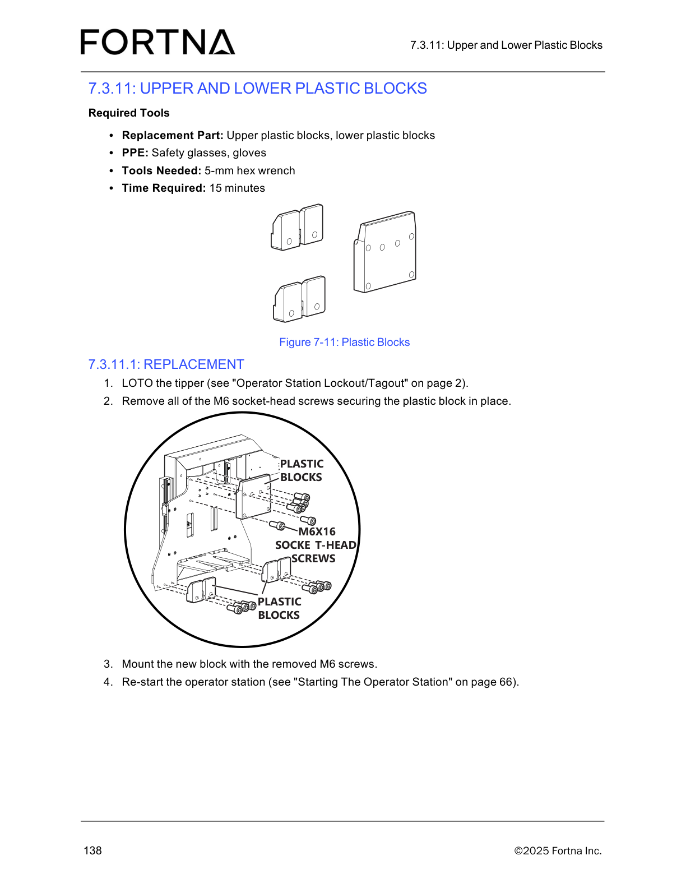
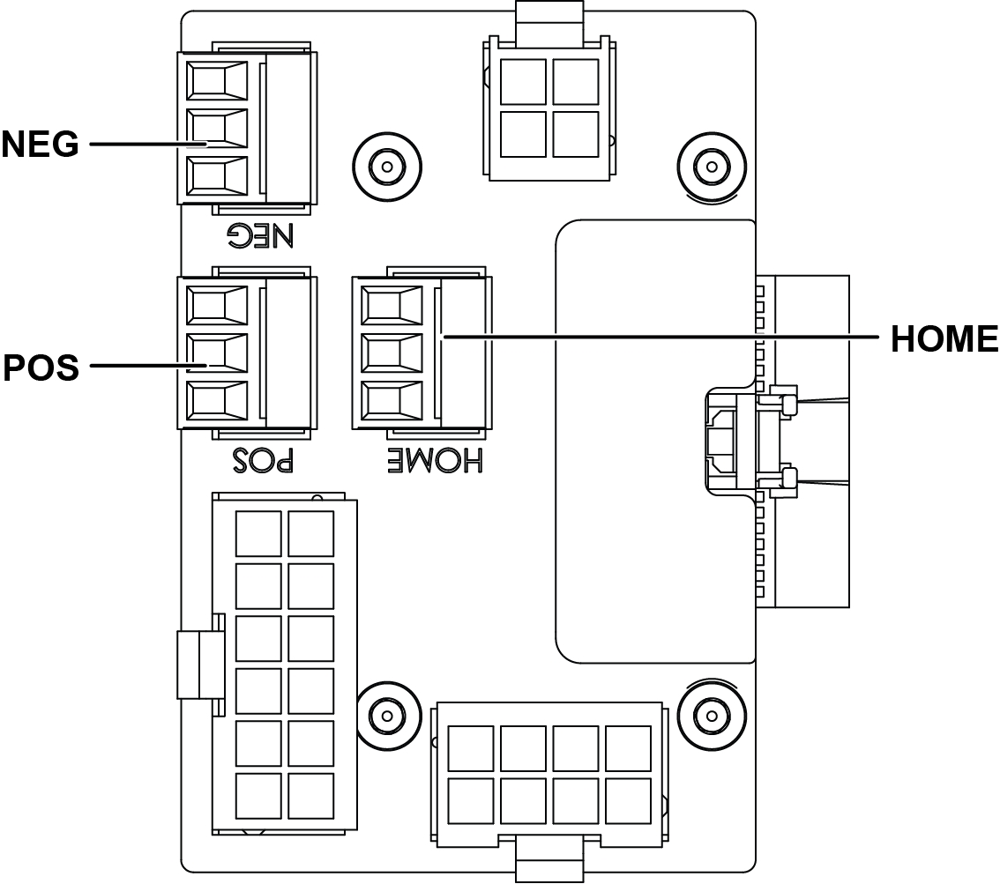

# Replace and Install Tote Detect Sensor (M3 screws + M8 connector) and Restart Operator Station

## Runbook Header

| Field | Value |
| --- | --- |
| Procedure ID | `proc_replace_and_install_tote_detect_sensor_m3_m8_restart_operator_station_v1` |
| Title | Replace and Install Tote Detect Sensor (M3 screws + M8 connector) and Restart Operator Station |
| Procedure Type | `operation` |
| Primary Role | `operator` |
| Supporting Roles | None |
| Support Safe | Yes |
| Capability Tags | `tipper_station_fault` |
| Access Surface | `tipper_hmi`, `physical_floor` |
| Audience Roles | `operator` |
| Failure Pattern Tags | None |
| Validation Status | `needs_sme_review` |
| Merge Status | `source_finalized` |

## Summary

Remove and replace the tote detect sensor by disconnecting the M8 connector and M3 socket-head screw, routing the replacement sensor through the frame (using the M8 connector/tape method), reinstalling grommets, mounting with M3 socket-head screws, reconnecting the M8 connector, and restarting the operator station so the sensor is ready for tote detection.

## When To Use

Use when a tote detect sensor must be replaced and reinstalled with the correct M3 socket-head screws and M8 connector, including routing through the frame and reinstalling grommets, followed by restarting the operator station.

## Safety And Operational Notes

* Perform LOTO on the tipper before disconnecting/removing the tote detect sensor and before restarting the operator station after work is complete (manual references "Operator Station Lockout/Tagout").

## Access Or Tools Needed

* Physical access to the tipper/operator station area
* PPE: safety glasses, gloves
* 1.5-mm hex wrench
* 6-mm hex wrench
* Replacement part: tote sensor
* LOTO capability for the tipper

## Visual References

*Example of a maintenance procedure that includes the manual instruction to re-start the operator station ("Re-start the operator station (see \"Starting The Operator Station\" on page 66)"). Use only as contextual evidence that restart is part of maintenance workflows; not a tote-sensor-specific restart control image.*

*Sensor wiring/connection diagram context for sensor installation and restart instruction (A-axis PCA connections; includes "Re-start the operator station").*

## Procedure Steps

### Step 1 — Perform LOTO on the tipper

**Responsible role:** operator

**Instruction:**
Apply LOTO to the tipper using the manual procedure referenced as "Operator Station Lockout/Tagout".

**Expected result:**
Tipper is under LOTO prior to disconnecting the M8 connector and M3 socket-head screw.

**Stop or Escalate If:**

* If LOTO cannot be applied/verified, stop and do not proceed with sensor disconnection/removal.

---

### Step 2 — Disconnect the M8 connector and M3 socket-head screw from the tote detect sensor

**Responsible role:** operator

**Instruction:**
Disconnect the M8 connector and the M3 socket-head screw from the tote detect sensor.

**Expected result:**
M8 connector is disconnected and the M3 socket-head screw is removed/loosened such that the sensor can be pulled out.

**Stop or Escalate If:**

* If the sensor cannot be disconnected cleanly, stop and re-check wiring/routing before continuing.

---

### Step 3 — Pull the sensor out

**Responsible role:** operator

**Instruction:**
Pull the tote detect sensor out after disconnecting the M8 connector and M3 socket-head screw.

**Expected result:**
Old tote detect sensor is removed from the frame.

**Stop or Escalate If:**

* If the sensor cannot be pulled out, stop and re-check that the M8 connector and M3 socket-head screw are fully disconnected.

---

### Step 4 — Route the replacement sensor through the frame using the M8 connector/tape method

**Responsible role:** operator

**Instruction:**
Route the replacement sensor through the frame by taping the replacement sensor to the M8 connector so the old sensor can be used to route the new sensor through the frame.

**Expected result:**
Replacement sensor is routed through the frame to the correct termination point for the M8 connector.

**Stop or Escalate If:**

* If routing is difficult or incorrect, stop and use the grommet-removal approach in the next step.

---

### Step 5 — If routing is difficult, pull grommets from the frame and re-install later

**Responsible role:** operator

**Instruction:**
If routing is difficult, pull the grommets from the frame to make routing easier, then re-install them later.

**Expected result:**
Sensor routing is completed successfully; grommets are available to be re-installed after routing.

**Stop or Escalate If:**

* If you cannot route the sensor even after pulling grommets, stop and re-check wiring/routing before proceeding to mounting.

---

### Step 6 — Mount the sensor using the M3 socket-head screws

**Responsible role:** operator

**Instruction:**
Mount the replacement sensor using the M3 socket-head screws.

**Expected result:**
Sensor is physically mounted using the M3 socket-head screws.

**Stop or Escalate If:**

* Stop and re-check wiring/routing if the sensor cannot be mounted securely with the M3 socket-head screws.

---

### Step 7 — Connect the M8 connector

**Responsible role:** operator

**Instruction:**
Connect the M8 connector to the tote detect sensor.

**Expected result:**
M8 connector is connected to the tote detect sensor.

**Stop or Escalate If:**

* If the M8 connector cannot be connected, stop and re-check wiring/routing before proceeding.

---

### Step 8 — Seat the small grommet around the wire back into the valve cover slot

**Responsible role:** operator

**Instruction:**
Put the small grommet around the wire back into the slot in the valve cover.

**Expected result:**
Small grommet is seated in the valve cover slot with the wire passing through it.

**Stop or Escalate If:**

* Stop and re-check wiring/routing if the grommet cannot be seated back into the valve cover slot.

---

### Step 9 — Re-install any removed grommets

**Responsible role:** operator

**Instruction:**
Re-install any removed grommets.

**Expected result:**
All grommets that were removed for routing are re-installed.

**Stop or Escalate If:**

* If any grommets cannot be reinstalled, stop and re-check routing before restarting the operator station.

---

### Step 10 — Re-start the operator station

**Responsible role:** operator

**Instruction:**
Re-start the operator station using the manual procedure "Starting The Operator Station".

**Expected result:**
Operator station is restarted after the sensor is installed and connected.

**Stop or Escalate If:**

* Escalate if the operator station cannot be restarted using the documented "Starting The Operator Station" procedure.

---

## Success Criteria

* Replacement tote detect sensor is physically mounted using M3 socket-head screws.
* M8 connector is connected to the tote detect sensor.
* Small grommet is seated in the valve cover slot around the wire.
* Any removed grommets are re-installed.
* Operator station is restarted successfully.

## Failure Conditions

* Sensor cannot be mounted securely with the M3 socket-head screws.
* Grommet cannot be seated back into the valve cover slot.
* Operator station cannot be restarted using the documented "Starting The Operator Station" procedure.

## Escalation Guidance

* If the operator station cannot be restarted using the documented "Starting The Operator Station" procedure, escalate per site support process.

## Missing Details / Known Gaps

* The packet does not include the specific page 66 image/screenshot for the operator station restart control; step 10 references the manual section "Starting The Operator Station" but no restart control image artifact is provided in this packet.
* The packet does not include the specific image/figure for the tote sensor routing through the frame and the tape-to-M8 connector method; step 4 references the manual routing instruction but no dedicated routing diagram artifact is provided in this packet.
* The packet does not include the specific image/figure for "Operator Station Lockout/Tagout" (page 2) referenced by the LOTO step.

## Source Lineage

- Candidate IDs: candidate_manual_optisweep_tote_detect_sensor_installation
- Source ID: `manual_optisweep_om_v3`
- Source Type: `manual`
