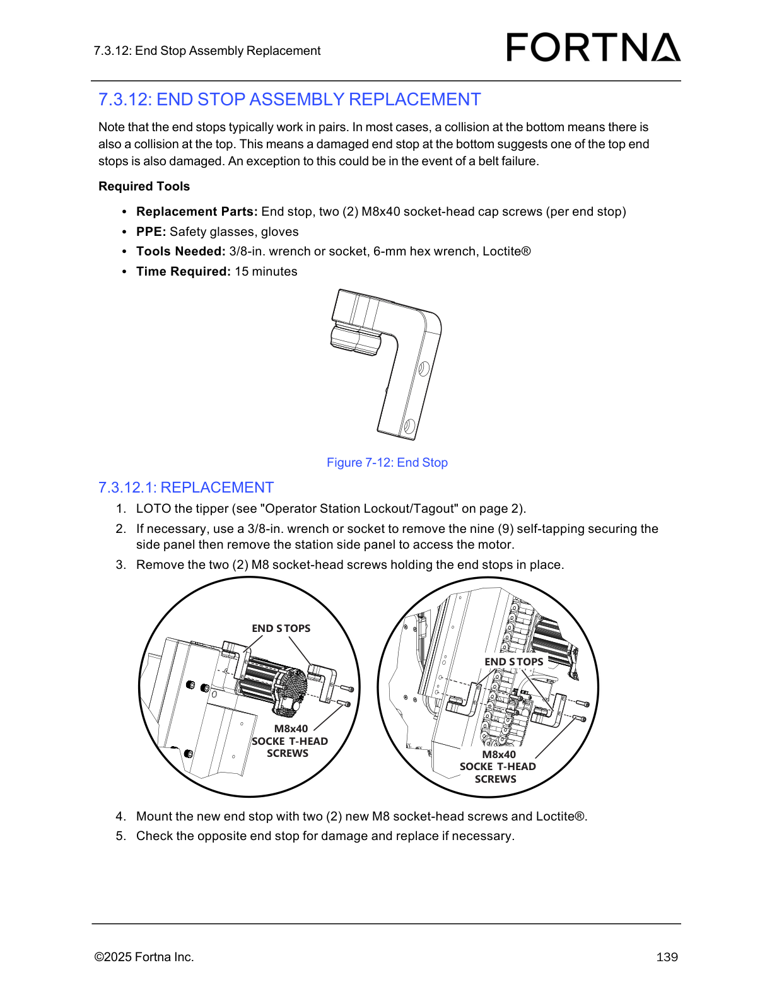
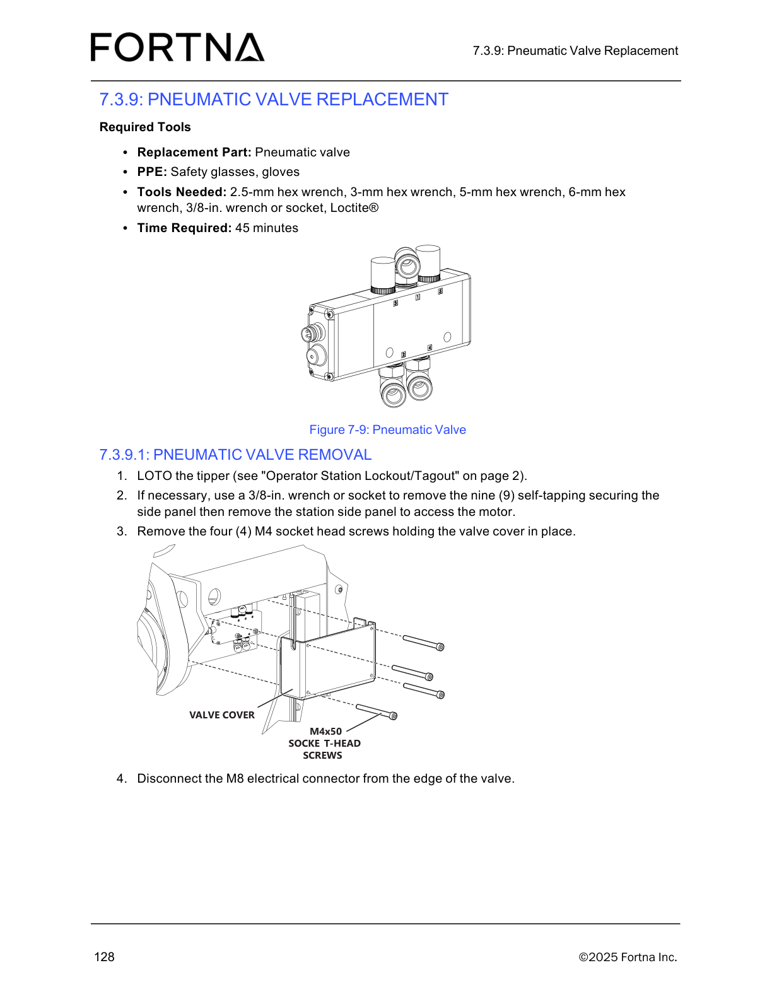
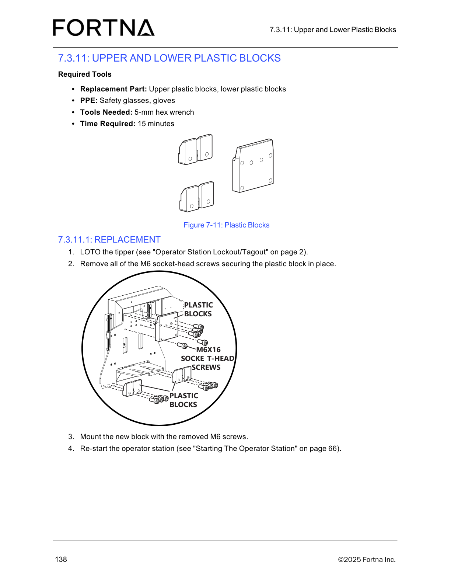

# Replace Tote Detect Sensor (LOTO tipper, disconnect M8, remove and remount sensor)

## Runbook Header

| Field | Value |
| --- | --- |
| Procedure ID | `proc_replace_tote_detect_sensor_loto_tippler_disconnect_m8_remove_remount_v1` |
| Title | Replace Tote Detect Sensor (LOTO tipper, disconnect M8, remove and remount sensor) |
| Procedure Type | `recovery` |
| Primary Role | `operator` |
| Supporting Roles | None |
| Support Safe | Yes |
| Capability Tags | `tipper_station_fault` |
| Access Surface | `physical_floor` |
| Audience Roles | `operator` |
| Failure Pattern Tags | None |
| Validation Status | `needs_sme_review` |
| Merge Status | `source_finalized` |

## Summary

Safely lock out the OptiSweep tipper, remove the Tote Detect sensor by disconnecting the M8 connector and M3 socket-head screw, pull the sensor out, mount the replacement sensor using the M3 socket-head screws, and restart the operator station.

## When To Use

Use when the Tote Detect sensor must be physically removed and replaced on the OptiSweep tipper (sensor replacement task).

## Safety And Operational Notes

* Perform LOTO of the tipper before disconnecting and removing the Tote Detect sensor.

## Access Or Tools Needed

* Physical access to the tipper and Tote Detect sensor
* PPE: safety glasses, gloves
* Tools: 1.5-mm hex wrench, 6-mm hex wrench
* Replacement part: Tote sensor
* Operator Station Lockout/Tagout procedure (page 2)
* Starting The Operator Station procedure (page 66)

## Visual References

*Manual maintenance diagram example for tipper LOTO/access and M8 hardware context (not Tote Detect sensor-specific).*

*Manual maintenance diagram example showing M8 electrical connector disconnect after LOTO (not Tote Detect sensor-specific).*

*Manual example that includes the pattern: LOTO → mount hardware → re-start the operator station (not Tote Detect sensor-specific).*

## Procedure Steps

### Step 1 — Identify the Tote Detect sensor location

**Responsible role:** operator

**Instruction:**
Use the manual’s “Sensors” section to identify the Tote sensor locations, then locate the Tote Detect sensor on the tipper/frame.

**Expected result:**
You have identified the correct Tote Detect sensor location on the tipper for the subsequent M8 disconnect and M3 screw removal.

**Stop or Escalate If:**

* Stop if you cannot identify the correct Tote Detect sensor location without guessing.

---

### Step 2 — LOTO the tipper

**Responsible role:** operator

**Instruction:**
Perform LOTO of the tipper using the manual’s “Operator Station Lockout/Tagout” procedure (page 2).

**Expected result:**
The tipper is in a locked out/tagged out state before any sensor disconnection/removal.

**Stop or Escalate If:**

* Stop if LOTO cannot be completed before proceeding.

---

### Step 3 — Disconnect the M8 connector and M3 socket-head screw

**Responsible role:** operator

**Instruction:**
Disconnect the M8 connector and remove the M3 socket-head screw securing the Tote Detect sensor.

**Expected result:**
The M8 connector is disconnected and the M3 socket-head screw is removed, allowing the sensor to be pulled out.

**Stop or Escalate If:**

* Stop and escalate if the sensor cannot be disconnected/reinstalled without forcing connectors or screws (risk of damage).

---

### Step 4 — Pull the sensor out

**Responsible role:** operator

**Instruction:**
Pull the Tote Detect sensor out of the frame/mount.

**Expected result:**
The Tote Detect sensor is removed from the frame/mount.

**Stop or Escalate If:**

* Stop if pulling requires forcing that could damage the sensor or wiring.

---

### Step 5 — Mount the replacement sensor with the M3 socket-head screws

**Responsible role:** operator

**Instruction:**
Mount the replacement Tote Detect sensor using the M3 socket-head screws.

**Expected result:**
The replacement sensor is mounted and secured with the M3 socket-head screws.

**Stop or Escalate If:**

* Stop and escalate if the sensor cannot be mounted without forcing connectors/screws (risk of damage).

---

### Step 6 — Restart the operator station

**Responsible role:** operator

**Instruction:**
Restart the operator station using the manual’s “Starting The Operator Station” procedure (page 66).

**Expected result:**
The operator station is restarted after the sensor replacement.

**Stop or Escalate If:**

* If the operator station cannot be restarted after installation, stop and escalate to the appropriate support procedure for operator station startup.

---

## Success Criteria

* Replacement Tote Detect sensor is physically mounted using the M3 socket-head screws.
* Operator station is restarted successfully after the sensor replacement.

## Failure Conditions

* Sensor cannot be disconnected/reinstalled without forcing connectors or screws (risk of damage).
* Operator station cannot be restarted after installation.

## Escalation Guidance

* If the sensor cannot be disconnected/reinstalled without forcing connectors or screws, stop and escalate to the appropriate support procedure for sensor replacement.
* If the operator station cannot be restarted after installation, stop and escalate to the appropriate support procedure for operator station startup.

## Missing Details / Known Gaps

* No sensor-location figure for the Tote Detect sensor is included in the provided packet artifacts; Step 1 cannot attach a Tote Detect-specific image reference.
* No operator station start control/power sequence screenshot is included in the provided packet artifacts; Step 6 cannot attach a start-control image reference.
* The packet does not include the specific LOTO page 2 content (lockout/tagout points/diagram) for the tipper; Step 2 references the procedure but cannot provide image evidence.

## Source Lineage

- Candidate IDs: candidate_manual_optisweep_tote_detect_sensor_removal_installation
- Source ID: `manual_optisweep_om_v3`
- Source Type: `manual`
