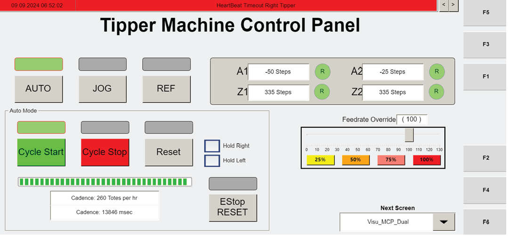

# Recover From AGV Motionless on Floor Fault (Locate AGV, E-stop Zone, Remove, Reset)

## Runbook Header

| Field | Value |
| --- | --- |
| Procedure ID | `proc_recover_from_agv_motionless_floor_fault_estop_reset_v1` |
| Title | Recover From AGV Motionless on Floor Fault (Locate AGV, E-stop Zone, Remove, Reset) |
| Procedure Type | `recovery` |
| Primary Role | `operator` |
| Supporting Roles | None |
| Support Safe | Yes |
| Capability Tags | `agv_physical_recovery` |
| Access Surface | `physical_floor`, `rms_ui` |
| Audience Roles | `operator` |
| Failure Pattern Tags | None |
| Validation Status | `needs_sme_review` |
| Merge Status | `source_finalized` |

## Summary

For an AGV that is motionless on the floor due to a fault, locate the faulted AGV (optionally using RMS for AGV error), stop the appropriate E-stop zone, remove the faulted AGV, pull E-STOP, and press the blue RESET button to resume operation.

## When To Use

Use when an AGV is motionless on the floor due to a fault and the system needs to be recovered so operation can resume.

## Safety And Operational Notes

* This procedure includes stopping an E-stop zone and pulling E-STOP; ensure safe physical handling and follow site safety practices while performing on-floor actions.

## Access Or Tools Needed

* Physical access to the appropriate E-STOP controls
* E-stop zone map
* Blue RESET button
* RMS / fleet status UI (if needed to identify the faulted AGV error)

## Related Operational Context

* ctx_manual_troubleshooting_agv_motionless_fault_v1

## Visual References

*RMS screen example used in the manual’s AGV fault recovery section (includes AGV fault description/exception code context).*

*Operator Station HMI photo showing a non-recoverable fault screen with manual jog mode and axis fault indicators (includes RESET availability context).*

*HMI screenshot for a faulted AGV with tote state; includes recovery-related actions (E-stop RMS, remove AGV via API controls, hospital handling, resume RMS).*

*AGV API Controls screen showing controls for AGV management (including Remove AGV and GET AGV STATUS).*

## Procedure Steps

### Step 1 — Locate the faulted AGV

**Responsible role:** operator

**Instruction:**
Locate the faulted AGV on the floor. If needed to identify the faulted AGV error, use the RMS / fleet status UI to determine which AGV is faulted.

**Expected result:**
You have identified the specific faulted AGV that is motionless on the floor.

---

### Step 2 — Stop the appropriate E-stop zone

**Responsible role:** operator

**Instruction:**
Reference the E-stop zone map and press E-STOP to stop the appropriate E-stop zone for the faulted AGV.

**Expected result:**
The appropriate E-stop zone is stopped (E-STOP action applied to the correct zone).

---

### Step 3 — Remove the faulted AGV

**Responsible role:** operator

**Instruction:**
Remove the faulted AGV from the floor/system area.

**Expected result:**
The faulted AGV has been removed.

---

### Step 4 — Pull E-STOP and press blue RESET

**Responsible role:** operator

**Instruction:**
Pull E-STOP, then press the blue RESET button.

**Expected result:**
The blue RESET button is pressed after pulling E-STOP.

---

### Step 5 — Verify the system resumes operation

**Responsible role:** operator

**Instruction:**
Observe the system after pressing blue RESET to confirm it resumes operation.

**Expected result:**
The system resumes operation.

**Stop or Escalate If:**

* If the system does not resume operation after RESET, stop and escalate to a supervisor/support for further troubleshooting.

---

## Success Criteria

* After pressing the blue RESET button, the system resumes operation.

## Failure Conditions

* System does not resume operation after RESET.

## Escalation Guidance

* If the system does not resume operation after RESET, stop and escalate to a supervisor/support for further troubleshooting.

## Missing Details / Known Gaps

* The packet does not provide the exact UI labels/locations for the blue RESET button or the specific E-stop zone map legend; it only states to use the E-stop zone map and press E-STOP.

## Source Lineage

- Candidate IDs: candidate_manual_optisweep_troubleshoot_agv_motionless_fault_estop_reset
- Source ID: `manual_optisweep_om_v3`
- Source Type: `manual`
