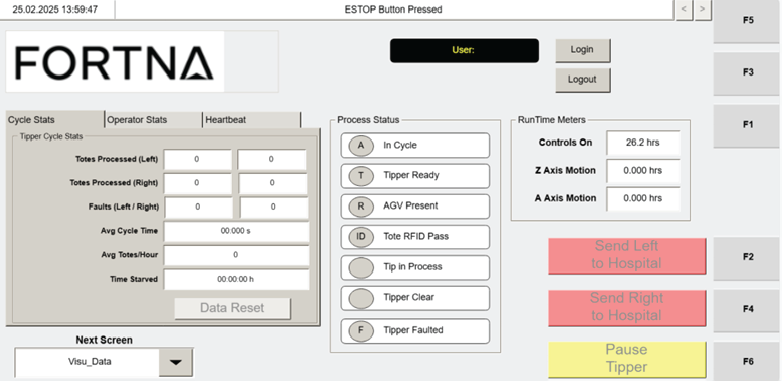
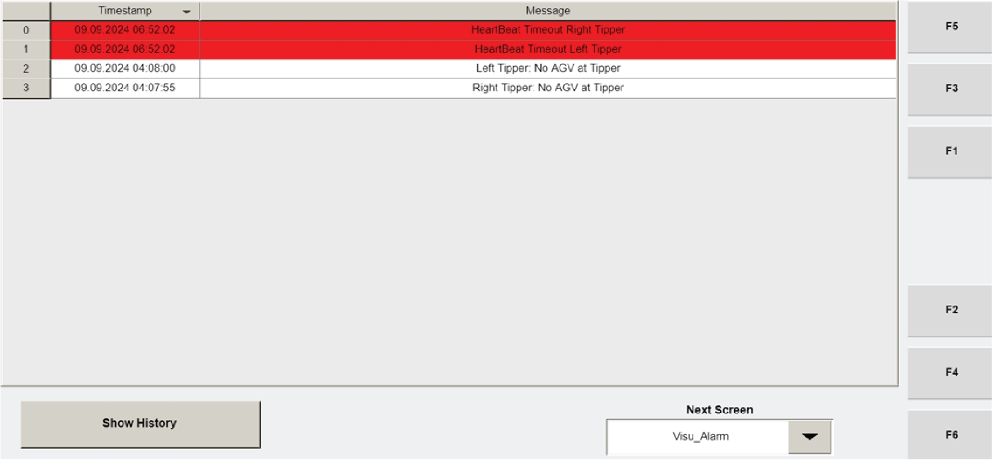

# Troubleshoot Too Many AGVs Directed to Hospital (Tipper Fault Beacon, Upstream Tipper Tote Count, E-stop)

## Runbook Header

| Field | Value |
| --- | --- |
| Procedure ID | `proc_troubleshoot_too_many_agvs_directed_to_hospital_tipper_fault_beacon_upstream_totes_estop_v1` |
| Title | Troubleshoot Too Many AGVs Directed to Hospital (Tipper Fault Beacon, Upstream Tipper Tote Count, E-stop) |
| Procedure Type | `recovery` |
| Primary Role | `L2_support` |
| Supporting Roles | None |
| Support Safe | Yes |
| Capability Tags | None |
| Access Surface | `tipper_hmi`, `physical_floor` |
| Audience Roles | `L2_support` |
| Failure Pattern Tags | None |
| Validation Status | `needs_sme_review` |
| Merge Status | `source_finalized` |

## Summary

When too many AGVs are being directed to the hospital, check for a tipper fault using the operator station fault beacon and correct it, then return the tipper to service. If upstream behavior is suspected, check each tipper’s tote sending to the Hospital Station; if at least five totes have been continuously sent, push E-STOP, call a supervisor, and investigate/correct why totes are being directed to the hospital station.

## When To Use

Use when the system is directing too many AGVs to the hospital and the corrective actions are to (1) clear a tipper fault indicated by the operator station fault beacon and return the tipper to service, and/or (2) identify upstream tote sending behavior to the Hospital Station and escalate with E-STOP when at least five totes are continuously sent.

## Safety And Operational Notes

* If the upstream condition is confirmed as continuously sending at least five totes to the hospital station, push E-STOP and call a supervisor (per troubleshooting corrective action).

## Access Or Tools Needed

* Operator station fault beacon (visual check)
* Physical access to each tipper to check tote sending behavior
* E-STOP (push) and ability to call a supervisor

## Related Operational Context

* ctx_manual_troubleshooting_too_many_agvs_hospital_v1

## Visual References

*Operator Station HMI Data Screen (VISU_DATA) showing the 'Tipper Stats' section including 'Totes Processed' and 'Totes sent to the Hospital Station' plus fault counts for left/right tippers.*

*Operator Station HMI Alarms Screen (Visu_Alarm) listing tipper alarms with timestamps and a SHOW HISTORY button (useful for reviewing tipper alarms while troubleshooting).*

## Procedure Steps

### Step 1 — Check operator station fault beacon for a tipper fault

**Responsible role:** L2_support

**Instruction:**
On the operator station, visually check the fault beacon for an indication of a tipper fault.

**Expected result:**
A tipper fault indication is observed on the operator station fault beacon (or no tipper fault indication is observed).

---

### Step 2 — Correct the tipper fault and return the tipper to service

**Responsible role:** L2_support

**Instruction:**
If the fault beacon indicates a tipper fault, correct the fault and return the tipper to service.

**Expected result:**
The tipper fault condition is corrected and the tipper is returned to service (so the excessive hospital-directed behavior is addressed).

---

### Step 3 — Check each tipper’s tote sending behavior to the hospital

**Responsible role:** L2_support

**Instruction:**
If upstream issues are suspected, go to each tipper and check how many totes are being sent to the Hospital Station.

**Expected result:**
For each tipper, you can determine the tote sending behavior to the Hospital Station (including whether it is continuously sending totes).

---

### Step 4 — Determine whether at least five totes have been continuously sent to the hospital station

**Responsible role:** L2_support

**Instruction:**
Using the tote sending behavior you observed for each tipper, determine whether at least five totes have been continuously sent to the Hospital Station.

**Expected result:**
You determine whether the continuous tote-sending threshold (>= 5 continuously sent totes) is met.

---

### Step 5 — Push E-STOP when the continuous tote-sending threshold is met

**Responsible role:** L2_support

**Instruction:**
If at least five totes have been continuously sent to the Hospital Station, push E-STOP.

**Expected result:**
E-STOP is pushed in response to the confirmed continuous tote-sending threshold.

**Stop or Escalate If:**

* If at least five totes have been continuously sent to the hospital station, proceed to supervisor escalation after pushing E-STOP.

---

### Step 6 — Call a supervisor after pushing E-STOP

**Responsible role:** L2_support

**Instruction:**
After pushing E-STOP, call a supervisor.

**Expected result:**
A supervisor is contacted/escalated following the E-STOP action.

---

### Step 7 — Investigate and correct why totes are being directed to the hospital station

**Responsible role:** L2_support

**Instruction:**
Investigate and correct the reason totes are being directed to the hospital station.

**Expected result:**
The upstream cause of continuous tote sending to the hospital station is identified and corrected.

---

## Success Criteria

* Tipper fault is corrected and the tipper is returned to service when the operator station fault beacon indicates a tipper fault.
* If upstream behavior is confirmed (>= 5 continuously sent totes to the Hospital Station), E-STOP is pushed, a supervisor is called, and the upstream cause of totes being directed to the hospital station is corrected.

## Failure Conditions

* Fault beacon continues to indicate a tipper fault after attempted correction.
* At least five totes continue to be continuously sent to the Hospital Station without successful correction of the upstream cause.

## Escalation Guidance

* When at least five totes have been continuously sent to the hospital station: push E-STOP and call a supervisor, then investigate/correct the reason totes are being directed to the hospital station.

## Missing Details / Known Gaps

* The manual states to 'Look for fault beacon on the operator station' but the packet does not provide a specific artifact showing the fault beacon location/appearance; the candidate requested an image but none is included in the provided artifacts.
* The manual instructs to 'go to each tipper and check how many totes are being sent to the hospital' but does not specify the exact live method/indicator for 'continuously sent' tote count at the tipper level; the VISU_DATA screen provides 'Totes sent to the Hospital Station' totals, but the packet does not define how to confirm 'continuously' from that display.

## Source Lineage

- Candidate IDs: candidate_manual_optisweep_troubleshoot_too_many_agvs_directed_to_hospital_fault_beacon_upstream_totes_estop_supervisor
- Source ID: `manual_optisweep_om_v3`
- Source Type: `manual`
