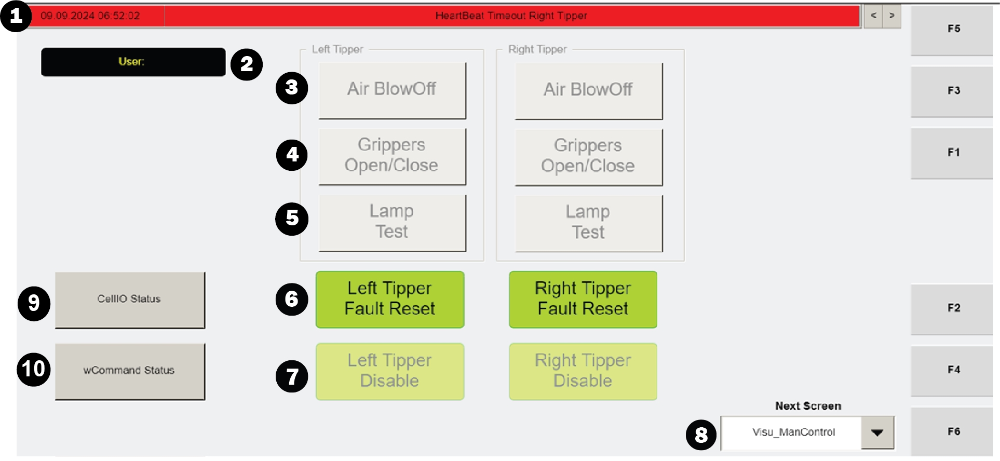
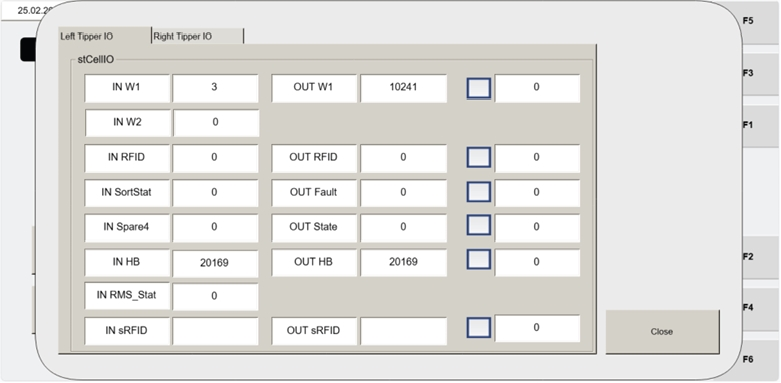

# Open CELLIO STATUS Sub-Screen From VISU_MANCONTROL to View Cell Control I/O Values

## Runbook Header

| Field | Value |
| --- | --- |
| Procedure ID | `proc_open_cellio_status_from_visu_mancontrol_v1` |
| Title | Open CELLIO STATUS Sub-Screen From VISU_MANCONTROL to View Cell Control I/O Values |
| Procedure Type | `diagnostic` |
| Primary Role | `L2_support` |
| Supporting Roles | `L2_support` |
| Support Safe | Yes |
| Capability Tags | `tipper_station_fault` |
| Access Surface | `tipper_hmi` |
| Audience Roles | `L2_support` |
| Failure Pattern Tags | None |
| Validation Status | `needs_sme_review` |
| Merge Status | `source_finalized` |

## Summary

From the Operator Station HMI maintenance manual control screen VISU_MANCONTROL, use the CELLIO STATUS button to open the CELLIO STATUS sub-screen and view cell control input/output values per tipper for troubleshooting/verification.

## When To Use

Use when you need to verify cell control input/output values per tipper from the Operator Station HMI by opening the CELLIO STATUS sub-screen via VISU_MANCONTROL.

## Access Or Tools Needed

* Tipper HMI / WebVisu / VISU access to the Operator Station maintenance manual control screen VISU_MANCONTROL and the CELLIO STATUS sub-screen.

## Related Operational Context

* ctx_manual_cellio_status_screen_v1
* ctx_manual_visu_mancontrol_screen_v1

## Visual References

*VISU_MANCONTROL screen showing the CELLIO STATUS button (Item 9).*

*CELLIO STATUS screen showing cell control input/output values per tipper.*

## Procedure Steps

### Step 1 — Open the VISU_MANCONTROL maintenance manual control screen

**Responsible role:** L2_support

**Instruction:**
On the Operator Station HMI (VISU / WebVisu), open the maintenance manual control screen named VISU_MANCONTROL.

**Expected result:**
The VISU_MANCONTROL screen is displayed and includes the CELLIO STATUS button (Item 9).

**Stop or Escalate If:**

* If you cannot reach VISU_MANCONTROL or cannot locate the CELLIO STATUS button, stop and escalate.

---

### Step 2 — Press CELLIO STATUS to open the cell control I/O values screen per tipper

**Responsible role:** L2_support

**Instruction:**
On VISU_MANCONTROL, press the CELLIO STATUS button (Item 9).

**Expected result:**
The CELLIO STATUS sub-screen opens.

**Stop or Escalate If:**

* If the CELLIO STATUS screen fails to open, stop and escalate.

---

### Step 3 — Verify cell control input/output values are displayed for each tipper

**Responsible role:** L2_support

**Instruction:**
On the CELLIO STATUS screen, verify that cell control input and output values are displayed for each tipper.

**Expected result:**
Cell control input and output values are displayed for each tipper on the CELLIO STATUS screen.

**Stop or Escalate If:**

* If the expected input/output values are missing/blank, stop and escalate.

---

## Success Criteria

* CELLIO STATUS sub-screen opens from VISU_MANCONTROL.
* Cell control input and output values are displayed for each tipper (not missing/blank).

## Failure Conditions

* CELLIO STATUS screen does not open.
* Cell control input/output values are missing or blank for one or more tippers.

## Escalation Guidance

* Escalate if the CELLIO STATUS screen fails to open or if the expected input/output values are missing/blank.

## Missing Details / Known Gaps

* The source does not define specific field names/values on the CELLIO STATUS screen; the expected result is limited to the presence of displayed cell control input/output values per tipper (not specific numeric/enum targets).

## Source Lineage

- Candidate IDs: candidate_manual_optisweep_visu_mancontrol_cellio_status_navigation
- Source ID: `manual_optisweep_om_v3`
- Source Type: `manual`
