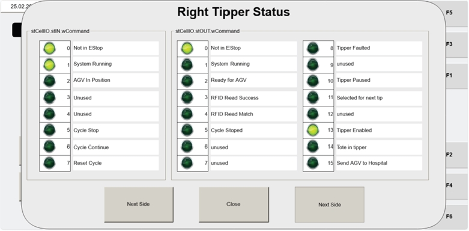

# Open WCOMMAND Screen and Check Input/Output Command Word Values for Left/Right Tipper

## Runbook Header

| Field | Value |
| --- | --- |
| Procedure ID | `proc_open_wcommand_screen_check_command_word_values_left_right_tipper_v1` |
| Title | Open WCOMMAND Screen and Check Input/Output Command Word Values for Left/Right Tipper |
| Procedure Type | `diagnostic` |
| Primary Role | `L2_support` |
| Supporting Roles | None |
| Support Safe | Yes |
| Capability Tags | `device_roster_state` |
| Access Surface | `tipper_hmi` |
| Audience Roles | `L2_support` |
| Failure Pattern Tags | None |
| Validation Status | `needs_sme_review` |
| Merge Status | `source_finalized` |

## Summary

On the Tipper HMI / WebVisu (VISU_MANCONTROL), open the WCOMMAND sub-screen to view the WCS input/output Command Word values for the selected tipper, and use NEXT SIDE to switch between left and right tipper communication.

## When To Use

Use when you need to verify the WCS communication as shown on the operator station tipper HMI by checking the input/output Command Word values for the left vs right tipper on the WCOMMAND screen.

## Access Or Tools Needed

* Tipper HMI / WebVisu / VISU access to the Operator Station maintenance manual control screen VISU_MANCONTROL and its WCOMMAND sub-screen.

## Related Operational Context

* ctx_manual_wcommand_screen_v1
* ctx_manual_visu_mancontrol_screen_v1

## Visual References

*VISU_MANCONTROL screen showing the WCOMMAND button (Item 10) and NEXT SIDE navigation context.*

*wCommand (WCOMMAND) screen showing the input/output Command Word values and navigation elements.*

## Procedure Steps

### Step 1 — Open VISU_MANCONTROL (Operator Station HMI maintenance manual control screen)

**Responsible role:** L2_support

**Instruction:**
On the Tipper HMI / WebVisu (VISU), open the Operator Station maintenance manual control screen named VISU_MANCONTROL.

**Expected result:**
The VISU_MANCONTROL screen is displayed with the WCOMMAND button available (Item 10).

**Stop or Escalate If:**

* VISU_MANCONTROL does not open.

---

### Step 2 — Press WCOMMAND button to open WCOMMAND sub-screen

**Responsible role:** L2_support

**Instruction:**
On VISU_MANCONTROL, press the WCOMMAND button (Item 10).

**Expected result:**
The WCOMMAND sub-screen opens and displays input and output Command Word values for the respective tipper to WCS.

**Stop or Escalate If:**

* WCOMMAND screen does not open.
* Command Word input/output values are missing/blank.

---

### Step 3 — Confirm input/output Command Word values are displayed on WCOMMAND screen

**Responsible role:** L2_support

**Instruction:**
On the WCOMMAND screen, confirm that the input and output Command Word values are displayed.

**Expected result:**
Input and output Command Word values are visible on the WCOMMAND screen.

**Stop or Escalate If:**

* Command Word input/output values are missing/blank.

---

### Step 4 — Use NEXT SIDE to switch between left and right tipper views and verify communication changes

**Responsible role:** L2_support

**Instruction:**
Press the NEXT SIDE button to navigate between the left and right tipper views, and confirm the displayed communication changes accordingly.

**Expected result:**
When NEXT SIDE is pressed, the displayed communication between the WCS and the operator station updates for the other tipper (left vs right).

**Stop or Escalate If:**

* Displayed communication does not change accordingly when switching left/right.

---

## Success Criteria

* WCOMMAND sub-screen opens from VISU_MANCONTROL.
* Input and output Command Word values are displayed on the WCOMMAND screen.
* Pressing NEXT SIDE switches the view between left and right tipper communication and the displayed communication updates accordingly.

## Failure Conditions

* WCOMMAND screen does not open.
* Command Word input/output values are missing/blank.
* NEXT SIDE does not change the displayed communication/view between left and right.

## Escalation Guidance

* Escalate if the WCOMMAND screen fails to open or if Command Word input/output values are missing/blank.

## Missing Details / Known Gaps

* The source does not specify exact field labels for the Command Word input/output values or any numeric patterns/expected values; success is limited to verifying that the input/output Command Word values are displayed and that NEXT SIDE updates the left/right communication view.

## Source Lineage

- Candidate IDs: candidate_manual_optisweep_visu_mancontrol_wcommand_navigation
- Source ID: `manual_optisweep_om_v3`
- Source Type: `manual`
