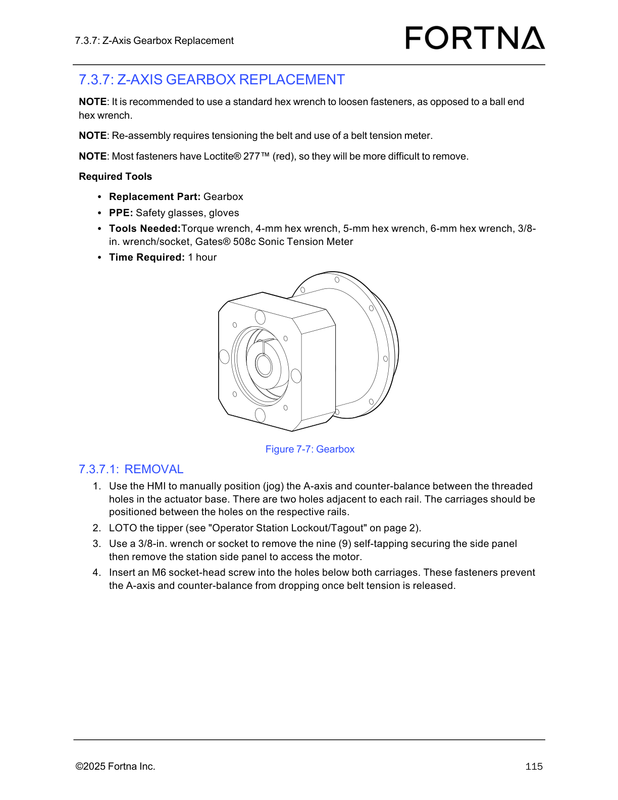

# Remove Z-Axis Gearbox for OptiSweep Z-Axis Gearbox Replacement (A-axis jog + LOTO + side panel removal)

## Runbook Header

| Field | Value |
| --- | --- |
| Procedure ID | `proc_remove_z_axis_gearbox_optisweep_v1` |
| Title | Remove Z-Axis Gearbox for OptiSweep Z-Axis Gearbox Replacement (A-axis jog + LOTO + side panel removal) |
| Procedure Type | `recovery` |
| Primary Role | `operator` |
| Supporting Roles | None |
| Support Safe | Yes |
| Capability Tags | `tipper_station_fault` |
| Access Surface | `tipper_hmi`, `physical_floor` |
| Audience Roles | `operator` |
| Failure Pattern Tags | None |
| Validation Status | `needs_sme_review` |
| Merge Status | `source_finalized` |

## Summary

Prepare the OptiSweep Z-axis for gearbox replacement by manually positioning the A-axis/counter-balance to the specified threaded-hole location using the tipper HMI, performing tipper lockout/tagout (LOTO), removing the station side panel (nine self-tapping fasteners), and exposing the motor/gearbox area. Install an M6 socket-head screw below both carriages to prevent dropping once belt tension is released.

## When To Use

Use when preparing an OptiSweep Z-axis gearbox replacement and you must (1) position the A-axis/counter-balance between the actuator-base threaded holes, (2) lockout/tagout the tipper, and (3) remove the station side panel to access the motor/gearbox area.

## Do Not Use For

* Do not use this procedure as a complete gearbox replacement workflow (it only covers the removal preparation steps evidenced in the provided manual section/page excerpt).

## Safety And Operational Notes

* Perform tipper LOTO using the manual’s referenced "Operator Station Lockout/Tagout" procedure (page 2).
* Stop if the A-axis/counter-balance cannot be positioned as described or cannot be held in place with the M6 socket-head screw.

## Access Or Tools Needed

* tipper_hmi (WebVisu/VISU operator station HMI)
* Physical access to tipper station for LOTO and side panel removal
* 3/8-in. wrench or socket
* M6 socket-head screw
* PPE: safety glasses, gloves

## Visual References

*Figure 7-7: Gearbox diagram supporting the removal preparation steps (A-axis/counter-balance positioning, tipper LOTO reference, nine side-panel fasteners, and M6 socket-head screw below both carriages).*

## Procedure Steps

### Step 1 — Jog A-axis and counter-balance to the threaded-hole position

**Responsible role:** operator

**Instruction:**
On the tipper HMI (WebVisu/VISU), manually position (jog) the A-axis and counter-balance between the threaded holes in the actuator base. There are two holes adjacent to each rail; position the carriages between the holes on the respective rails.

**Expected result:**
A-axis/counter-balance are positioned between the threaded holes with carriages between the holes on their respective rails.

**Stop or Escalate If:**

* Stop and escalate if the A-axis/counter-balance cannot be positioned between the threaded holes as described.

---

### Step 2 — Perform tipper LOTO using the referenced Operator Station Lockout/Tagout procedure

**Responsible role:** operator

**Instruction:**
Perform LOTO for the tipper using the manual’s referenced "Operator Station Lockout/Tagout" procedure (page 2).

**Expected result:**
Tipper is locked out/tagged out.

**Stop or Escalate If:**

* Stop if LOTO cannot be completed safely using the referenced "Operator Station Lockout/Tagout" procedure.

---

### Step 3 — Remove the station side panel fasteners and the station side panel

**Responsible role:** operator

**Instruction:**
Using a 3/8-in. wrench or socket, remove the nine (9) self-tapping securing the side panel, then remove the station side panel to access the motor.

**Expected result:**
Station side panel is removed and the motor/gearbox access area is exposed.

---

### Step 4 — Install M6 socket-head screw below both carriages to prevent dropping

**Responsible role:** operator

**Instruction:**
Insert an M6 socket-head screw into the holes below both carriages. These fasteners prevent the A-axis and counter-balance from dropping once belt tension is released.

**Expected result:**
An M6 socket-head screw is installed into the holes below both carriages.

**Stop or Escalate If:**

* Stop and escalate if the carriages cannot be held in place with the M6 socket-head screw.

---

## Success Criteria

* A-axis/counter-balance are positioned between the threaded holes with carriages between the holes on their respective rails.
* Tipper is locked out/tagged out using the referenced Operator Station Lockout/Tagout procedure (page 2).
* Station side panel is removed and the motor/gearbox access area is exposed.
* M6 socket-head screw is installed below both carriages to prevent dropping once belt tension is released.

## Failure Conditions

* A-axis/counter-balance cannot be positioned between the threaded holes as described.
* LOTO cannot be completed safely using the referenced Operator Station Lockout/Tagout procedure (page 2).
* Side panel cannot be removed to access the motor.
* Carriages cannot be held in place with the M6 socket-head screw.

## Escalation Guidance

* If any stop condition is met (positioning, LOTO, side panel removal, or M6 screw retention), stop work and escalate per site maintenance escalation process (not specified in the provided packet).

## Missing Details / Known Gaps

* The provided evidence covers only the removal preparation steps (jog positioning, tipper LOTO reference, side panel fastener removal, side panel removal, and M6 screw insertion). Full gearbox removal, belt tensioning, and reassembly steps are not included in the provided excerpt.
* The packet does not include the actual page-2 "Operator Station Lockout/Tagout" figure/points; only the reference is provided.

## Source Lineage

- Candidate IDs: candidate_manual_optisweep_z_axis_gearbox_replacement_removal
- Source ID: `manual_optisweep_om_v3`
- Source Type: `manual`
