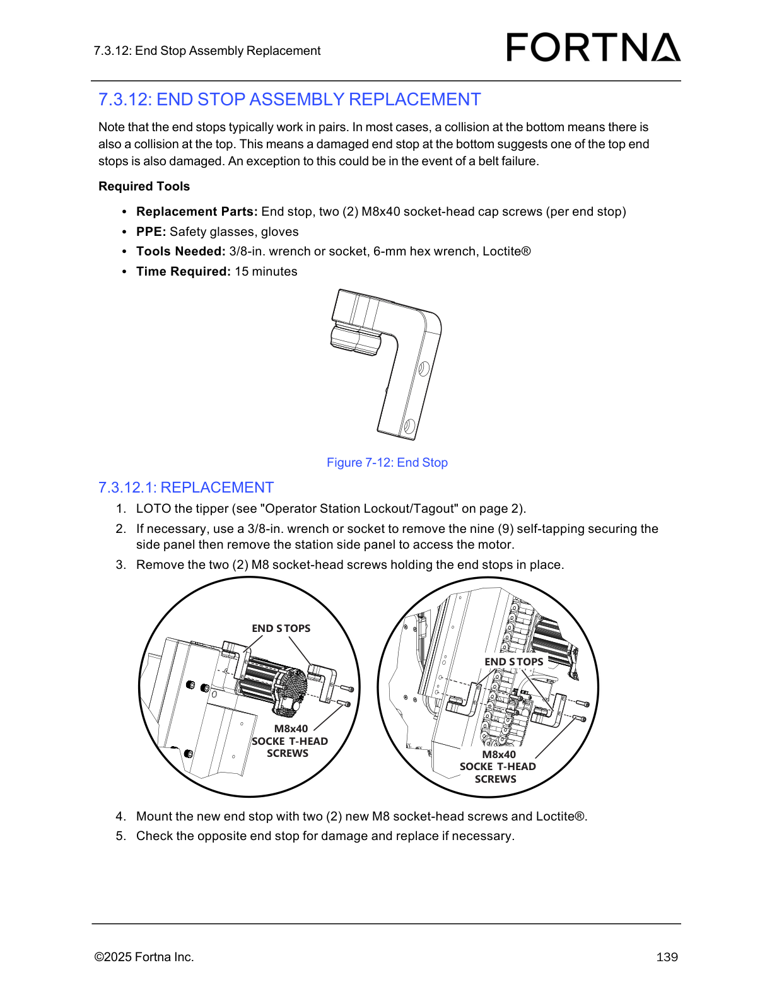

# Quick Replacement of Z-Axis Cable Carrier (Snap Apart/Ends Snap-In)

## Runbook Header

| Field | Value |
| --- | --- |
| Procedure ID | `proc_quick_replacement_z_axis_cable_carrier_v1` |
| Title | Quick Replacement of Z-Axis Cable Carrier (Snap Apart/Ends Snap-In) |
| Procedure Type | `recovery` |
| Primary Role | `operator` |
| Supporting Roles | None |
| Support Safe | Yes |
| Capability Tags | `agv_physical_recovery` |
| Access Surface | `physical_floor` |
| Audience Roles | `operator` |
| Failure Pattern Tags | None |
| Validation Status | `needs_sme_review` |
| Merge Status | `source_finalized` |

## Summary

Performs a quick Z-axis cable carrier replacement by LOTO the tipper, snapping the carrier apart at both ends, removing the old carrier, installing the new carrier, snapping cross bars closed, and snapping both ends into the end pieces that remain mounted.

## When To Use

Use when both ends of the existing Z-axis cable carrier are in good condition and you need a quick replacement by snapping the carrier apart at both ends, leaving the end pieces mounted on the tipper.

## Do Not Use For

* Do not use this quick replacement method if either end of the existing carrier is not in good condition (the procedure is explicitly a quick replacement only when both ends are good).
* Do not proceed if LOTO cannot be completed safely or if access to the motor/side panel is unclear.

## Safety And Operational Notes

* Perform LOTO on the tipper before removing the side panel or disassembling the cable carrier.

## Access Or Tools Needed

* Physical access to the tipper and station side panel
* LOTO capability for the tipper
* 3/8-in. wrench or socket

## Visual References

*End stop assembly diagram (shows end stop mounting hardware and supports the concept of end pieces remaining mounted on the tipper).*

## Procedure Steps

### Step 1 — LOTO the tipper

**Responsible role:** operator

**Instruction:**
Perform LOTO on the tipper using the manual’s referenced “Operator Station Lockout/Tagout” location.

**Expected result:**
The tipper is in a locked-out/tagged-out state prior to side panel removal or carrier disassembly.

**Stop or Escalate If:**

* If LOTO cannot be completed safely, escalate to site/maintenance support before proceeding.

---

### Step 2 — Remove station side panel (if necessary) to access the motor

**Responsible role:** operator

**Instruction:**
If necessary, use a 3/8-in. wrench or socket to remove the nine (9) self-tapping securing screws for the station side panel, then remove the station side panel to access the motor.

**Expected result:**
The station side panel is removed and the motor access area is available.

**Stop or Escalate If:**

* If access to the motor/side panel is unclear, escalate to site/maintenance support before proceeding.

---

### Step 3 — Snap apart the old cable carrier at both ends (leave end pieces attached)

**Responsible role:** operator

**Instruction:**
Disassemble or “snap apart” the cable carrier at both ends, leaving only the end pieces attached to the tipper.

**Expected result:**
The old cable carrier is separated at both ends, with only the end pieces remaining attached to the tipper.

**Stop or Escalate If:**

* Stop and re-check alignment if the new carrier cannot be snapped fully into the end pieces or if cross bars do not fully close.

---

### Step 4 — Snap ends off the new carrier and open cross bars on the outside of the new carrier

**Responsible role:** operator

**Instruction:**
“Snap” the ends off the new cable carrier and open all the cross bars on the outside of the new cable carrier.

**Expected result:**
The new carrier’s ends are snapped off, and all outside cross bars are open.

**Stop or Escalate If:**

* Stop and re-check alignment if the new carrier cannot be snapped fully into the end pieces or if cross bars do not fully close.

---

### Step 5 — Open cross bars on the old carrier and remove it from the system

**Responsible role:** operator

**Instruction:**
Open all the cross bars on the outside of the old cable carrier and remove it from the system.

**Expected result:**
The old cable carrier is removed from the system.

---

### Step 6 — Position the new carrier roughly in place with internal dividers against the air line

**Responsible role:** operator

**Instruction:**
Put the new cable carrier roughly in place while positioning the internal dividers all the way to one side, against the air line.

**Expected result:**
New carrier is positioned roughly in place and internal dividers are all the way to one side against the air line.

**Stop or Escalate If:**

* Stop and re-check alignment if the new carrier cannot be snapped fully into the end pieces or if cross bars do not fully close.

---

### Step 7 — Snap all outside cross bars closed

**Responsible role:** operator

**Instruction:**
“Snap” all the cross bars closed.

**Expected result:**
All outside cross bars on the new carrier are snapped closed.

**Stop or Escalate If:**

* Stop and re-check alignment if the new carrier cannot be snapped fully into the end pieces or if cross bars do not fully close.

---

### Step 8 — Snap both ends into the end pieces still mounted on the tipper

**Responsible role:** operator

**Instruction:**
“Snap” both ends into the end pieces that are still mounted.

**Expected result:**
Both ends of the new carrier are snapped into the end pieces that remain mounted on the tipper.

**Stop or Escalate If:**

* Stop and re-check alignment if the new carrier cannot be snapped fully into the end pieces or if cross bars do not fully close.
* If LOTO cannot be completed safely or access to the motor/side panel is unclear, escalate to site/maintenance support before proceeding.

---

## Success Criteria

* New Z-axis cable carrier is installed with all outside cross bars snapped closed.
* Both ends of the new carrier are snapped into the end pieces that remain mounted on the tipper.
* Internal dividers are positioned all the way to one side against the air line.

## Failure Conditions

* New carrier cannot be snapped fully into the end pieces.
* Cross bars do not fully close.
* LOTO cannot be completed safely.
* Access to the motor/side panel is unclear.

## Escalation Guidance

* If LOTO cannot be completed safely or access to the motor/side panel is unclear, escalate to site/maintenance support before proceeding.

## Missing Details / Known Gaps

* The manual references “Operator Station Lockout/Tagout” on page 2, but the lockout/tagout image/figure is not included in this packet; therefore the exact lockout/tagout points are not shown here.

## Source Lineage

- Candidate IDs: candidate_manual_optisweep_zaxis_cable_carrier_quick_replacement
- Source ID: `manual_optisweep_om_v3`
- Source Type: `manual`
