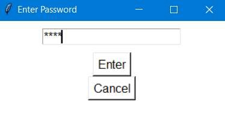

# Configure Barcode Interface scanner settings (password, prefixes, HTTP/OPC URLs) for AGV and Hospital control IPs

## Runbook Header

| Field | Value |
| --- | --- |
| Procedure ID | `proc_configure_barcode_interface_scanner_settings_http_opc_prefixes_v1` |
| Title | Configure Barcode Interface scanner settings (password, prefixes, HTTP/OPC URLs) for AGV and Hospital control IPs |
| Procedure Type | `operation` |
| Primary Role | `L1_support` |
| Supporting Roles | None |
| Support Safe | Yes |
| Capability Tags | `gateway_health` |
| Access Surface | `apidog` |
| Audience Roles | `L1_support` |
| Failure Pattern Tags | None |
| Validation Status | `needs_sme_review` |
| Merge Status | `source_finalized` |

## Summary

On the Windows laptop used for scanner setup, update the replacement Zebra DS3608-SR scanner’s Barcode Interface settings so tote/location label prefixes match and the HTTP/OPC URLs point to the correct AGV control and Hospital control IP addresses, then save the settings.

## When To Use

Use when a scanner is replaced and the new scanner must be set up so Barcode Interface settings use the correct tote/location prefixes and the correct AGV/Hospital control IP addresses in the HTTP and OPC URL fields.

## Access Or Tools Needed

* Windows 10/11 laptop
* Barcode Interface.exe application
* FORTNA account login
* AGV control IP address
* Hospital control IP address

## Related Operational Context

* ctx_manual_scanner_replacement_setup_v1
* ctx_manual_barcode_interface_app_v1
* ctx_manual_scanner_setup_connectivity_v1
* ctx_manual_scanner_settings_password_v1

## Visual References

*Scanner Setup screen showing the settings button/password prompt, prefix fields, HTTP URL field (AGV control IP), OPC URL field (Hospital control IP), and Save Settings button.*

## Procedure Steps

### Step 1 — Launch Barcode Interface on the scanner setup laptop

**Responsible role:** L1_support

**Instruction:**
On the Windows laptop used for scanner setup, launch the Barcode Interface application (Barcode Interface.exe).

**Expected result:**
Barcode Interface is open and ready for interaction (scanner setup workflow visible).

---

### Step 2 — Open Settings and enter the default password

**Responsible role:** L1_support

**Instruction:**
In Barcode Interface, click the "settings" button and supply the default password "Opti".

**Expected result:**
The settings panel accepts the password and the settings fields are available for editing.

---

### Step 3 — Verify tote/location label prefixes match

**Responsible role:** L1_support

**Instruction:**
Verify the configured prefixes match the labels on the totes and locations.

**Expected result:**
Prefix values shown in the settings match the tote/location label prefixes you physically verify.

**Stop or Escalate If:**

* Stop and escalate if the prefixes do not match the tote/location labels.

---

### Step 4 — Update HTTP and OPC URLs to correct AGV/Hospital control IPs

**Responsible role:** L1_support

**Instruction:**
Change the URL for both the HTTP and OPC settings so the HTTP URL contains the AGV control IP address and the OPC URL contains the Hospital control IP address.

**Expected result:**
HTTP URL field includes the AGV control IP address; OPC URL field includes the Hospital control IP address.

**Stop or Escalate If:**

* Stop and escalate if the HTTP/OPC URLs cannot be updated to include the correct AGV control and Hospital control IP addresses.

---

### Step 5 — Save the scanner settings

**Responsible role:** L1_support

**Instruction:**
Save the settings using the "Save Settings" button.

**Expected result:**
Settings are saved (the updated prefix/URL values are committed after clicking "Save Settings").

---

## Success Criteria

* After saving, the Barcode Interface settings reflect prefixes matching tote/location labels.
* After saving, the HTTP URL contains the AGV control IP address and the OPC URL contains the Hospital control IP address.

## Failure Conditions

* Prefixes do not match tote/location labels.
* HTTP/OPC URLs cannot be updated to include the correct AGV control and Hospital control IP addresses.
* Settings do not persist after clicking "Save Settings".

## Escalation Guidance

* If prefixes do not match tote/location labels, stop and escalate.
* If HTTP/OPC URLs cannot be updated to include the correct AGV control and Hospital control IP addresses, stop and escalate.

## Missing Details / Known Gaps

* The packet does not provide the exact field labels/names for the prefix fields, HTTP URL field, and OPC URL field as they appear in the Barcode Interface UI; only the actions and their intent are specified.

## Source Lineage

- Candidate IDs: candidate_manual_scanner_setup_configure_settings_http_opc_prefixes
- Source ID: `manual_optisweep_om_v3`
- Source Type: `manual`
