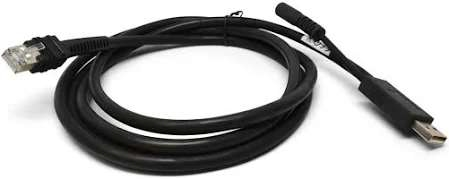
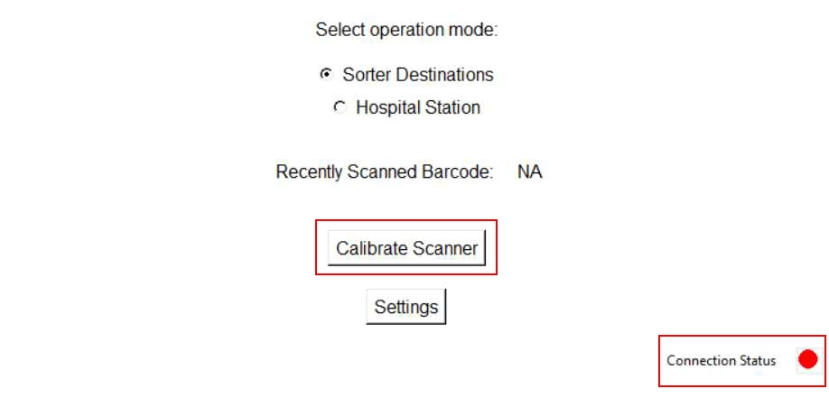

# Set up a replacement Zebra DS3608-SR scanner using Barcode Interface (hardware connect + connectivity + calibration)

## Runbook Header

| Field | Value |
| --- | --- |
| Procedure ID | `proc_set_up_replacement_zebra_ds3608sr_scanner_barcode_interface_v1` |
| Title | Set up a replacement Zebra DS3608-SR scanner using Barcode Interface (hardware connect + connectivity + calibration) |
| Procedure Type | `recovery` |
| Primary Role | `L1_support` |
| Supporting Roles | None |
| Support Safe | Yes |
| Capability Tags | `gateway_health` |
| Access Surface | `apidog` |
| Audience Roles | `L1_support` |
| Failure Pattern Tags | None |
| Validation Status | `needs_sme_review` |
| Merge Status | `source_finalized` |

## Summary

Set up a replacement Zebra DS3608-SR scanner so the Barcode Interface application shows healthy connectivity and the scanner is calibrated when the app connectivity indicator is red.

## When To Use

Use when a Zebra DS3608-SR scanner has been replaced and needs setup so Barcode Interface connectivity is healthy; if the Barcode Interface connectivity indicator is red, calibration is required.

## Access Or Tools Needed

* Windows 10/11 laptop
* Barcode Interface.exe application
* FORTNA account login
* Zebra DS3608-SR scanner dock
* USB cable with RJ45 side (to dock) and USB to laptop
* Power adapter
* 120 VAC outlet (x2)
* Network connectivity to the AGV control and Hospital control at the laptop (validated by pinging their IP addresses)

## Related Operational Context

* ctx_manual_scanner_replacement_setup_v1
* ctx_manual_barcode_interface_app_v1
* ctx_manual_scanner_setup_connectivity_v1
* ctx_manual_scanner_setup_hardware_v1

## Visual References

*Scanner Setup procedure image (hardware connections + dock power light + battery indicator note + connectivity/calibration decision).*

*Scanner Setup screen showing settings access (settings button), default password 'Opti', prefix verification, and HTTP/OPC URL fields with Save Settings.*

## Procedure Steps

### Step 1 — Verify laptop and Barcode Interface availability; log in with a FORTNA account

**Responsible role:** L1_support

**Instruction:**
On the Windows 10/11 laptop, confirm Barcode Interface.exe is installed (on the desktop with a FORTNA logo), then log into the laptop with a FORTNA account.

**Expected result:**
You are logged into the Windows laptop with a FORTNA account and Barcode Interface.exe is available to launch.

---

### Step 2 — Connect scanner dock cabling and power; confirm dock lights up

**Responsible role:** L1_support

**Instruction:**
Connect the RJ45 side of the USB cable to the back of the scanner dock, connect the USB to the laptop, and connect the auxiliary cable to the power adapter. Plug the power adapter into a 120 VAC outlet (x2). Confirm the dock lights up.

**Expected result:**
The scanner dock powers on and its lights are on.

**Stop or Escalate If:**

* Stop and escalate if the dock does not light up after connecting power.

---

### Step 3 — Charge the scanner on the dock until the battery indicator turns green

**Responsible role:** L1_support

**Instruction:**
If the scanner is uncharged, place it on the dock until the red battery symbol shown on top turns green.

**Expected result:**
Scanner battery indicator changes from red to green.

**Stop or Escalate If:**

* Stop and escalate if the scanner battery indicator does not turn green after resting on the dock.

---

### Step 4 — Launch Barcode Interface application

**Responsible role:** L1_support

**Instruction:**
Launch the Barcode Interface application (should be on the desktop).

**Expected result:**
Barcode Interface is open and the screen is ready for connectivity status verification.

---

### Step 5 — Check Barcode Interface connectivity indicator (bottom right)

**Responsible role:** L1_support

**Instruction:**
Check the connectivity indicator at the bottom right of the Barcode Interface screen.

**Expected result:**
Connectivity indicator is either green or red.

---

### Step 6 — Calibrate scanner only if connectivity indicator is red

**Responsible role:** L1_support

**Instruction:**
If the connectivity indicator is red, click "Calibrate Scanner" and follow the onscreen instructions until calibration completes.

**Expected result:**
After calibration, the operator observes the connectivity indicator change to green.

**Stop or Escalate If:**

* Stop and escalate if the Barcode Interface connectivity indicator remains red after clicking "Calibrate Scanner" and following the onscreen instructions.

---

### Step 7 — Skip calibration if connectivity indicator is green

**Responsible role:** L1_support

**Instruction:**
If the connectivity indicator is green, skip calibration and proceed to the next step of the overall scanner setup procedure.

**Expected result:**
Connectivity indicator is green and calibration is not performed.

---

## Success Criteria

* Barcode Interface connectivity indicator at the bottom right is green.
* If connectivity was red initially, calibration was run and the operator observes the connectivity indicator change to green.
* Scanner battery indicator is green (if it was initially red).

## Failure Conditions

* Dock does not light up after connecting power.
* Scanner battery indicator does not turn green after resting on the dock.
* Barcode Interface connectivity indicator remains red after clicking "Calibrate Scanner" and following onscreen instructions.

## Escalation Guidance

* If the dock does not light up after connecting power, stop and escalate.
* If the scanner battery indicator does not turn green after resting on the dock, stop and escalate.
* If the Barcode Interface connectivity indicator remains red after calibration, stop and escalate.

## Missing Details / Known Gaps

* The source states network connectivity must be validated by pinging AGV and Hospital control IP addresses, but it does not provide the exact ping command/UI steps to use on the Windows laptop; therefore this runbook does not include specific ping execution steps.

## Source Lineage

- Candidate IDs: candidate_manual_scanner_setup_replacement_zebra_ds3608sr
- Source ID: `manual_optisweep_om_v3`
- Source Type: `manual`
