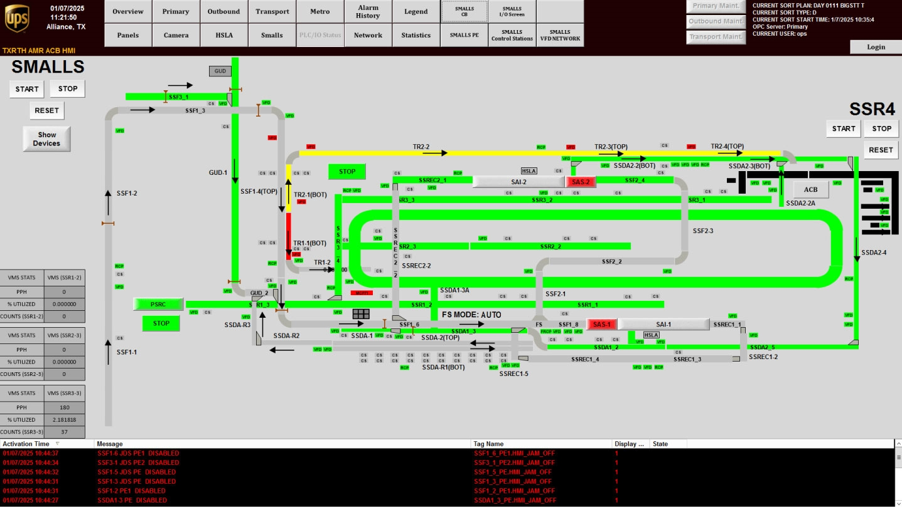

# Check SMALLS System Health Using the Smalls Overview HMI Screen (Color-Coded Layout)

## Runbook Header

| Field | Value |
| --- | --- |
| Procedure ID | `proc_check_smalls_system_health_smalls_overview_hmi_v1` |
| Title | Check SMALLS System Health Using the Smalls Overview HMI Screen (Color-Coded Layout) |
| Procedure Type | `diagnostic` |
| Primary Role | `operator` |
| Supporting Roles | None |
| Support Safe | Yes |
| Capability Tags | `device_roster_state` |
| Access Surface | `tipper_hmi` |
| Audience Roles | `operator` |
| Failure Pattern Tags | None |
| Validation Status | `needs_sme_review` |
| Merge Status | `source_finalized` |

## Summary

Use the SMALLS overview screen on the System HMI to quickly identify which parts of the SMALLS system are in a normal vs abnormal (color-coded) status based on the system layout.

## When To Use

When you need a fast, at-a-glance health check of the SMALLS system parts using the color-coded SMALLS system layout.

## Access Or Tools Needed

* Tipper HMI / WebVisu / VISU (System HMI access where the SMALLS button is available)
* SMALLS overview screen ("Smalls" overview screen)

## Related Operational Context

* ctx_manual_smalls_overview_screen_v1

## Visual References

*Figure 4-4: Smalls System Overview Screen (color-coded SMALLS system layout).*

## Procedure Steps

### Step 1 — Open the "Smalls" overview screen from the System HMI

**Responsible role:** operator

**Instruction:**
On the System HMI, press the SMALLS button to open the "Smalls" overview screen.

**Expected result:**
The "Smalls" overview screen is displayed.

**Stop or Escalate If:**

* If you cannot access the "Smalls" overview screen, stop and escalate for support.

---

### Step 2 — Review the SMALLS system layout on the "Smalls" overview screen

**Responsible role:** operator

**Instruction:**
On the "Smalls" overview screen, review the SMALLS system layout.

**Expected result:**
You can see the SMALLS system layout with parts displayed for status checking.

**Stop or Escalate If:**

* If you cannot clearly determine which parts are shown on the layout, stop and escalate.

---

### Step 3 — Check each SMALLS part’s color-coded status indicator

**Responsible role:** operator

**Instruction:**
For each part shown on the layout, observe the color-coded status indicator.

**Expected result:**
You have identified which parts (if any) show abnormal color-coded status (i.e., not the normal/expected color for that part).

**Stop or Escalate If:**

* Stop and escalate if multiple system parts show abnormal color-coded status.

---

### Step 4 — Identify abnormal parts and decide whether to stop/escalate

**Responsible role:** operator

**Instruction:**
Identify any parts whose color-coded status indicates an abnormal condition (i.e., not the normal/expected color for that part). If the layout indicates an offline/blocked section requiring support action, treat it as abnormal.

**Expected result:**
You have a clear list of abnormal parts (if any) and a decision to escalate when abnormality is widespread or unclear.

**Stop or Escalate If:**

* Stop and escalate if multiple system parts show abnormal color-coded status.
* Stop and escalate if the layout indicates an offline/blocked section requiring support action.
* Stop and escalate if you cannot determine which parts are abnormal from the screen.

---

## Success Criteria

* Operator can open the "Smalls" overview screen and visually identify abnormal color-coded status indicators for any SMALLS parts.
* Operator escalates when multiple parts show abnormal color-coded status or when abnormality is unclear.

## Failure Conditions

* One or more SMALLS parts show abnormal color-coded status indicators.
* Multiple SMALLS parts show abnormal color-coded status indicators.
* The operator cannot determine which parts are abnormal from the screen.
* The layout indicates an offline/blocked section requiring support action.

## Escalation Guidance

* If multiple parts show abnormal color-coded status, or if the layout indicates an offline/blocked section requiring support action, stop and escalate for support.

## Missing Details / Known Gaps

* The manual section provided does not define the specific color-to-meaning mapping (what each color corresponds to). This runbook therefore instructs the operator to treat any color that is not the normal/expected color for that part as abnormal, without specifying exact meanings.

## Source Lineage

- Candidate IDs: candidate_manual_smalls_overview_check_color_status
- Source ID: `manual_optisweep_om_v3`
- Source Type: `manual`
