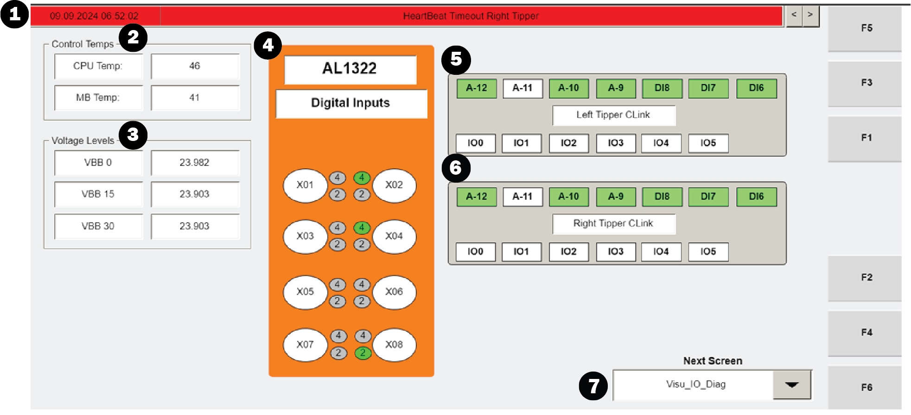

# Check Operator Station HMI I/O Diagnostics (VISU_IO_DIAG) for CPU/MB Temps, 24V, and Input/ Switch States

## Runbook Header

| Field | Value |
| --- | --- |
| Procedure ID | `proc_check_operator_station_hmi_io_diagnostics_visu_io_diag_v1` |
| Title | Check Operator Station HMI I/O Diagnostics (VISU_IO_DIAG) for CPU/MB Temps, 24V, and Input/ Switch States |
| Procedure Type | `diagnostic` |
| Primary Role | `L1_support` |
| Supporting Roles | None |
| Support Safe | Yes |
| Capability Tags | `device_roster_state` |
| Access Surface | `tipper_hmi` |
| Audience Roles | `L1_support` |
| Failure Pattern Tags | None |
| Validation Status | `needs_sme_review` |
| Merge Status | `source_finalized` |

## Summary

Use the read-only Operator Station HMI screen VISU_IO_DIAG to troubleshoot operator-station I/O by verifying the displayed Control Temps (CPU and MB), internal controller Voltage Levels (expected 24 V), and the on/off status of the station switch and inputs. Use the input sections to open input detail information and use the screen drop-down to navigate to other screens if needed.

## When To Use

When troubleshooting operator-station I/O on the Operator Station HMI and you need to confirm that the HMI hardware diagnostics are reporting expected values for CPU/MB temperatures, internal controller voltage (should be 24 V), and the station switch/input on/off indications.

## Safety And Operational Notes

* VISU_IO_DIAG is a read-only screen used for troubleshooting.

## Access Or Tools Needed

* Tipper HMI / WebVisu / VISU access to the VISU_IO_DIAG screen

## Related Operational Context

* ctx_manual_visu_io_diag_screen_v1
* ctx_manual_visu_io_diag_control_temps_v1
* ctx_manual_visu_io_diag_voltage_levels_v1
* ctx_manual_visu_io_diag_switch_status_v1
* ctx_manual_visu_io_diag_input_details_v1

## Visual References

*Figure 4-27: Operator Station IO Diagnostics Screen (VISU_IO_DIAG) showing the informational banner, Control Temps (CPU/MB), Voltage Levels (expected 24 V), switch status (inputs on/off), input sections that open detail windows, and the drop-down menu.*

## Procedure Steps

### Step 1 — Open the read-only VISU_IO_DIAG diagnostics screen on the Operator Station HMI

**Responsible role:** L1_support

**Instruction:**
On the Operator Station HMI, navigate to the read-only screen named VISU_IO_DIAG (Operator Station IO Diagnostics Screen).

**Expected result:**
The VISU_IO_DIAG screen is open and displays the informational banner, the “Control Temps” section, the “Voltage Levels” section, the switch status section (inputs on/off), the input sections, and the drop-down menu.

**Stop or Escalate If:**

* VISU_IO_DIAG cannot be opened or does not display the Control Temps / Voltage Levels / input sections.

---

### Step 2 — Check the informational banner for active alarms/messages

**Responsible role:** L1_support

**Instruction:**
Review the informational banner at the top of the VISU_IO_DIAG screen. If messages are present, use the right-side arrows to cycle through messages.

**Expected result:**
The informational banner shows any current alarms or informational messages; if multiple messages exist, you can navigate through them using the right-side arrows.

---

### Step 3 — Verify CPU and motherboard (MB) temperature readings in Control Temps

**Responsible role:** L1_support

**Instruction:**
In the “Control Temps” section, verify the CPU temperature and the motherboard (MB) temperature values displayed on the screen.

**Expected result:**
The “Control Temps” section shows temperature readings for both CPU and MB.

---

### Step 4 — Verify internal controller voltage readings in Voltage Levels (expected 24 V)

**Responsible role:** L1_support

**Instruction:**
In the “Voltage Levels” section, verify the internal controller voltage reading(s). These should be 24 V.

**Expected result:**
The “Voltage Levels” section shows internal controller voltage readings with a value of 24 V.

**Stop or Escalate If:**

* “Voltage Levels” are not 24 V.

---

### Step 5 — Verify station switch/input on/off indications in the switch status section

**Responsible role:** L1_support

**Instruction:**
In the switch status section (corresponding to the switch mounted on the station), verify which inputs are shown as ON vs OFF.

**Expected result:**
The switch status section displays which station inputs are ON and which are OFF.

**Stop or Escalate If:**

* Switch/input ON/OFF indications do not match the expected station behavior being investigated.

---

### Step 6 — Open input detail window by selecting an input section

**Responsible role:** L1_support

**Instruction:**
In the inputs section, select one of the input sections to open the window with more information about what the selected input is.

**Expected result:**
Selecting an input section opens a window providing more information about that input.

---

### Step 7 — Use the VISU_IO_DIAG drop-down menu to navigate to other screens if needed

**Responsible role:** L1_support

**Instruction:**
Use the drop-down menu on the VISU_IO_DIAG screen to directly select/view other screens if needed for additional troubleshooting context.

**Expected result:**
The drop-down menu allows direct selection of another screen to view.

---

## Success Criteria

* VISU_IO_DIAG is opened and displays the Control Temps, Voltage Levels, switch status, and input sections.
* Voltage Levels indicates internal controller voltage is 24 V.
* Switch status shows station inputs with ON/OFF indications that match the expected station behavior being investigated.
* Selecting an input section opens a detail window with more information about that input.

## Failure Conditions

* VISU_IO_DIAG cannot be opened or does not display the Control Temps / Voltage Levels / input sections.
* Voltage Levels is not 24 V.
* Switch/input ON/OFF indications do not match the expected station behavior being investigated.
* Selecting an input section does not open the input detail window.

## Escalation Guidance

* Escalate if “Voltage Levels” are not 24 V.
* Escalate if the switch/input ON/OFF indications do not match the expected station behavior being investigated.
* Escalate if the VISU_IO_DIAG screen cannot be opened or does not display the Control Temps / Voltage Levels / input sections as described.

## Source Lineage

- Candidate IDs: candidate_manual_tip_hmi_visu_io_diag_check_io_health
- Source ID: `manual_optisweep_om_v3`
- Source Type: `manual`
