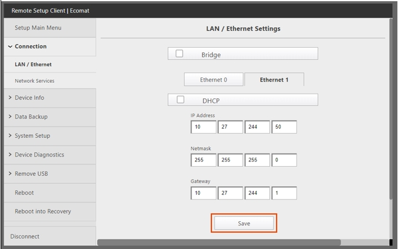
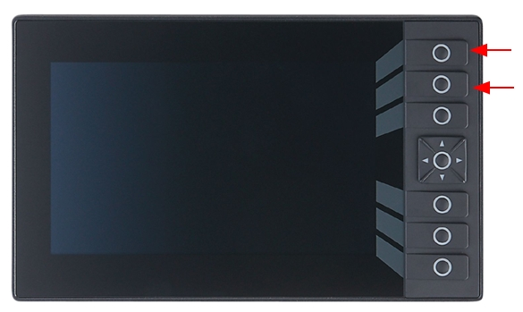
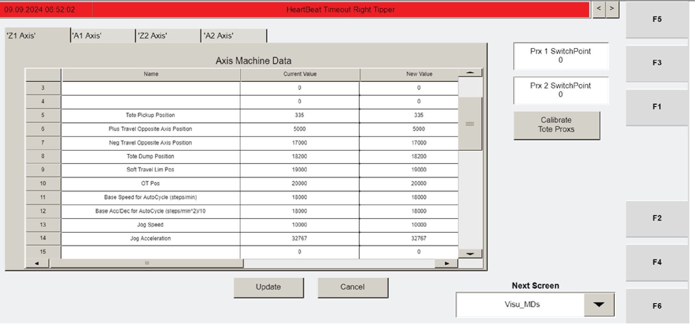

# Load New Tipper Firmware via Tipper HMI (VISU) USB Install

## Runbook Header

| Field | Value |
| --- | --- |
| Procedure ID | `proc_load_new_tipper_firmware_v1` |
| Title | Load New Tipper Firmware via Tipper HMI (VISU) USB Install |
| Procedure Type | `recovery` |
| Primary Role | `operator` |
| Supporting Roles | None |
| Support Safe | Yes |
| Capability Tags | `tipper_station_fault` |
| Access Surface | `tipper_hmi` |
| Audience Roles | `operator` |
| Failure Pattern Tags | None |
| Validation Status | `needs_sme_review` |
| Merge Status | `source_finalized` |

## Summary

Update the tipper controller firmware using the Tipper HMI (VISU) USB install flow, then power-cycle the controller and confirm the HMI returns to the expected default screen state ("Visu_Default" with IP and subnet mask settings) and that F3 navigates to "Visu_MCP_Dual".

## When To Use

Use when you need to load new firmware onto a tipper controller using the HMI USB install flow and then verify the HMI returns to the expected default screen state.

## Access Or Tools Needed

* Tipper HMI / WebVisu / VISU access (physical access to the HMI on the tipper)
* Tipper power disconnect access
* USB drive containing the new firmware version
* USB dongle on the HMI

## Visual References

*HMI screenshot showing the "Visu_Default" screen with IP and subnet mask settings during tipper commissioning (used to verify expected default screen state).*

*Tipper commissioning step image showing the gray screen appearance after holding the top buttons during power-on (used to confirm firmware-load mode entry).*

*HMI screenshot showing the "Visu_MCP_Dual" screen (used to confirm F3 navigation result).*

## Procedure Steps

### Step 1 — Turn off power to the tipper using the disconnect

**Responsible role:** operator

**Instruction:**
Turn off power to the tipper using the disconnect.

**Expected result:**
The tipper controller is powered off (HMI is not in normal operation).

---

### Step 2 — Hold the top three buttons on the tipper HMI

**Responsible role:** operator

**Instruction:**
On the tipper HMI, press and hold the top three buttons.

**Expected result:**
The top three buttons are held continuously in preparation for powering on.

---

### Step 3 — Power on the tipper while continuing to hold the top three buttons

**Responsible role:** operator

**Instruction:**
While continuing to hold the top three buttons, power on the tipper.

**Expected result:**
The controller begins booting into the firmware-load mode.

**Stop or Escalate If:**

* If the gray screen does not appear after holding the top three buttons during power-on, stop and re-check that the correct buttons are held through power-on before proceeding.

---

### Step 4 — Wait for the gray screen

**Responsible role:** operator

**Instruction:**
Keep holding the buttons until a gray screen appears.

**Expected result:**
A gray screen appears on the tipper HMI.

**Stop or Escalate If:**

* If the gray screen does not appear, stop and re-check that the correct buttons are held through power-on before proceeding.

---

### Step 5 — Insert the USB drive into the HMI USB dongle

**Responsible role:** operator

**Instruction:**
Plug the USB drive containing the new firmware version into the USB dongle on the HMI.

**Expected result:**
The USB drive is physically connected to the HMI USB dongle.

---

### Step 6 — Press INSTALL FROM FILE

**Responsible role:** operator

**Instruction:**
Press the "INSTALL FROM FILE" button.

**Expected result:**
The HMI begins the firmware install flow from the USB.

---

### Step 7 — Load the firmware from the USB until the install completes

**Responsible role:** operator

**Instruction:**
Load the firmware from the USB (continue the on-screen install flow until it completes).

**Expected result:**
The on-screen install flow reaches completion.

---

### Step 8 — Power-cycle the controller and boot normally

**Responsible role:** operator

**Instruction:**
Power the controller off and back on, then allow it to boot normally without pressing any buttons.

**Expected result:**
Controller reboots normally without entering the firmware-load mode.

---

### Step 9 — Verify Visu_Default screen appears with IP and subnet mask settings

**Responsible role:** operator

**Instruction:**
Verify the "Visu_Default" screen appears on the HMI displaying the IP and subnet mask settings.

**Expected result:**
The HMI shows the "Visu_Default" screen and displays IP and subnet mask fields.

**Stop or Escalate If:**

* If "Visu_Default" does not appear or IP/subnet mask fields are not shown after reboot, stop and escalate for support rather than continuing with further HMI navigation.

---

### Step 10 — Press F3 to navigate to Visu_MCP_Dual

**Responsible role:** operator

**Instruction:**
Press F3 to go to the "Visu_MCP_Dual" screen.

**Expected result:**
The HMI displays the "Visu_MCP_Dual" screen after pressing F3.

---

## Success Criteria

* After the power cycle, the HMI shows the "Visu_Default" screen displaying IP and subnet mask settings.
* Pressing F3 navigates to the "Visu_MCP_Dual" screen.

## Failure Conditions

* Gray screen does not appear after holding the top three buttons during power-on.
* "Visu_Default" does not appear or IP/subnet mask fields are not shown after reboot.
* F3 does not navigate to "Visu_MCP_Dual".

## Escalation Guidance

* If "Visu_Default" does not appear or IP/subnet mask fields are not shown after reboot, stop and escalate for support rather than continuing with further HMI navigation.

## Missing Details / Known Gaps

* Exact button labels/positions for the "top three buttons" are not provided in the packet text (only the instruction to hold the top three buttons).
* The packet does not include the specific expected on-screen progress/completion indicators for the "INSTALL FROM FILE" flow (only that the on-screen install flow should complete).

## Source Lineage

- Candidate IDs: candidate_manual_tipper_hmi_load_firmware
- Source ID: `manual_optisweep_om_v3`
- Source Type: `manual`
