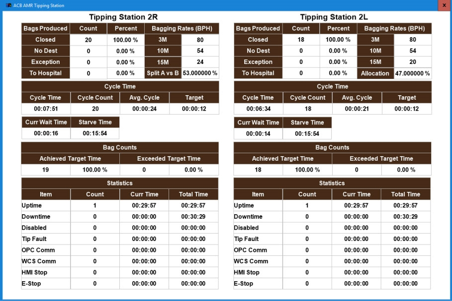

# Open and Use the Tipping Station Screen on the Tipper HMI

## Runbook Header

| Field | Value |
| --- | --- |
| Procedure ID | `proc_open_and_use_tipping_station_screen_tipper_hmi_v1` |
| Title | Open and Use the Tipping Station Screen on the Tipper HMI |
| Procedure Type | `operation` |
| Primary Role | `operator` |
| Supporting Roles | None |
| Support Safe | Yes |
| Capability Tags | `tipper_station_fault` |
| Access Surface | `tipper_hmi` |
| Audience Roles | `operator` |
| Failure Pattern Tags | None |
| Validation Status | `needs_sme_review` |
| Merge Status | `source_finalized` |

## Summary

Navigate the Tipper HMI to the “Tipping Station” screen to view bag completion counts, error information, and task duration metrics for the tipping station.

## When To Use

Use when you need to monitor tipping station performance by checking bag completion counts, error information, and how long tasks take on the Tipper HMI.

## Access Or Tools Needed

* Tipper HMI / WebVisu / VISU (allowed access surface: tipper_hmi)
* HMI navigation controls: SMALLS button, ACB drop-down, ACB1 - AMT TT option, tipper button on the right side of the screen

## Related Operational Context

* ctx_manual_tipping_station_screen_overview_v1
* ctx_manual_tipping_station_screen_navigation_v1
* ctx_manual_tipping_station_metrics_v1

## Visual References

*Figure 4-7: Tipping Station Screen (shows bag completion count, error indicators/counts, and task duration metrics).*

## Procedure Steps

### Step 1 — Press the SMALLS button on the Tipper HMI

**Responsible role:** operator

**Instruction:**
On the Tipper HMI, press the SMALLS button.

**Expected result:**
The SMALLS drop-down menu is displayed.

---

### Step 2 — Select ACB from the SMALLS drop-down menu

**Responsible role:** operator

**Instruction:**
In the drop-down menu, select "ACB".

**Expected result:**
The options list updates to show ACB options.

---

### Step 3 — Select ACB1 - AMT TT from the options list

**Responsible role:** operator

**Instruction:**
From the options list, select "ACB1 - AMT TT".

**Expected result:**
The system is set to the “ACB1 - AMT TT” context so the tipper button can open the Tipping Station screen.

---

### Step 4 — Press the tipper button on the right side of the screen

**Responsible role:** operator

**Instruction:**
Press the tipper button on the right side of the screen.

**Expected result:**
The “Tipping Station” screen opens.

**Stop or Escalate If:**

* If the “Tipping Station” screen does not appear after selecting "ACB1 - AMT TT" and pressing the tipper button, stop and escalate to support/site IT to restore HMI navigation or access.

---

### Step 5 — Verify bag completion, errors, and task duration metrics on the Tipping Station screen

**Responsible role:** operator

**Instruction:**
Verify the “Tipping Station” screen is displayed and check that it shows: (1) how many bags are completed, (2) errors, and (3) how long tasks take.

**Expected result:**
The “Tipping Station” screen displays bag completion information, error information, and task duration/timers.

---

## Success Criteria

* The “Tipping Station” screen opens successfully on the Tipper HMI.
* The screen displays bag completion information, error information, and task duration metrics.

## Failure Conditions

* “Tipping Station” screen does not appear after selecting “ACB1 - AMT TT” and pressing the tipper button.
* “Tipping Station” screen appears but does not show bag completion, errors, and task duration metrics.

## Escalation Guidance

* If the “Tipping Station” screen does not appear after selecting "ACB1 - AMT TT" and pressing the tipper button, stop and escalate to support/site IT to restore HMI navigation or access.

## Source Lineage

- Candidate IDs: candidate_manual_tipper_hmi_open_tipping_station_screen
- Source ID: `manual_optisweep_om_v3`
- Source Type: `manual`
