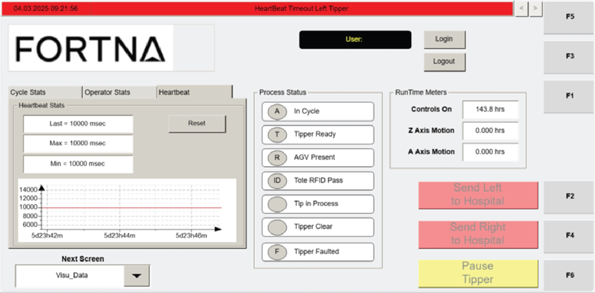

# Reset Heartbeat Stats Data to Zero on the VISU_DATA Screen

## Runbook Header

| Field | Value |
| --- | --- |
| Procedure ID | `proc_reset_heartbeat_stats_to_zero_visu_data_v1` |
| Title | Reset Heartbeat Stats Data to Zero on the VISU_DATA Screen |
| Procedure Type | `operation` |
| Primary Role | `operator` |
| Supporting Roles | None |
| Support Safe | Yes |
| Capability Tags | `opc_connection_or_tipper_heartbeat` |
| Access Surface | `tipper_hmi` |
| Audience Roles | `operator` |
| Failure Pattern Tags | None |
| Validation Status | `needs_sme_review` |
| Merge Status | `source_finalized` |

## Summary

Use the Heartbeat section RESET button on the Operator Station HMI VISU_DATA screen to clear the heartbeat timing statistics (Last/Max/Min in milliseconds) back to zero.

## When To Use

When the Operator Station HMI VISU_DATA screen Heartbeat section shows Last/Max/Min heartbeat timing values that you need to reset to zero using the on-screen RESET button.

## Access Or Tools Needed

* Tipper HMI / WebVisu / VISU (Operator Station HMI)

## Related Operational Context

* ctx_manual_visu_data_screen_overview_v1
* ctx_manual_heartbeat_stats_metrics_v1

## Visual References

*Operator Station HMI Data Screen—Heartbeat Stats (Figure 4-22) showing the Heartbeat section with Last/Max/Min (ms) and the RESET button.*

## Procedure Steps

### Step 1 — Open the Operator Station HMI and navigate to the VISU_DATA screen

**Responsible role:** operator

**Instruction:**
On the Operator Station HMI, navigate to the VISU_DATA screen (Operator Station HMI Data Screen).

**Expected result:**
The VISU_DATA screen is displayed and the Heartbeat section is accessible on the screen.

---

### Step 2 — Locate the Heartbeat section and the RESET button

**Responsible role:** operator

**Instruction:**
On the VISU_DATA screen, locate the "Heartbeat" section and the "RESET" button within that section.

**Expected result:**
You can see the Heartbeat section fields: Last, Max, Min (milliseconds) and the RESET button.

---

### Step 3 — Press the Heartbeat RESET button to reset the data to zero

**Responsible role:** operator

**Instruction:**
Press the RESET button in the Heartbeat section on the VISU_DATA screen.

**Expected result:**
The Heartbeat Stats values displayed for Last, Max, and Min reset to zero.

**Stop or Escalate If:**

* If the Heartbeat Stats values do not reset to zero, stop and escalate for support rather than repeatedly pressing RESET.

---

### Step 4 — Verify Heartbeat Last/Max/Min values show reset-to-zero

**Responsible role:** operator

**Instruction:**
Verify that the Heartbeat fields (Last, Max, Min in milliseconds) now display zero values.

**Expected result:**
Last, Max, and Min show zero (reset-to-zero values) on the VISU_DATA screen.

**Stop or Escalate If:**

* If the Heartbeat Stats values do not reset to zero, stop and escalate for support rather than repeatedly pressing RESET.

---

## Success Criteria

* After pressing RESET, the VISU_DATA screen Heartbeat Stats fields Last, Max, and Min (milliseconds) display zero values.

## Failure Conditions

* Heartbeat Stats Last/Max/Min do not reset to zero after pressing the Heartbeat RESET button.

## Escalation Guidance

* If the Heartbeat Stats values do not reset to zero, stop and escalate for support rather than repeatedly pressing RESET.

## Source Lineage

- Candidate IDs: candidate_manual_tipper_hmi_visu_data_reset_heartbeat_stats
- Source ID: `manual_optisweep_om_v3`
- Source Type: `manual`
