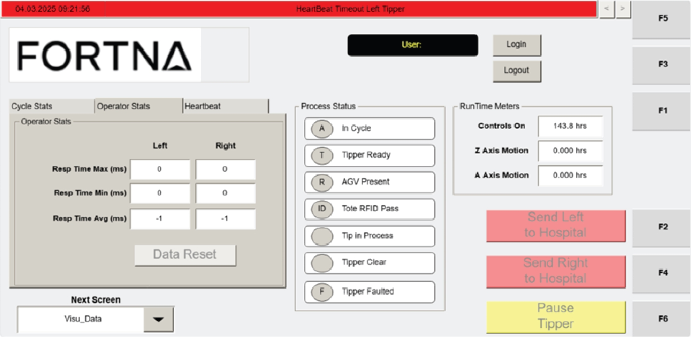

# Reset Operator Stats Data to Zero on the VISU_DATA Screen

## Runbook Header

| Field | Value |
| --- | --- |
| Procedure ID | `proc_reset_operator_stats_data_to_zero_visu_data_v1` |
| Title | Reset Operator Stats Data to Zero on the VISU_DATA Screen |
| Procedure Type | `operation` |
| Primary Role | `operator` |
| Supporting Roles | None |
| Support Safe | Yes |
| Capability Tags | `device_roster_state` |
| Access Surface | `tipper_hmi` |
| Audience Roles | `operator` |
| Failure Pattern Tags | None |
| Validation Status | `needs_sme_review` |
| Merge Status | `source_finalized` |

## Summary

Use the DATA RESET button in the Operator Stats section on the Operator Station HMI VISU_DATA screen to clear the operator response-time metrics (left and right) back to zero.

## When To Use

When the Operator Stats response-time metrics on the VISU_DATA screen need to be cleared (reset) to zero using the Operator Stats section DATA RESET button.

## Access Or Tools Needed

* Tipper HMI / WebVisu / VISU (Operator Station HMI)

## Related Operational Context

* ctx_manual_visu_data_screen_overview_v1
* ctx_manual_operator_stats_response_time_v1

## Visual References

*Operator Station HMI Data Screen—Operator Stats section showing Resp Time Max (ms), Resp Time Min (ms), Resp Time Avg (ms) for left/right tippers and the DATA RESET button.*

## Procedure Steps

### Step 1 — Open the VISU_DATA screen on the Operator Station HMI

**Responsible role:** operator

**Instruction:**
On the Operator Station HMI, navigate to the VISU_DATA screen (Operator Station HMI Data Screen).

**Expected result:**
The VISU_DATA screen is displayed and the Operator Stats section is visible.

---

### Step 2 — Locate the Operator Stats section and DATA RESET button

**Responsible role:** operator

**Instruction:**
Locate the Operator Stats section on the VISU_DATA screen and find the DATA RESET button within that section.

**Expected result:**
The Operator Stats section is located and the DATA RESET button is visible.

---

### Step 3 — Press DATA RESET to reset operator stats to zero

**Responsible role:** operator

**Instruction:**
Press the DATA RESET button in the Operator Stats section.

**Expected result:**
The Operator Stats response-time metrics reset to zero on the VISU_DATA screen.

**Stop or Escalate If:**

* If the Operator Stats values do not reset to zero, stop and escalate for support rather than repeatedly pressing the reset.

---

### Step 4 — Verify response-time fields reset to zero (left and right)

**Responsible role:** operator

**Instruction:**
Verify that the Operator Stats response-time fields show reset-to-zero values for both left and right tippers: Resp Time Max (ms), Resp Time Min (ms), and Resp Time Avg (ms).

**Expected result:**
Resp Time Max (ms), Resp Time Min (ms), and Resp Time Avg (ms) for both left and right tippers display zero values as shown on the VISU_DATA screen.

**Stop or Escalate If:**

* If the Operator Stats values do not reset to zero, stop and escalate for support rather than repeatedly pressing the reset.

---

## Success Criteria

* After pressing DATA RESET, the Operator Stats response-time metrics (Resp Time Max (ms), Resp Time Min (ms), Resp Time Avg (ms)) for both left and right tippers display zero values on the VISU_DATA screen.

## Failure Conditions

* Operator Stats response-time fields do not reset to zero after pressing DATA RESET.

## Escalation Guidance

* If the Operator Stats values do not reset to zero, stop and escalate for support rather than repeatedly pressing the reset.

## Missing Details / Known Gaps

* Exact navigation method to reach VISU_DATA (e.g., which function key or on-screen menu path) is not explicitly provided in the packet evidence for this candidate; only that the VISU_DATA screen is the target.

## Source Lineage

- Candidate IDs: candidate_manual_tipper_hmi_visu_data_reset_operator_stats
- Source ID: `manual_optisweep_om_v3`
- Source Type: `manual`
