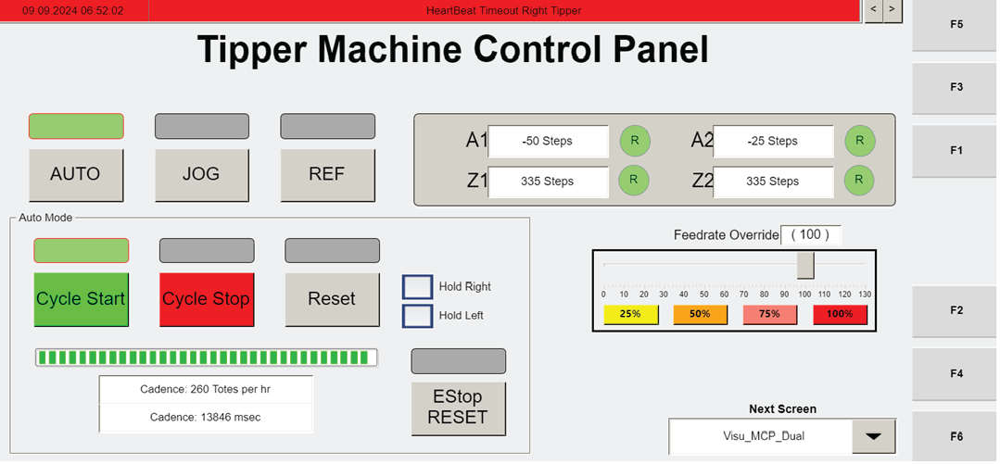

# Restart Tipper Cycle After Fault or E-Stop Using Visu_MCP_Dual Buttons

## Runbook Header

| Field | Value |
| --- | --- |
| Procedure ID | `proc_restart_tipper_cycle_after_fault_or_estop_using_visu_mcp_dual_buttons_v1` |
| Title | Restart Tipper Cycle After Fault or E-Stop Using Visu_MCP_Dual Buttons |
| Procedure Type | `recovery` |
| Primary Role | `operator` |
| Supporting Roles | None |
| Support Safe | Yes |
| Capability Tags | `tipper_station_fault` |
| Access Surface | `tipper_hmi` |
| Audience Roles | `operator` |
| Failure Pattern Tags | None |
| Validation Status | `needs_sme_review` |
| Merge Status | `source_finalized` |

## Summary

Use the primary operator HMI screen "Visu_MCP_Dual" (Tipper Machine Control Panel) to reset the tipper system after a fault (RESET → CYCLE START) or after an E-stop (ESTOP RESET → AUTO → CYCLE START). Active buttons are indicated by illuminated green bars.

## When To Use

When the tipper system needs to be reset and the tipper operation cycle restarted after a fault or after an E-stop, using the primary operator screen "Visu_MCP_Dual".

## Do Not Use For

* Do not use this procedure to jog the tipper. The screen notes that only maintenance personnel should jog the tipper.

## Safety And Operational Notes

* Only maintenance personnel should jog the tipper (JOG is maintenance-only per the screen description).

## Access Or Tools Needed

* Tipper HMI / WebVisu / VISU (Visu_MCP_Dual screen)

## Related Operational Context

* ctx_manual_visu_mcp_dual_reset_sequence_v1

## Visual References

*Visu_MCP_Dual (Tipper Machine Control Panel) showing the informational banner, AUTO, JOG, REF, CYCLE START, CYCLE STOP, RESET, AUTO REF, and ESTOP RESET buttons; active buttons indicated by illuminated green bars.*

*Operator Station HMI Data Screen (VISU_DATA) showing the informational banner with right-side arrows for navigating messages and the Tipper Stats section.*

*Operator Station HMI Manual Control Screen (VISU_MANCONTROL) showing maintenance-level manual controls (not required for this reset/restart procedure).*

*Operator station screen photo from a non-recoverable fault recovery procedure showing AUTO and CYCLE START sequence context and RESET after the robot leaves the tipper.*

## Procedure Steps

### Step 1 — Open the primary operator screen "Visu_MCP_Dual" (Tipper Machine Control Panel)

**Responsible role:** operator

**Instruction:**
On the operator station HMI, navigate to the primary screen labeled "Visu_MCP_Dual" (Tipper Machine Control Panel).

**Expected result:**
The "Visu_MCP_Dual" button panel is visible, including RESET, ESTOP RESET, AUTO, and CYCLE START buttons, with active buttons indicated by illuminated green bars.

---

### Step 2 — Check the informational banner for alarms/messages and navigate if needed

**Responsible role:** operator

**Instruction:**
On the "Visu_MCP_Dual" screen, check the informational banner at the top for alarm/informational messages. If multiple messages exist, use the right-side arrows to navigate through them.

**Expected result:**
The informational banner shows alarm/informational messages, and the right-side arrows can be used to navigate through messages.

---

### Step 3 — If in a fault state, press RESET then confirm active green bar

**Responsible role:** operator

**Instruction:**
If the system is in a fault state, press the "RESET" button and confirm its active green bar illuminates.

**Expected result:**
The "RESET" button shows as active (illuminated green bar above the button).

**Stop or Escalate If:**

* Stop and escalate if the expected restart does not occur after pressing the documented reset sequence (RESET→CYCLE START).

---

### Step 4 — Press CYCLE START to restart the tipper operation cycle

**Responsible role:** operator

**Instruction:**
Press "CYCLE START" to restart the tipper operation cycle (confirm the cycle start action is accepted on the screen).

**Expected result:**
The "CYCLE START" action is accepted on the screen (CYCLE START becomes active/accepted as indicated by the screen’s active button indication).

**Stop or Escalate If:**

* Stop and escalate if the expected restart does not occur after pressing the documented reset sequence (RESET→CYCLE START).

---

### Step 5 — If after an E-stop, press ESTOP RESET then AUTO then CYCLE START

**Responsible role:** operator

**Instruction:**
If the system is after an E-stop, press "ESTOP RESET" (confirm its active green bar illuminates), then press "AUTO", then press "CYCLE START" to restart the system.

**Expected result:**
ESTOP RESET becomes active (green bar illuminates), AUTO is selected, and CYCLE START is accepted to restart the system.

**Stop or Escalate If:**

* Stop and escalate if the expected restart does not occur after pressing the documented reset sequence (ESTOP RESET→AUTO→CYCLE START).
* Do not attempt to jog the tipper unless you are maintenance personnel (JOG is maintenance-only per the screen description).

---

## Success Criteria

* After a fault reset, pressing CYCLE START restarts the tipper operation cycle.
* After an E-stop reset, completing ESTOP RESET → AUTO → CYCLE START restarts the system.
* Active buttons show illuminated green bars above the pressed/active controls.

## Failure Conditions

* The expected restart does not occur after pressing the documented reset sequence (RESET→CYCLE START for faults, or ESTOP RESET→AUTO→CYCLE START for E-stop).
* Active green bars do not illuminate above the expected buttons after pressing them.

## Escalation Guidance

* If the expected restart does not occur after the documented reset sequence, stop and escalate.

## Source Lineage

- Candidate IDs: candidate_manual_tipper_visu_mcp_dual_fault_reset_cycle_restart
- Source ID: `manual_optisweep_om_v3`
- Source Type: `manual`
