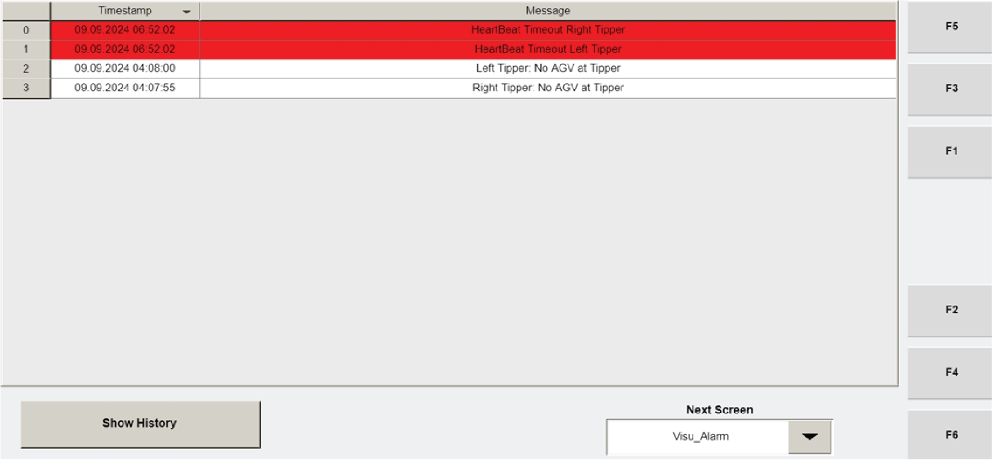

# Review Tipper Alarm History on Operator Station HMI (Visu_Alarm)

## Runbook Header

| Field | Value |
| --- | --- |
| Procedure ID | `proc_review_tipper_alarm_history_visu_alarm_v1` |
| Title | Review Tipper Alarm History on Operator Station HMI (Visu_Alarm) |
| Procedure Type | `diagnostic` |
| Primary Role | `operator` |
| Supporting Roles | None |
| Support Safe | Yes |
| Capability Tags | None |
| Access Surface | `tipper_hmi` |
| Audience Roles | `operator` |
| Failure Pattern Tags | None |
| Validation Status | `needs_sme_review` |
| Merge Status | `source_finalized` |

## Summary

Use the Operator Station HMI Visu_Alarm screen to view the list of tipper alarms with timestamps, then press SHOW HISTORY to load the last 1500 alarm records for live troubleshooting of tipper faults.

## When To Use

When you need to review tipper alarm entries and their timestamps on the Operator Station HMI, including accessing the last 1500 alarm records via SHOW HISTORY to support investigation of a tipper fault.

## Access Or Tools Needed

* Operator Station HMI access to the "Visu_Alarm" screen
* Ability to click the "SHOW HISTORY" button

## Related Operational Context

* ctx_manual_visu_alarm_screen_v1
* ctx_manual_visu_alarm_history_v1
* ctx_manual_tipper_alarms_v1

## Visual References

*Operator Station HMI Visu_Alarm screen showing the list of tipper alarms with timestamps and the SHOW HISTORY button.*

## Procedure Steps

### Step 1 — Open the Operator Station HMI screen "Visu_Alarm"

**Responsible role:** operator

**Instruction:**
On the Operator Station HMI, open the screen named "Visu_Alarm".

**Expected result:**
The Visu_Alarm screen is displayed and ready to show the tipper alarm list.

---

### Step 2 — Verify the alarm list shows tipper alarms with timestamps

**Responsible role:** operator

**Instruction:**
On the Visu_Alarm screen, verify the list of tipper alarms is displayed and that each alarm entry includes a timestamp.

**Expected result:**
A list of tipper alarms is visible, and each entry includes a timestamp.

---

### Step 3 — Click SHOW HISTORY to load alarm history

**Responsible role:** operator

**Instruction:**
On the Visu_Alarm screen, click the "SHOW HISTORY" button.

**Expected result:**
The screen switches/updates to show the alarm history view.

**Stop or Escalate If:**

* If the alarm list is empty or timestamps/entries do not populate after pressing SHOW HISTORY, stop and escalate to support for further investigation of tipper alarm reporting.

---

### Step 4 — Confirm the history shows up to the last 1500 alarm records

**Responsible role:** operator

**Instruction:**
In the history view, confirm the list expands to include historical entries up to the last 1500 alarm records.

**Expected result:**
The history view shows up to the last 1500 alarm records.

---

### Step 5 — Record the relevant alarm entry/entries and timestamps

**Responsible role:** operator

**Instruction:**
Stop on the relevant alarm entry/entries for the tipper fault you are investigating and record the alarm identity exactly as displayed on the list and the associated timestamp.

**Expected result:**
You have recorded the alarm identity/identity(ies) and their associated timestamps from the Visu_Alarm history list.

---

## Success Criteria

* Visu_Alarm shows a list of tipper alarms with timestamps.
* After pressing SHOW HISTORY, the history view shows up to the last 1500 alarm records.
* The operator records the relevant alarm identity/identity(ies) and associated timestamp(s) for the tipper fault under investigation.

## Failure Conditions

* Alarm list is empty.
* Timestamps/entries do not populate after pressing SHOW HISTORY.
* History view does not show up to the last 1500 alarm records.

## Escalation Guidance

* If the alarm list is empty or timestamps/entries do not populate after pressing SHOW HISTORY, stop and escalate to support for further investigation of tipper alarm reporting.

## Source Lineage

- Candidate IDs: candidate_manual_visu_alarm_screen_show_history
- Source ID: `manual_optisweep_om_v3`
- Source Type: `manual`
