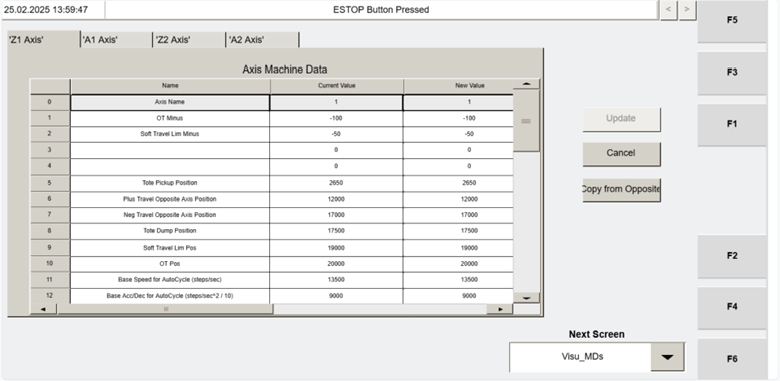

# Use VISU_MDS “COPY FROM OPPOSITE” to copy axis parameters to the selected axis

## Runbook Header

| Field | Value |
| --- | --- |
| Procedure ID | `proc_use_visu_mds_copy_from_opposite_axis_parameters_v1` |
| Title | Use VISU_MDS “COPY FROM OPPOSITE” to copy axis parameters to the selected axis |
| Procedure Type | `operation` |
| Primary Role | `operator` |
| Supporting Roles | None |
| Support Safe | Yes |
| Capability Tags | `device_roster_state` |
| Access Surface | `tipper_hmi` |
| Audience Roles | `operator` |
| Failure Pattern Tags | None |
| Validation Status | `needs_sme_review` |
| Merge Status | `source_finalized` |

## Summary

On the Operator Station HMI (VISU_MDS “Machine Data” screen), use the VISU_MDS “COPY FROM OPPOSITE” button to copy Machine Data parameters from the opposite tipper to the selected axis (Z1, A1, Z2, or A2).

## When To Use

Use when you need to update VISU_MDS Machine Data parameters for a selected axis by copying the corresponding parameters from the other tipper using the VISU_MDS “COPY FROM OPPOSITE” function.

## Do Not Use For

* Do not use this procedure as a substitute for motor replacement commissioning/alignment steps; the manual states Machine Data parameters generally do not require changing unless a motor is replaced.

## Access Or Tools Needed

* Tipper HMI / WebVisu / VISU access to the VISU_MDS “Machine Data” screen

## Related Operational Context

* ctx_manual_visu_mds_copy_from_opposite_v1
* ctx_manual_visu_mds_screen_overview_v1

## Visual References

*VISU_MDS “Machine Data” screen (Figure 4-26) showing axis-specific Machine Data parameters for Z1/A1/Z2/A2 and the “COPY FROM OPPOSITE” button.*

## Procedure Steps

### Step 1 — Open the VISU_MDS “Machine Data” screen

**Responsible role:** operator

**Instruction:**
On the Operator Station HMI, open the VISU_MDS “Machine Data” screen (the screen that contains parameters for axes Z1, A1, Z2, and A2).

**Expected result:**
The VISU_MDS “Machine Data” screen is displayed with axis parameters visible for Z1, A1, Z2, and A2.

---

### Step 2 — Select the target axis (Z1, A1, Z2, or A2)

**Responsible role:** operator

**Instruction:**
On the VISU_MDS “Machine Data” screen, select the target axis whose parameters you want to update (Z1, A1, Z2, or A2).

**Expected result:**
The selected axis is indicated on the VISU_MDS screen so that the “COPY FROM OPPOSITE” action will apply to that axis.

---

### Step 3 — Press “COPY FROM OPPOSITE” to copy parameters to the selected axis

**Responsible role:** operator

**Instruction:**
Click the “COPY FROM OPPOSITE” button on the VISU_MDS “Machine Data” screen.

**Expected result:**
The Machine Data values for the selected axis update to reflect the copied parameters from the opposite tipper.

**Stop or Escalate If:**

* If pressing “COPY FROM OPPOSITE” results in no visible change to the selected axis Machine Data values, stop and escalate.

---

### Step 4 — Verify the selected axis Machine Data values updated

**Responsible role:** operator

**Instruction:**
On the VISU_MDS “Machine Data” screen, verify that the Machine Data values for the selected axis updated to the copied values. Check the listed IDs/fields including: OT Minus (ID 1), Tote Pickup Position (ID 5), travel opposite positions (IDs 6 and 7), Tote Dump Position (ID 8), Soft Travel Lim Pos (ID 9), OT Pos (ID 10), Base Speed for AutoCycle (ID 11) and Base Acc/Dec for AutoCycle (ID 12), Jog Speed (ID 13) and Jog Acceleration (ID 14), and Home/offset/homing parameters (IDs 20–24).

**Expected result:**
The selected axis shows updated values for the checked Machine Data IDs/fields after the copy.

**Stop or Escalate If:**

* If mismatches persist after copy, re-check the axis selection and the specific Machine Data IDs shown on VISU_MDS.

---

## Success Criteria

* After pressing “COPY FROM OPPOSITE”, the VISU_MDS Machine Data values for the selected axis reflect the copied parameters from the opposite tipper.
* The checked Machine Data IDs/fields on VISU_MDS show updated values consistent with the manual’s machine-to-machine matching list, accounting for the stated exceptions (MD5 Tote Pickup Position and MD21 Home Offset).

## Failure Conditions

* Pressing “COPY FROM OPPOSITE” produces no visible change to the selected axis Machine Data values.
* After copy, one or more expected Machine Data IDs/fields do not update or remain mismatched (excluding the manual-stated exceptions).

## Escalation Guidance

* Stop and escalate if pressing “COPY FROM OPPOSITE” results in no visible change to the selected axis Machine Data values.
* If mismatches persist after copy, re-check the axis selection and the specific Machine Data IDs shown on VISU_MDS, then escalate if still unresolved.

## Missing Details / Known Gaps

* The manual does not specify any confirmation dialog, timing/delay, or whether the copy operation is instantaneous vs requires an additional confirmation step beyond pressing “COPY FROM OPPOSITE”.

## Source Lineage

- Candidate IDs: candidate_manual_visu_mds_copy_from_opposite_axis_parameters
- Source ID: `manual_optisweep_om_v3`
- Source Type: `manual`
