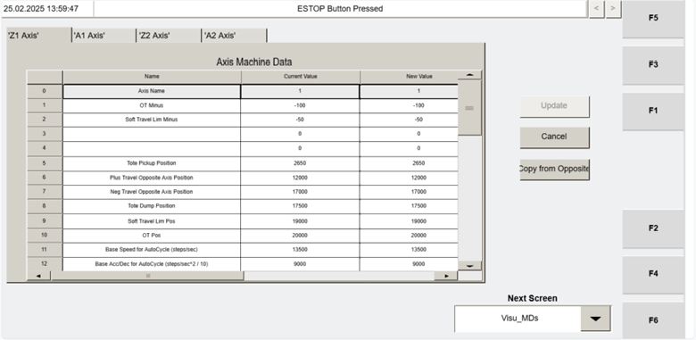

# Verify VISU_MDS (Machine Data) axis parameters match between machines (Z1/A1/Z2/A2)

## Runbook Header

| Field | Value |
| --- | --- |
| Procedure ID | `proc_verify_visu_mds_machine_data_axis_match_v1` |
| Title | Verify VISU_MDS (Machine Data) axis parameters match between machines (Z1/A1/Z2/A2) |
| Procedure Type | `diagnostic` |
| Primary Role | `operator` |
| Supporting Roles | None |
| Support Safe | Yes |
| Capability Tags | `device_roster_state` |
| Access Surface | `tipper_hmi` |
| Audience Roles | `operator` |
| Failure Pattern Tags | None |
| Validation Status | `needs_sme_review` |
| Merge Status | `source_finalized` |

## Summary

Use the Operator Station HMI VISU_MDS “Machine Data” screen to verify that key axis parameters match between machines for axes Z1, A1, Z2, and A2. Treat MD5 (Tote Pickup Position) and MD21 (Home Offset) as documented exceptions that are expected to be unique per machine and per axis.

## When To Use

When you need to confirm whether VISU_MDS “Machine Data” axis parameters are consistent between machines for the same axis (Z1/A1/Z2/A2), using the documented matching rules and exceptions.

## Safety And Operational Notes

* The VISU_MDS “Machine Data” screen parameters generally do not require changing unless a motor is replaced.

## Access Or Tools Needed

* Tipper HMI / WebVisu / VISU access to the VISU_MDS “Machine Data” screen

## Related Operational Context

* ctx_manual_visu_mds_screen_overview_v1
* ctx_manual_visu_mds_axis_parameters_v1
* ctx_manual_visu_mds_unique_parameters_v1

## Visual References

*Figure 4-26: Operator Station HMI Machine Data screen showing axis-specific parameters for Z1/A1/Z2/A2 and the COPY FROM OPPOSITE button.*

## Procedure Steps

### Step 1 — Open the Operator Station HMI VISU_MDS “Machine Data” screen

**Responsible role:** operator

**Instruction:**
On the Operator Station HMI, navigate to the “Visu_MDs” screen (F2) to display the VISU_MDS “Machine Data” screen.

**Expected result:**
The VISU_MDS “Machine Data” screen is displayed with axis parameters available for axes Z1, A1, Z2, and A2.

---

### Step 2 — Select an axis (Z1, A1, Z2, or A2) and locate the Machine Data IDs/values to compare

**Responsible role:** operator

**Instruction:**
For the selected axis (Z1, A1, Z2, or A2), locate the Machine Data IDs and values shown on the VISU_MDS “Machine Data” screen, including: ID 0 Axis Name, ID 1 OT Minus, ID 5 Tote Pickup Position, ID 6 Plus Travel Opposite Axis Position, ID 7 Neg Travel Opposite Axis Position, ID 8 Tote Dump Position, ID 9 Soft Travel Lim Pos, ID 10 OT Pos, ID 11 Base Speed for AutoCycle (steps/min), ID 12 Base Acc/Dec for AutoCycle (steps/min^2)/10, ID 13 Jog Speed, ID 14 Jog Acceleration, and ID 20 Home Position / ID 21 Home Offset / ID 22 Homing Speed / ID 23 Homing CAM Speed / ID 24 Homing Acceleration.

**Expected result:**
The selected axis shows the Machine Data values for the listed IDs (0, 1, 5, 6, 7, 8, 9, 10, 11, 12, 13, 14, 20, 21, 22, 23, 24) on the VISU_MDS screen.

---

### Step 3 — Compare machine-to-machine values for the selected axis (Z1/A1/Z2/A2)

**Responsible role:** operator

**Instruction:**
Compare the Machine Data values between machines for the selected axis. The following data values should match between machines: ID 0 Axis Name, ID 1 OT Minus, ID 5 Tote Pickup Position, ID 6 Plus Travel Opposite Axis Position, ID 7 Neg Travel Opposite Axis Position, ID 8 Tote Dump Position, ID 9 Soft Travel Lim Pos, ID 10 OT Pos, ID 11 Base Speed for AutoCycle (steps/min), ID 12 Base Acc/Dec for AutoCycle (steps/min^2)/10, ID 13 Jog Speed, and ID 14 Jog Acceleration, plus ID 20 Home Position, ID 21 Home Offset, ID 22 Homing Speed, ID 23 Homing CAM Speed, and ID 24 Homing Acceleration.

**Expected result:**
For the selected axis, you can identify which Machine Data IDs match and which IDs differ between the two machines being compared.

**Stop or Escalate If:**

* Escalate if any mismatch is found for any Machine Data ID other than MD5 (Tote Pickup Position) and MD21 (Home Offset).

---

### Step 4 — Apply the documented exceptions for MD5 and MD21

**Responsible role:** operator

**Instruction:**
When comparing machine-to-machine values for the selected axis, apply these exceptions: (1) MD5 Tote Pickup Position is expected to be unique for every machine and every axis, and (2) MD21 Home Offset is expected to be unique for every machine and every axis.

**Expected result:**
Any differences observed in MD5 (Tote Pickup Position) and MD21 (Home Offset) are treated as expected and not counted as faults.

**Stop or Escalate If:**

* Do not treat differences in MD5 Tote Pickup Position or MD21 Home Offset as a fault; they are expected to be unique per machine and axis.

---

### Step 5 — Repeat the comparison for the remaining axes (Z1/A1/Z2/A2) and conclude

**Responsible role:** operator

**Instruction:**
Repeat the axis selection, ID/value location, machine-to-machine comparison, and exception handling for each axis: Z1, A1, Z2, and A2.

**Expected result:**
You have a pass/fail determination for each axis based on whether any non-exception Machine Data ID differs between machines.

**Stop or Escalate If:**

* Escalate if any parameter other than MD5 (Tote Pickup Position) and MD21 (Home Offset) is different between machines for the same axis.

---

## Success Criteria

* For each axis (Z1, A1, Z2, A2), all Machine Data values match between machines for the listed IDs, except MD5 (Tote Pickup Position) and MD21 (Home Offset), which may differ.

## Failure Conditions

* On VISU_MDS, any Machine Data ID other than MD5 (Tote Pickup Position) and MD21 (Home Offset) differs between machines for the same axis.

## Escalation Guidance

* Escalate if any mismatch is found for any Machine Data ID other than MD5 (Tote Pickup Position) and MD21 (Home Offset).

## Missing Details / Known Gaps

* The source does not provide explicit operator steps for selecting which machine to compare (e.g., how to switch between machines/tippers within VISU_MDS). The procedure assumes the operator can view the relevant machine’s axis values on the VISU_MDS screen.

## Source Lineage

- Candidate IDs: candidate_manual_visu_mds_verify_axis_machine_data_match
- Source ID: `manual_optisweep_om_v3`
- Source Type: `manual`
