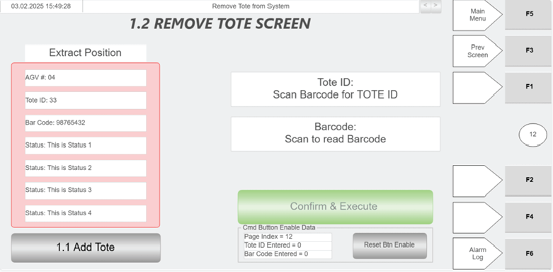

# Use Hospital HMI "Remove Tote" screen to remove a tote from the system

## Runbook Header

| Field | Value |
| --- | --- |
| Procedure ID | `proc_use_hospital_hmi_remove_tote_screen_to_remove_tote_v1` |
| Title | Use Hospital HMI "Remove Tote" screen to remove a tote from the system |
| Procedure Type | `operation` |
| Primary Role | `operator` |
| Supporting Roles | None |
| Support Safe | Yes |
| Capability Tags | `tote_lifecycle_state` |
| Access Surface | `hospital_hmi` |
| Audience Roles | `operator` |
| Failure Pattern Tags | None |
| Validation Status | `needs_sme_review` |
| Merge Status | `source_finalized` |

## Summary

On the Hospital HMI, scan the tote barcode to populate Tote ID/Barcode fields, verify extract-side position information from WCS (AGV#, Tote ID, Bar Code, Status), ensure the tote is positioned properly on the extract side, then press CONFIRM & EXECUTE to remove the tote from the system.

## When To Use

Use when a tote is at the Hospital Station extract side and the station operator needs to remove that tote from the system so the required task can be performed.

## Safety And Operational Notes

* Do not press CONFIRM & EXECUTE until the tote is positioned properly on the extract side.

## Access Or Tools Needed

* Hospital HMI access to the "Remove Tote" screen
* Green barcode scanner

## Visual References

*Hospital HMI Remove Tote screen (Figure 4-32) showing Tote ID and Barcode scan controls, CONFIRM & EXECUTE button, and Extract Position Information panel (AGV#, Tote ID, Bar Code, Status), plus Add Tote shortcut.*

*Hospital Station layout diagram (page 92) showing induct side (left) and extract side (right) to support physical placement confirmation.*

## Procedure Steps

### Step 1 — Open the Hospital HMI "Remove Tote" screen

**Responsible role:** operator

**Instruction:**
Open the Hospital HMI screen labeled "Remove Tote".

**Expected result:**
The Hospital HMI "Remove Tote" screen is displayed with fields/controls for Tote ID, Barcode, CONFIRM & EXECUTE, and the Extract Position Information panel.

---

### Step 2 — Scan tote barcode to populate the Tote ID field

**Responsible role:** operator

**Instruction:**
In the Tote ID area, use the green scanner to scan the tote bar code to populate the Tote ID field.

**Expected result:**
The Tote ID field is populated after scanning the tote bar code.

---

### Step 3 — Scan tote barcode to populate the Barcode field

**Responsible role:** operator

**Instruction:**
In the Barcode area, press the Barcode scan control and then use the green scanner to scan the tote bar code to populate the Barcode field.

**Expected result:**
The Barcode field is populated after scanning the tote bar code.

---

### Step 4 — Verify Extract Position Information for the extract side (AGV#, Tote ID, Bar Code, Status)

**Responsible role:** operator

**Instruction:**
Verify the "Extract Position Information" panel shows WCS data for the extract side, including AGV# (ID of the AGV at the extract side), Tote ID (ID of the tote at the extract side), Bar Code (scanned information), and Status (status messages received from the WCS about the tote).

**Expected result:**
Extract Position Information panel displays AGV#, Tote ID, Bar Code, and Status values for the extract side.

**Stop or Escalate If:**

* If the Extract Position Information (AGV#, Tote ID, Bar Code, Status) does not match the tote you intend to remove, re-scan using the green scanner controls before executing.

---

### Step 5 — Ensure the tote is positioned properly on the extract side

**Responsible role:** operator

**Instruction:**
Ensure the tote is positioned properly on the extract side of the Hospital Station.

**Expected result:**
The tote is physically located on the extract side, ready for removal.

**Stop or Escalate If:**

* Do not press CONFIRM & EXECUTE until the tote is positioned properly on the extract side.

---

### Step 6 — Press CONFIRM & EXECUTE to remove the tote from the system

**Responsible role:** operator

**Instruction:**
Press the CONFIRM & EXECUTE button to remove the tote from the system.

**Expected result:**
The tote is removed from the system using the Remove Tote screen workflow; the screen reflects the removal action and the Extract Position Information panel reflects the WCS-provided extract-side details.

**Stop or Escalate If:**

* Do not press CONFIRM & EXECUTE until the tote is positioned properly on the extract side.
* If the Extract Position Information (AGV#, Tote ID, Bar Code, Status) does not match the tote you intend to remove, re-scan using the green scanner controls before executing.

---

### Step 7 — Use Add Tote shortcut if needed

**Responsible role:** operator

**Instruction:**
If needed, use the "Add Tote" shortcut button to navigate to the "Add Tote" screen.

**Expected result:**
The Hospital HMI navigates to the "Add Tote" screen.

---

## Success Criteria

* Tote removal is executed via the Hospital HMI Remove Tote screen workflow (CONFIRM & EXECUTE pressed after tote is positioned properly on the extract side).
* Extract Position Information panel shows WCS-provided extract-side details including AGV#, Tote ID, Bar Code, and Status.

## Failure Conditions

* Extract Position Information (AGV#, Tote ID, Bar Code, Status) does not match the tote intended for removal.
* Tote is not positioned properly on the extract side when attempting removal.

## Escalation Guidance

* If Extract Position Information does not match the tote you intend to remove, re-scan using the green scanner controls before executing. If mismatch persists after re-scanning, stop and escalate to appropriate support per site process (no additional escalation path is specified in the provided source section).

## Missing Details / Known Gaps

* The provided section does not specify exact on-screen status text or a specific post-execution confirmation indicator beyond the workflow description and the presence of WCS-provided Extract Position Information fields.

## Source Lineage

- Candidate IDs: hospital_hmi_remove_tote_4_1_3_2_3_1_2
- Source ID: `manual_optisweep_om_v3`
- Source Type: `manual`
