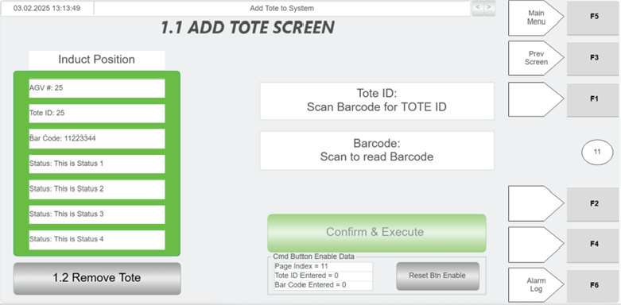
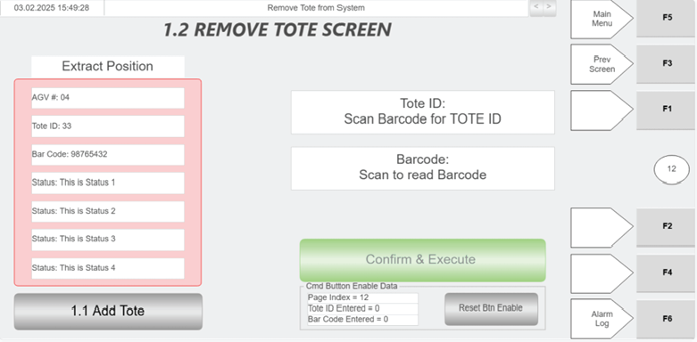

# Hospital HMI: Add Tote (send tote back into system via induct side)

## Runbook Header

| Field | Value |
| --- | --- |
| Procedure ID | `proc_hospital_hmi_add_tote_induct_v1` |
| Title | Hospital HMI: Add Tote (send tote back into system via induct side) |
| Procedure Type | `operation` |
| Primary Role | `operator` |
| Supporting Roles | None |
| Support Safe | Yes |
| Capability Tags | `tote_lifecycle_state` |
| Access Surface | `hospital_hmi` |
| Audience Roles | `operator` |
| Failure Pattern Tags | None |
| Validation Status | `needs_sme_review` |
| Merge Status | `source_finalized` |

## Summary

Use the Hospital HMI “Add Tote” screen to scan the tote barcode into the Tote ID and Barcode fields, verify the induct-side position information from WCS (AGV#, Tote ID, Barcode, Status), ensure the tote is positioned properly on the induct side, then press CONFIRM & EXECUTE to send the tote back into the system. Use the “Remove Tote” shortcut button if you need to switch to the Remove Tote screen.

## When To Use

When a tote needs to be sent back into the OptiSweep system from the Hospital Station induct side using the Hospital HMI “Add Tote” workflow.

## Access Or Tools Needed

* Hospital HMI access to the “Add Tote” screen
* Green scanner for tote barcode scanning

## Visual References

*Hospital HMI “Add Tote” screen layout and controls (Tote ID, Barcode, CONFIRM & EXECUTE, Induct Position Information panel, Remove Tote shortcut).*

*Hospital HMI “Remove Tote” screen (used via the Remove Tote shortcut from Add Tote).*

*Hospital Station layout diagram showing induct side (left side) and end stops; supports physical placement guidance (tote flush against end stops).*

## Procedure Steps

### Step 1 — Open the Hospital HMI “Add Tote” screen

**Responsible role:** operator

**Instruction:**
On the Hospital HMI, open the “Add Tote” screen (Figure 4-31).

**Expected result:**
The Hospital HMI “Add Tote” screen is displayed with the Tote ID field, Barcode field, CONFIRM & EXECUTE button, and the Induct Position Information panel.

---

### Step 2 — Scan tote barcode into the Tote ID field

**Responsible role:** operator

**Instruction:**
In the Tote ID field, use the green scanner to scan the tote bar code to populate the Tote ID.

**Expected result:**
The Tote ID field is populated with the scanned tote ID.

---

### Step 3 — Scan tote barcode into the Barcode field

**Responsible role:** operator

**Instruction:**
In the Barcode field, press the Barcode control, then use the green scanner to scan the tote bar code.

**Expected result:**
The Barcode field is populated with the scanned barcode data.

---

### Step 4 — Verify induct-side position information from WCS

**Responsible role:** operator

**Instruction:**
Verify the “Induct Position Information” panel shows WCS data for the induct side, including AGV#, Tote ID, Barcode, and Status.

**Expected result:**
Induct Position Information panel displays AGV#, Tote ID, Barcode, and Status values for the induct side.

**Stop or Escalate If:**

* If Induct Position Information (AGV#, Tote ID, Barcode, Status) does not match the tote being scanned/positioned, do not press CONFIRM & EXECUTE yet; re-scan Tote ID and Barcode.

---

### Step 5 — Ensure tote is positioned properly on the induct side

**Responsible role:** operator

**Instruction:**
Place the tote on the induct side and ensure it is positioned properly (flush against the end stops on the induct side).

**Expected result:**
Tote is physically positioned on the induct side in the correct location for re-entry.

---

### Step 6 — Press CONFIRM & EXECUTE to send tote back into the system

**Responsible role:** operator

**Instruction:**
After the tote is positioned properly on the induct side, press CONFIRM & EXECUTE.

**Expected result:**
The tote is sent back into the system (initiated by the Add Tote screen). The Induct Position Information panel reflects WCS status messages for the tote/induct side (AGV#, Tote ID, Barcode, Status).

**Stop or Escalate If:**

* If the tote cannot be sent back into the system after pressing CONFIRM & EXECUTE, use the “Remove Tote” shortcut button to access the Remove Tote screen and follow that screen’s procedure.

---

### Step 7 — Use Remove Tote shortcut if needed

**Responsible role:** operator

**Instruction:**
If needed, use the “Remove Tote” shortcut button to navigate to the “Remove Tote” screen.

**Expected result:**
The Hospital HMI navigates from “Add Tote” to the “Remove Tote” screen.

---

## Success Criteria

* After pressing CONFIRM & EXECUTE, the tote is sent back into the system (as initiated by the Add Tote screen).
* Induct Position Information panel shows WCS status messages for the tote/induct side (AGV#, Tote ID, Barcode, Status).

## Failure Conditions

* Induct Position Information (AGV#, Tote ID, Barcode, Status) does not match the tote being scanned/positioned.
* Tote cannot be sent back into the system after pressing CONFIRM & EXECUTE.

## Escalation Guidance

* If Induct Position Information does not match the tote being scanned/positioned, re-scan the tote bar code into the Tote ID and Barcode fields before pressing CONFIRM & EXECUTE.
* If the tote cannot be sent back into the system after pressing CONFIRM & EXECUTE, use the “Remove Tote” shortcut button to access the Remove Tote screen and follow that screen’s procedure.

## Source Lineage

- Candidate IDs: manual_optisweep_om_v3_hmi_add_tote_4_1_3_2_2_1_1
- Source ID: `manual_optisweep_om_v3`
- Source Type: `manual`
