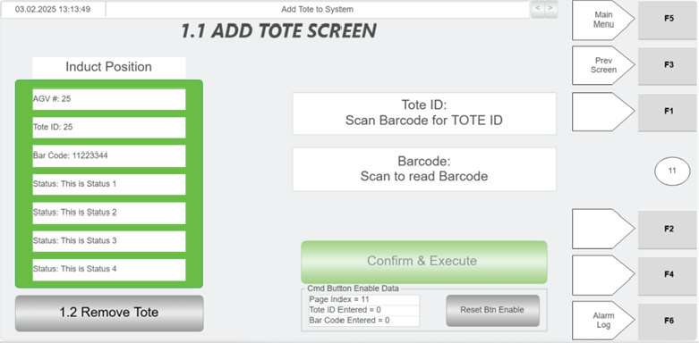
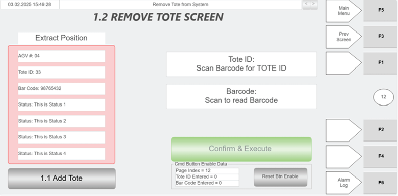

# Remove Tote via Hospital HMI (shortcut to Remove Tote screen)

## Runbook Header

| Field | Value |
| --- | --- |
| Procedure ID | `proc_remove_tote_via_hospital_hmi_shortcut_to_remove_tote_screen_v1` |
| Title | Remove Tote via Hospital HMI (shortcut to Remove Tote screen) |
| Procedure Type | `operation` |
| Primary Role | `operator` |
| Supporting Roles | None |
| Support Safe | Yes |
| Capability Tags | `tote_lifecycle_state` |
| Access Surface | `hospital_hmi` |
| Audience Roles | `operator` |
| Failure Pattern Tags | None |
| Validation Status | `needs_sme_review` |
| Merge Status | `source_finalized` |

## Summary

Use the Hospital HMI Add Tote screen controls (green scanner, Tote ID and Barcode fields, and CONFIRM & EXECUTE) to send a tote back into the OptiSweep system from the induct side. Use the 1.2 Remove Tote button as a shortcut to the Remove Tote screen.

## When To Use

When a tote needs to be sent back into the OptiSweep system from the hospital station induct side using the Hospital HMI workflow.

## Access Or Tools Needed

* Hospital HMI access to the Add Tote screen and the Remove Tote screen (via the 1.2 Remove Tote shortcut button).
* Green scanner for tote bar code scanning.

## Visual References

*Hospital HMI Add Tote screen showing green scanner inputs for Tote ID and Barcode, CONFIRM & EXECUTE, Induct Position Information panel, and the 1.2 Remove Tote shortcut button.*

*Hospital HMI Remove Tote screen showing green scanner inputs for Tote ID and Barcode, CONFIRM & EXECUTE, Extract Position Information panel, and the 1.1 Add Tote shortcut button.*

*Hospital Station layout diagram showing induct side (left side) and end stops to ensure the tote is flush for inducting back into the system.*

## Procedure Steps

### Step 1 — Open the Hospital HMI screen with the "1.2 Remove Tote" shortcut button

**Responsible role:** operator

**Instruction:**
On the Hospital HMI, open the screen that contains the "1.2 Remove Tote" shortcut button (shown on the Hospital HMI Add Tote screen).

**Expected result:**
The Hospital HMI screen is displayed with a visible "1.2 Remove Tote" shortcut button.

---

### Step 2 — Navigate to the "Remove Tote" screen using the "1.2 Remove Tote" shortcut

**Responsible role:** operator

**Instruction:**
Press the "1.2 Remove Tote" button to navigate to the "Remove Tote" screen.

**Expected result:**
The Hospital HMI "Remove Tote" screen is displayed.

---

### Step 3 — Scan tote barcode to populate the "Tote ID" field

**Responsible role:** operator

**Instruction:**
On the Remove Tote screen, use the green scanner to scan the tote bar code to populate the "Tote ID" field.

**Expected result:**
The "Tote ID" field is populated after scanning with the green scanner.

---

### Step 4 — Scan tote barcode to populate the "Barcode" field

**Responsible role:** operator

**Instruction:**
Press the "Barcode" control (press and then use the green scanner) and scan the tote bar code to populate the "Barcode" field.

**Expected result:**
"Barcode" field is populated after scanning.

---

### Step 5 — Verify induct-side WCS position information and Status before executing

**Responsible role:** operator

**Instruction:**
Verify the "Induct Position Information" panel shows WCS data for the induct side, including AGV#, Tote ID (induct side), Barcode, and that a "Status" message is present.

**Expected result:**
"Induct Position Information" panel displays AGV#, Tote ID (induct side), Barcode, and a "Status" message.

**Stop or Escalate If:**

* If the "Induct Position Information" panel does not show expected WCS data (AGV#, Tote ID, Barcode, Status), do not execute; re-check that the tote is positioned properly on the induct side before pressing "CONFIRM & EXECUTE".

---

### Step 6 — Press "CONFIRM & EXECUTE" to send the tote back into the system

**Responsible role:** operator

**Instruction:**
After the tote is positioned properly on the induct side and the Induct Position Information panel shows WCS data and Status, press "CONFIRM & EXECUTE" to send the tote back into the system.

**Expected result:**
The tote is sent back into the system via the induct side after pressing "CONFIRM & EXECUTE".

**Stop or Escalate If:**

* If the "Tote ID" and/or "Barcode" fields do not populate after scanning with the green scanner, re-scan the tote bar code.
* If the "Induct Position Information" panel does not show expected WCS data (AGV#, Tote ID, Barcode, Status), do not execute; re-check that the tote is positioned properly on the induct side before pressing "CONFIRM & EXECUTE".

---

## Success Criteria

* After pressing "CONFIRM & EXECUTE", the tote is sent back into the system via the induct side.
* The Hospital HMI "Induct Position Information" panel reflects WCS-received information including AGV#, Tote ID (induct side), Barcode, and a Status message.

## Failure Conditions

* Tote ID and/or Barcode fields do not populate after scanning.
* Induct Position Information panel does not show expected WCS data (AGV#, Tote ID, Barcode, Status).
* CONFIRM & EXECUTE is attempted without proper induct-side positioning and/or without WCS data present.

## Escalation Guidance

* If the Induct Position Information panel does not show expected WCS data (AGV#, Tote ID, Barcode, Status) and re-scanning/re-positioning does not resolve it, stop and escalate to the appropriate support team/site lead for further troubleshooting.

## Missing Details / Known Gaps

* The provided source section for "Add Tote" describes the induct-side workflow and the "1.2 Remove Tote" shortcut, but does not provide the full induct-side field/button details for the Remove Tote screen itself. This runbook uses the Remove Tote screen for scanning controls (Tote ID and Barcode) based on the Remove Tote screen figure description, and uses the Add Tote screen description for induct-side WCS verification and CONFIRM & EXECUTE send-back behavior.

## Source Lineage

- Candidate IDs: manual_optisweep_om_v3_remove_tote_hospital_hmi_add_tote_screen
- Source ID: `manual_optisweep_om_v3`
- Source Type: `manual`
